# CDCKIT — Clock Domain Crossing Toolkit
## Hardware Architecture Specification (HAS) & Micro-Architecture Specification (MAS)

| Campo | Valor |
|---|---|
| Documento | CDCKIT-SPEC-001 |
| IP | `cdckit` — Biblioteca de primitivas CDC + FIFO asíncrona parametrizable |
| Versión del documento | 0.7 (Draft) |
| Versión de la IP | 1.0 (objetivo) |
| Fecha | 2026-10-29 |
| Proyecto padre | NetSwitch-4 — bloque de interfaz MAC ↔ núcleo |
| Plataforma de referencia | AMD Vivado ML Standard Edition (gratuita) · Artix-7 `xc7a100tcsg324-1` |

---

## Índice

**Parte I — Hardware Architecture Specification (HAS)**

1. [Introducción](#1-introducción)
2. [Resumen de características](#2-resumen-de-características)
3. [Descripción funcional](#3-descripción-funcional)
4. [Interfaces de hardware](#4-interfaces-de-hardware)
5. [Parámetros de configuración](#5-parámetros-de-configuración)
6. [Relojes y resets](#6-relojes-y-resets)
7. [Rendimiento y latencias](#7-rendimiento-y-latencias)
8. [Requisitos de integración](#8-requisitos-de-integración)

**Parte II — Micro-Architecture Specification (MAS)**

9. [Jerarquía de módulos](#9-jerarquía-de-módulos)
10. [`cdckit_sync`](#10-cdckit_sync--sincronizador-de-nivel)
11. [`cdckit_rst_sync`](#11-cdckit_rst_sync--sincronizador-de-reset)
12. [`cdckit_pulse_sync`](#12-cdckit_pulse_sync--sincronizador-de-pulsos-toggle)
13. [`cdckit_hs`](#13-cdckit_hs--transferencia-multibit-por-handshake-de-4-fases)
14. [`cdckit_afifo`](#14-cdckit_afifo--fifo-asíncrona)
15. [Intención CDC y tabla de cruces](#15-intención-cdc-y-tabla-de-cruces)
16. [Restricciones de timing (XDC)](#16-restricciones-de-timing-xdc)
17. [Aserciones de diseño](#17-aserciones-de-diseño)
18. [Recursos, potencia y portabilidad ASIC](#18-recursos-potencia-y-portabilidad-asic)
19. [Matriz de trazabilidad de requisitos](#19-matriz-de-trazabilidad-de-requisitos)
20. [Temas abiertos](#20-temas-abiertos)

**Anexos**

- [A. Análisis de MTBF](#anexo-a--análisis-de-mtbf)
- [B. Integración de referencia: snapshot de contador de 64 b](#anexo-b--integración-de-referencia-snapshot-de-contador-de-64-b)
- [C. Glosario](#anexo-c--glosario)
- [D. Referencias](#anexo-d--referencias)

---

## Convenciones del documento

**Nomenclatura de señales.**

| Sufijo / prefijo | Significado |
|---|---|
| `_i` / `_o` | Entrada / salida del módulo. |
| `_ni` / `_no` | Entrada / salida activa en bajo. |
| `_q` | Salida de registro (flip-flop). |
| `_d` | Entrada D de registro (valor próximo). |
| `w*` / `r*` | Dominio de escritura / lectura de la FIFO. |
| `src_*` / `dst_*` | Dominio origen / destino. |

**Unidades.** `T_x` denota el período del reloj `x`. Las latencias se expresan en flancos activos (de subida) del reloj indicado.

---

# PARTE I — HARDWARE ARCHITECTURE SPECIFICATION

## 1. Introducción

### 1.1 Alcance

`cdckit` es una biblioteca de cinco primitivas sintetizables para transferir información de forma segura entre dominios de reloj sin relación de frecuencia ni de fase:

| Módulo | Clase de señal que transporta |
|---|---|
| `cdckit_sync` | Nivel de 1 bit, o bits mutuamente independientes. |
| `cdckit_rst_sync` | Reset asíncrono hacia un dominio de reloj. |
| `cdckit_pulse_sync` | Eventos de un ciclo (pulsos). |
| `cdckit_hs` | Palabra multibit esporádica (configuración, snapshots). |
| `cdckit_afifo` | Flujo continuo de palabras multibit. |

**Fuera de alcance de la versión 1.0:**

- FIFO asíncrona sobre Block RAM (la v1.0 solo usa RAM distribuida, LUTRAM; ver OI-01).
- Profundidades que no son potencia de 2.
- Conversión de ancho de datos entre puertos.
- Protección ECC o de paridad de la memoria.
- Reset independiente de un solo dominio de la FIFO (ver §6.3 y OI-02).
- Implementación ASIC. El RTL se mantiene portable (puertos de scan, requisitos DFT y de aislamiento como informativos, §18.3), pero la v1.0 solo se verifica e implementa en FPGA.
- Verificación formal (la plataforma de referencia no incluye motor formal; ver OI-08).

### 1.2 Contexto del sistema

En NetSwitch-4, `cdckit_afifo` desacopla cada MAC RX (reloj recuperado de 156.25 MHz, ±100 ppm) del núcleo (250 MHz). El resto de primitivas transportan estado de enlace, eventos de control de flujo y snapshots de contadores hacia el dominio de configuración (100 MHz).

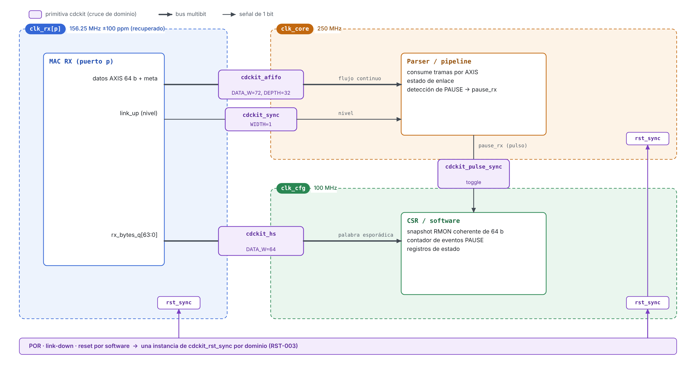
*Figura 1 — Uso de `cdckit` en NetSwitch-4.*

### 1.3 Configuración de referencia

Salvo indicación contraria, las cifras de este documento usan la configuración de referencia de NetSwitch-4:

| Parámetro | Valor |
|---|---|
| `DATA_W` (FIFO) | 72 (64 b de datos + 8 b de `tkeep` / `tlast` / `tuser`) |
| `DEPTH` | 32 |
| `NUM_STAGES` | 2 |
| `wclk` | 156.25 MHz (T = 6.4 ns) |
| `rclk` | 250 MHz (T = 4.0 ns) |
| Dispositivo | Artix-7 `xc7a100tcsg324-1` (grado de velocidad -1) |
| Herramientas | Vivado ML Standard Edition 2025.1 |

---

## 2. Resumen de características

- Cinco primitivas CDC con estructura reconocible por `report_cdc` de Vivado (sincronizadores marcados con `ASYNC_REG`) y por herramientas CDC comerciales.
- Todos los sincronizadores se implementan a través de **una única primitiva** (`cdckit_sync`). Esto permite sustituirla por la macro `xpm_cdc_array_single` de Vivado, o por una celda sincronizadora de librería en ASIC, sin modificar el resto del RTL.
- Número de etapas de sincronización configurable (2 a 4).
- Sincronizador de reset con aserción asíncrona y liberación síncrona, más bypass para modo de test (portabilidad ASIC; en FPGA se fija a 0).
- Sincronizador de pulsos basado en toggle, sin camino combinacional entre dominios.
- Transferencia multibit por handshake de 4 fases con interfaz valid/ready en el origen y registro de retención.
- FIFO asíncrona:
  - punteros Gray **registrados** sincronizados al dominio opuesto;
  - semántica *first-word fall-through* (FWFT);
  - banderas `full` / `empty` conservadoras, garantizadas sin overflow ni underflow;
  - umbrales `almost_full` / `almost_empty` programables por parámetro;
  - contadores de ocupación por dominio;
  - indicadores de `overflow` / `underflow` (intento de escritura con FIFO llena o de lectura con FIFO vacía);
  - opción de forzar `rd_data_o` a cero cuando la FIFO está vacía.
- Throughput sostenido de 1 palabra por ciclo en ambos puertos.
- Aserciones SVA embebidas (deshabilitadas en síntesis) para los invariantes críticos.
- Tabla de cruces CDC, clasificación esperada en `report_cdc` e intención de restricciones XDC con alcance por módulo (§16).
- Equivalencia documentada con las macros XPM de Vivado, que sirven de referencia de recursos y Fmax (Tabla 8-1).

---

## 3. Descripción funcional

### 3.1 Diagrama de bloques de la IP

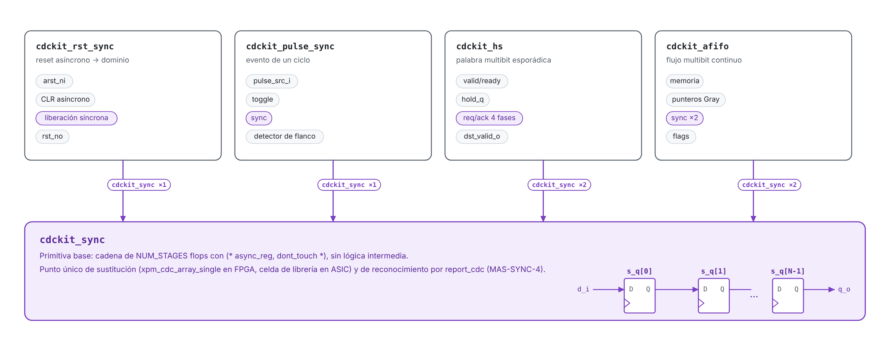
*Figura 2 — Composición de la IP. Toda sincronización pasa por `cdckit_sync`.*

### 3.2 Selección de primitiva

La IP no decide qué primitiva usar; esa decisión corresponde al integrador. La Tabla 3-1 es la guía normativa de selección.

| Característica de la señal | Primitiva | Restricción de uso |
|---|---|---|
| Nivel de 1 bit, cambia lentamente respecto a `clk_dst` | `cdckit_sync` (`WIDTH=1`) | La señal DEBE salir de un flip-flop del dominio origen. |
| Varios bits **independientes** entre sí | `cdckit_sync` (`WIDTH=N`) | NO DEBE usarse si los bits se interpretan juntos. |
| Evento de un ciclo | `cdckit_pulse_sync` | Separación mínima entre eventos (PERF-003). |
| Palabra multibit esporádica | `cdckit_hs` | Tasa ≤ 1 / T_hs (PERF-004). |
| Flujo multibit continuo | `cdckit_afifo` | — |
| Reset asíncrono | `cdckit_rst_sync` | Una instancia por dominio de reloj. |

*Tabla 3-1 — Selección de primitiva por clase de señal.*

### 3.3 Requisitos funcionales

| ID | Requisito |
|---|---|
| FUNC-001 | Toda señal que cruce entre dominios dentro de `cdckit` DEBE atravesar una instancia de `cdckit_sync`. |
| FUNC-002 | `cdckit_sync` NO DEBE contener lógica combinacional entre sus etapas. |
| FUNC-003 | `cdckit_rst_sync` DEBE propagar la aserción de reset sin depender de `clk_i` y DEBE liberar el reset sincronizado a `clk_i` tras `NUM_STAGES` flancos. |
| FUNC-004 | `cdckit_pulse_sync` DEBE generar exactamente un pulso de un ciclo de `clk_dst_i` por cada pulso de `clk_src_i`, siempre que se respete PERF-003. |
| FUNC-005 | `cdckit_hs` DEBE entregar en el destino la palabra exacta aceptada en el origen, sin valores intermedios ni mezclas de bits. |
| FUNC-006 | `cdckit_hs` NO DEBE aceptar una nueva palabra (`src_ready_o = 0`) hasta completar las cuatro fases de la transferencia anterior. |
| FUNC-007 | `cdckit_afifo` DEBE entregar las palabras en el mismo orden en que fueron escritas, sin pérdida ni duplicación. |
| FUNC-008 | `cdckit_afifo` NO DEBE escribir en memoria cuando `full_o = 1`, ni avanzar el puntero de lectura cuando `empty_o = 1`. Esos intentos se señalan en `wr_overflow_o` / `rd_underflow_o`. |
| FUNC-009 | `full_o` y `empty_o` DEBEN ser conservadores: pueden activarse antes o liberarse después del estado real, pero NUNCA deben permitir overflow ni underflow. |
| FUNC-010 | `rd_data_o` DEBE presentar la palabra en cabeza de la FIFO mientras `empty_o = 0` (FWFT). |
| FUNC-011 | Con `OUTPUT_ZERO_IF_EMPTY = 1`, `rd_data_o` DEBE valer cero mientras `empty_o = 1`. |
| FUNC-012 | Tras el reset, la FIFO DEBE presentar `empty_o = 1`, `full_o = 0`, `wr_level_o = 0` y `rd_level_o = 0`. |

### 3.4 Teoría de operación

**Sincronización de nivel.** Una señal que se muestrea de forma asíncrona puede llevar al primer flip-flop a un estado metaestable. Las etapas posteriores conceden tiempo de resolución antes de que el valor alcance la lógica funcional. La probabilidad de fallo decrece exponencialmente con ese tiempo (Anexo A).

**Pulsos.** Un pulso del origen puede ser más corto que el período destino. Por eso se convierte en una transición de nivel (toggle), se sincroniza el nivel y se reconstruye el pulso en el destino detectando el flanco.

**Palabras esporádicas.** La palabra se congela en un registro de retención del dominio origen. Solo se sincronizan las señales de control `req` / `ack`. El protocolo garantiza que el dato está estable siempre que el destino lo muestrea.

**Flujos continuos.** Los datos se escriben en una memoria con el reloj de escritura y se leen con el de lectura. Solo cruzan los punteros, codificados en Gray: entre valores consecutivos cambia un único bit, de modo que una captura durante la transición devuelve el valor anterior o el nuevo, nunca uno inválido. El retardo de sincronización hace que cada dominio vea el puntero remoto atrasado, por lo que las banderas son conservadoras.

---

## 4. Interfaces de hardware

Columnas de las tablas: **Dir** = dirección, **Dom.** = dominio de reloj, **Reset** = valor durante el reset.

### 4.1 `cdckit_sync`

| Señal | Dir | Ancho | Dom. | Reset | Descripción |
|---|---|---|---|---|---|
| `clk_i` | in | 1 | — | — | Reloj destino. |
| `rst_ni` | in | 1 | `clk_i` | — | Reset asíncrono activo bajo, ya sincronizado al dominio destino. |
| `d_i` | in | `WIDTH` | asíncrono | — | Entrada a sincronizar. DEBE provenir de un flip-flop. |
| `q_o` | out | `WIDTH` | `clk_i` | `RESET_VAL` | Salida sincronizada. |

### 4.2 `cdckit_rst_sync`

| Señal | Dir | Ancho | Dom. | Reset | Descripción |
|---|---|---|---|---|---|
| `clk_i` | in | 1 | — | — | Reloj del dominio que recibe el reset. |
| `arst_ni` | in | 1 | asíncrono | — | Fuente de reset asíncrona (POR, link-down, software). |
| `scan_mode_i` | in | 1 | estático | — | 1 = modo de test; selecciona `scan_rst_ni`. En FPGA DEBE conectarse a `1'b0` (INTG-007). |
| `scan_rst_ni` | in | 1 | — | — | Reset controlado por el ATPG en modo de test. En FPGA DEBE conectarse a `1'b1`. |
| `rst_no` | out | 1 | `clk_i` | 0 | Reset del dominio: aserción asíncrona, liberación síncrona. |

### 4.3 `cdckit_pulse_sync`

| Señal | Dir | Ancho | Dom. | Reset | Descripción |
|---|---|---|---|---|---|
| `clk_src_i` | in | 1 | — | — | Reloj origen. |
| `rst_src_ni` | in | 1 | `clk_src_i` | — | Reset del dominio origen. |
| `pulse_src_i` | in | 1 | `clk_src_i` | — | Evento de un ciclo. |
| `clk_dst_i` | in | 1 | — | — | Reloj destino. |
| `rst_dst_ni` | in | 1 | `clk_dst_i` | — | Reset del dominio destino. |
| `pulse_dst_o` | out | 1 | `clk_dst_i` | 0 | Pulso de un ciclo por cada evento del origen. |

### 4.4 `cdckit_hs`

| Señal | Dir | Ancho | Dom. | Reset | Descripción |
|---|---|---|---|---|---|
| `clk_src_i` | in | 1 | — | — | Reloj origen. |
| `rst_src_ni` | in | 1 | `clk_src_i` | — | Reset del dominio origen. |
| `src_valid_i` | in | 1 | `clk_src_i` | — | Palabra disponible. |
| `src_ready_o` | out | 1 | `clk_src_i` | 1 | La IP puede aceptar una palabra. Salida registrada. |
| `src_data_i` | in | `DATA_W` | `clk_src_i` | — | Palabra a transferir. Se captura en el ciclo `src_valid_i && src_ready_o`. |
| `clk_dst_i` | in | 1 | — | — | Reloj destino. |
| `rst_dst_ni` | in | 1 | `clk_dst_i` | — | Reset del dominio destino. |
| `dst_valid_o` | out | 1 | `clk_dst_i` | 0 | Pulso de un ciclo: `dst_data_o` contiene una palabra nueva. |
| `dst_data_o` | out | `DATA_W` | `clk_dst_i` | 0 | Última palabra recibida. Estable hasta la siguiente transferencia. |

Protocolo del lado origen: **valid/ready** de AMBA. `src_valid_i` NO DEBE depender de `src_ready_o`. La transferencia ocurre en el flanco en que ambas valen 1. El lado destino no tiene backpressure: el consumidor DEBE aceptar `dst_valid_o` en el ciclo en que se activa.

### 4.5 `cdckit_afifo`

**Puerto de escritura (dominio `wclk_i`)**

| Señal | Dir | Ancho | Reset | Descripción |
|---|---|---|---|---|
| `wclk_i` | in | 1 | — | Reloj de escritura. |
| `wrst_ni` | in | 1 | — | Reset del dominio de escritura (ver RST-004). |
| `wr_en_i` | in | 1 | — | Petición de escritura. Se ignora si `full_o = 1`. |
| `wr_data_i` | in | `DATA_W` | — | Dato a escribir. |
| `full_o` | out | 1 | 0 | FIFO llena (conservador). Registrado. |
| `almost_full_o` | out | 1 | 0 | `wr_level ≥ AF_THRESH`. Registrado. |
| `wr_level_o` | out | `AW+1` | 0 | Ocupación vista desde el dominio de escritura (≥ ocupación real). |
| `wr_overflow_o` | out | 1 | 0 | Pulso: hubo `wr_en_i` con `full_o = 1`. Registrado. |

**Puerto de lectura (dominio `rclk_i`)**

| Señal | Dir | Ancho | Reset | Descripción |
|---|---|---|---|---|
| `rclk_i` | in | 1 | — | Reloj de lectura. |
| `rrst_ni` | in | 1 | — | Reset del dominio de lectura (ver RST-004). |
| `rd_en_i` | in | 1 | — | Consume la palabra en cabeza. Se ignora si `empty_o = 1`. |
| `rd_data_o` | out | `DATA_W` | — / 0 | Palabra en cabeza (FWFT). Cero si `OUTPUT_ZERO_IF_EMPTY = 1` y `empty_o = 1`. |
| `empty_o` | out | 1 | 1 | FIFO vacía (conservador). Registrado. |
| `almost_empty_o` | out | 1 | 1 | `rd_level ≤ AE_THRESH`. Registrado. |
| `rd_level_o` | out | `AW+1` | 0 | Ocupación vista desde el dominio de lectura (≤ ocupación real). |
| `rd_underflow_o` | out | 1 | 0 | Pulso: hubo `rd_en_i` con `empty_o = 1`. Registrado. |

`AW = $clog2(DEPTH)`.

### 4.6 Requisitos de interfaz

| ID | Requisito |
|---|---|
| INTF-001 | Todas las salidas de banderas y estado de `cdckit_afifo` DEBEN ser registradas (sin camino combinacional desde una entrada). |
| INTF-002 | `src_ready_o` de `cdckit_hs` DEBE ser registrada y NO DEBE depender combinacionalmente de `src_valid_i`. |
| INTF-003 | Cada señal DEBE usarse únicamente en el dominio que indica su tabla. Usar `wr_level_o` en `rclk_i` es un cruce no sincronizado. |
| INTF-004 | El módulo integrador DEBE garantizar que `d_i` de `cdckit_sync` proviene directamente de un flip-flop del dominio origen. |

### 4.7 Diagramas de tiempo

**Escritura en FIFO vacía y primera lectura** (`NUM_STAGES = 2`, `rclk` más rápido que `wclk`)

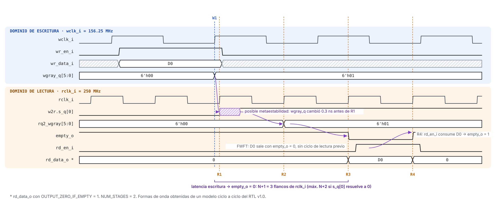
*Figura 3 — Latencia escritura→lectura: de `NUM_STAGES+1` a `NUM_STAGES+2` flancos de `rclk` tras el flanco de `wclk` que acepta la escritura.*

**Transferencia por `cdckit_hs`**

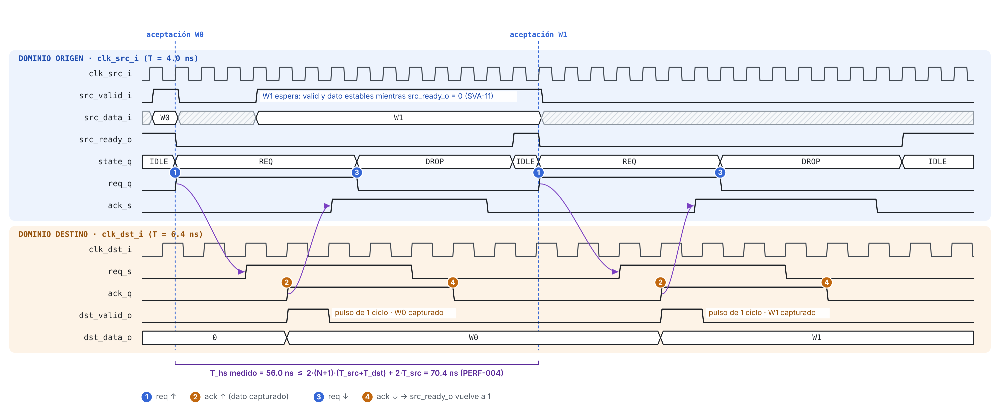
*Figura 4 — Handshake de 4 fases.*

---

## 5. Parámetros de configuración

| Módulo | Parámetro | Tipo | Rango | Defecto | Descripción |
|---|---|---|---|---|---|
| todos | `NUM_STAGES` | int | 2–4 | 2 | Etapas de sincronización. Se elige con el análisis de MTBF (Anexo A). |
| `cdckit_sync` | `WIDTH` | int | ≥ 1 | 1 | Número de bits independientes. |
| `cdckit_sync` | `RESET_VAL` | logic [WIDTH-1:0] | — | `'0` | Valor de salida durante el reset. |
| `cdckit_hs` | `DATA_W` | int | ≥ 1 | 32 | Ancho de la palabra. |
| `cdckit_afifo` | `DATA_W` | int | ≥ 1 | 72 | Ancho de la palabra. |
| `cdckit_afifo` | `DEPTH` | int | potencia de 2, ≥ 4 | 32 | Número de entradas. |
| `cdckit_afifo` | `AF_THRESH` | int | 1 … `DEPTH` | `DEPTH-4` (`DEPTH-1` si `DEPTH = 4`) | Umbral de `almost_full_o` (≥). |
| `cdckit_afifo` | `AE_THRESH` | int | 0 … `DEPTH-1` | 2 | Umbral de `almost_empty_o` (≤). |
| `cdckit_afifo` | `OUTPUT_ZERO_IF_EMPTY` | bit | 0 / 1 | 0 | Fuerza `rd_data_o = 0` con la FIFO vacía. |

| ID | Requisito |
|---|---|
| PARAM-001 | La IP DEBE detener la elaboración (`$fatal` de elaboración dentro de un bloque `generate`) si `DEPTH` no es potencia de 2 o es menor que 4, tanto en `xelab` como en `synth_design` (OI-10). |
| PARAM-002 | La IP DEBE detener la elaboración si `NUM_STAGES` está fuera de 2–4. |
| PARAM-003 | La IP DEBE detener la elaboración si `AF_THRESH` o `AE_THRESH` están fuera de rango. |

**Justificación.**

- `DEPTH ≥ 4`: la comparación de `full` invierte los dos bits más significativos del puntero Gray y requiere `AW ≥ 2`.
- `DEPTH` potencia de 2: la secuencia Gray DEBE cerrar el ciclo cambiando un solo bit.
- `OUTPUT_ZERO_IF_EMPTY = 0` por defecto: el enmascarado añade `DATA_W` compuertas AND en el camino de lectura. Se recomienda habilitarlo cuando `rd_data_o` alimenta lógica que no está calificada por `empty_o`; así se evita que `report_cdc` reporte un camino de datos no calificado en el consumidor.

---

## 6. Relojes y resets

### 6.1 Relojes

| ID | Requisito |
|---|---|
| CLK-001 | Los relojes de cada primitiva PUEDEN no tener ninguna relación de frecuencia ni de fase. |
| CLK-002 | La IP DEBE funcionar correctamente con cualquier relación `f_src / f_dst` dentro de [1/16, 16]. Fuera de ese rango la funcionalidad se mantiene, pero no se verifica en la versión 1.0. |
| CLK-003 | La IP NO DEBE generar, dividir ni gatear relojes. |
| CLK-004 | Si dos dominios comparten frecuencia nominal con fuentes distintas (p. ej. ±100 ppm), la IP DEBE funcionar sin pérdida. La compensación de tasa (inserción o eliminación de idles) es responsabilidad del sistema. |

### 6.2 Resets

| ID | Requisito |
|---|---|
| RST-001 | Todos los flip-flops de control DEBEN usar reset asíncrono activo bajo, liberado de forma síncrona en su dominio mediante `cdckit_rst_sync`. En Artix-7 se mapean a `FDCE`/`FDPE`; se mantiene el reset asíncrono porque FUNC-003 exige aserción sin reloj y por portabilidad ASIC. |
| RST-002 | Los flip-flops de datos (memoria de la FIFO, registro de retención de `cdckit_hs`) PUEDEN no tener reset. Su contenido nunca se observa sin una bandera de validez reseteada. |
| RST-003 | Cada dominio de reloj DEBE recibir su propia instancia de `cdckit_rst_sync`. |
| RST-004 | Para `cdckit_afifo`, `wrst_ni` y `rrst_ni` DEBEN activarse con solapamiento temporal de al menos `NUM_STAGES+1` ciclos del reloj más lento, y la FIFO DEBE considerarse vacía tras la liberación. |
| RST-005 | Para `cdckit_hs`, el reset de un solo dominio PUEDE perder la transferencia en curso, pero NO DEBE generar un `dst_valid_o` espurio. |
| RST-006 | Para `cdckit_pulse_sync`, el reset solo del dominio destino PUEDE perder eventos en curso, pero NO DEBE generar un `pulse_dst_o` espurio. El reset solo del dominio origen PUEDE generar como máximo un `pulse_dst_o` espurio (ver OI-07). |

### 6.3 Secuencia de reset de la FIFO

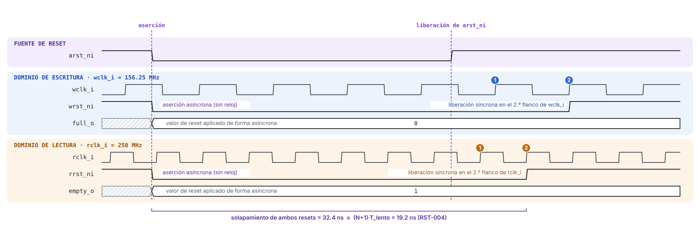
*Figura 5 — Secuencia de reset soportada.*

**Limitación.** El reset de un solo dominio de la FIFO con el otro activo deja punteros incoherentes entre dominios: es un Reset Domain Crossing no soportado en la versión 1.0. El integrador DEBE aplicar la secuencia de la Figura 5. Ver OI-02.

---

## 7. Rendimiento y latencias

### 7.1 Requisitos de rendimiento

| ID | Requisito |
|---|---|
| PERF-001 | `cdckit_afifo` DEBE aceptar una escritura por ciclo de `wclk_i` mientras `full_o = 0` y entregar una lectura por ciclo de `rclk_i` mientras `empty_o = 0`. |
| PERF-002 | Con `NUM_STAGES = 2`, relojes iguales y tráfico continuo, `cdckit_afifo` DEBERÍA sostener 1 palabra/ciclo sin que `full_o` se active si `DEPTH ≥ 8`. Valor a confirmar en verificación (OI-03). |
| PERF-003 | `cdckit_pulse_sync` garantiza la entrega de cada evento si la separación entre dos pulsos consecutivos del origen es ≥ `3·T_dst + 2·T_src`. Con separaciones menores, pulsos consecutivos PUEDEN fusionarse en uno. |
| PERF-004 | `cdckit_hs` DEBE completar una transferencia, de `src_valid_i && src_ready_o` hasta el nuevo `src_ready_o = 1`, en ≤ `T_hs = 2·(NUM_STAGES+1)·(T_src + T_dst) + 2·T_src`. |
| PERF-005 | En la plataforma de referencia (§1.3), el arnés de implementación (§16.4) DEBERÍA cerrar timing tras `route_design` con `wclk` = 156.25 MHz y `rclk` = 250 MHz: WNS ≥ 0, WHS ≥ 0, TPWS ≥ 0 y `report_bus_skew` sin violaciones. Si `rclk` = 250 MHz no cierra en grado -1, el requisito se evalúa a la Fmax obtenida según PERF-006 (OI-13). |
| PERF-006 | DEBERÍA documentarse la Fmax de cada dominio, obtenida reduciendo el período de su reloj en pasos de 0.1 ns hasta que WNS < 0. |
| PERF-007 | DEBERÍAN documentarse los recursos y la Fmax de cada primitiva frente a su macro XPM equivalente (Tabla 8-1), implementadas en el mismo arnés. |

### 7.2 Tabla de latencias (`NUM_STAGES = N`)

| Camino | Latencia mínima | Latencia máxima | Referencia temporal |
|---|---|---|---|
| `cdckit_sync`: `d_i` → `q_o` | N·T_dst | (N+1)·T_dst | Cambio de `d_i` |
| `cdckit_rst_sync`: aserción | 0 (combinacional asíncrona) | t_clr→q | Flanco de bajada de `arst_ni` |
| `cdckit_rst_sync`: liberación | N flancos de `clk_i` | N+1 flancos | Flanco de subida de `arst_ni` |
| `cdckit_pulse_sync`: evento → `pulse_dst_o` | (N+1) flancos de `clk_dst` | (N+2) flancos | Flanco de `clk_src` que muestrea el pulso |
| `cdckit_hs`: aceptación → `dst_valid_o` | (N+1) flancos de `clk_dst` | (N+2) flancos | Flanco de `clk_src` de aceptación |
| `cdckit_afifo`: escritura → `empty_o = 0` | (N+1) flancos de `rclk` | (N+2) flancos | Flanco de `wclk` que acepta la escritura |
| `cdckit_afifo`: lectura → `full_o = 0` | (N+1) flancos de `wclk` | (N+2) flancos | Flanco de `rclk` que acepta la lectura |
| `cdckit_afifo`: `rd_en_i` → siguiente `rd_data_o` | 1 flanco de `rclk` | 1 flanco | — |

El flanco adicional del máximo cubre dos efectos: la incertidumbre de muestreo (fase arbitraria entre relojes) y la posibilidad de que la primera etapa resuelva la metaestabilidad hacia el valor anterior.

### 7.3 Dimensionamiento de la profundidad

Para una ráfaga de `B` palabras escritas a `f_w` mientras se lee continuamente a `f_r < f_w`, sin backpressure en el escritor:

```
DEPTH ≥ B · (1 − f_r / f_w) + (N + 2)            ; redondeado a la siguiente potencia de 2
```

Ejemplo NetSwitch-4, lado TX (el núcleo escribe a 250 MHz y la MAC lee a 156.25 MHz), trama de 1518 B en 190 beats de 8 B:

```
DEPTH ≥ 190 · (1 − 156.25/250) + 4 = 190 · 0.375 + 4 = 75.25   →   DEPTH = 128
```

El lado RX (escritura a 156.25 MHz, lectura a 250 MHz) solo absorbe stalls del núcleo. Su profundidad se fija por la duración máxima de stall que especifique el núcleo: configuración de referencia `DEPTH = 32`.

---

## 8. Requisitos de integración

| ID | Requisito |
|---|---|
| INTG-001 | El integrador NO DEBE insertar lógica combinacional entre el flip-flop origen y el puerto `d_i` de `cdckit_sync`. |
| INTG-002 | El integrador NO DEBE sincronizar por separado bits que luego se recombinan o interpretan juntos (reconvergencia). Esa información DEBE cruzar por `cdckit_hs` o `cdckit_afifo`. |
| INTG-003 | El integrador DEBE cargar los archivos XDC con alcance por módulo de la §16 (`read_xdc -unmanaged -ref`, `PROCESSING_ORDER LATE`), de modo que se apliquen a cada instancia. |
| INTG-004 | El integrador DEBE ejecutar `report_cdc -details` sobre el diseño integrado y justificar con `create_waiver` cada advertencia que quede, con referencia a la §15. |
| INTG-005 | La primitiva `cdckit_sync` PUEDE sustituirse por `xpm_cdc_array_single` (FPGA) o por una celda sincronizadora de librería (ASIC). La sustitución DEBE preservar el número de etapas. `xpm_cdc_array_single` no tiene reset: la pérdida de `RESET_VAL` DEBE evaluarse en cada uso. |
| INTG-006 | El consumidor de `rd_data_o` DEBE calificar su uso con `empty_o = 0`, o la instancia DEBE configurarse con `OUTPUT_ZERO_IF_EMPTY = 1`. |
| INTG-007 | En FPGA, `scan_mode_i` DEBE conectarse a `1'b0` y `scan_rst_ni` a `1'b1`. La síntesis elimina así el mux de test. |
| INTG-008 | Entre los relojes de una instancia NO DEBEN usarse `set_clock_groups` ni `set_false_path` globales, porque anularían las restricciones de la §16 (STA-001). |

| Primitiva `cdckit` | Macro XPM equivalente | Diferencias relevantes |
|---|---|---|
| `cdckit_sync` | `xpm_cdc_single` / `xpm_cdc_array_single` | XPM sin reset; mismo número de etapas configurable. |
| `cdckit_rst_sync` | `xpm_cdc_async_rst` | XPM sin mux de test. |
| `cdckit_pulse_sync` | `xpm_cdc_pulse` | `cdckit` añade la ventana de armado (MAS-PLS-5). |
| `cdckit_hs` | `xpm_cdc_handshake` | `cdckit` expone valid/ready en el origen. |
| `cdckit_afifo` | `xpm_fifo_async` | `cdckit` añade flags `overflow`/`underflow`, niveles por dominio y `OUTPUT_ZERO_IF_EMPTY`. |

*Tabla 8-1 — Equivalencias con las macros XPM de Vivado (referencia para PERF-007).*

---

# PARTE II — MICRO-ARCHITECTURE SPECIFICATION

## 9. Jerarquía de módulos

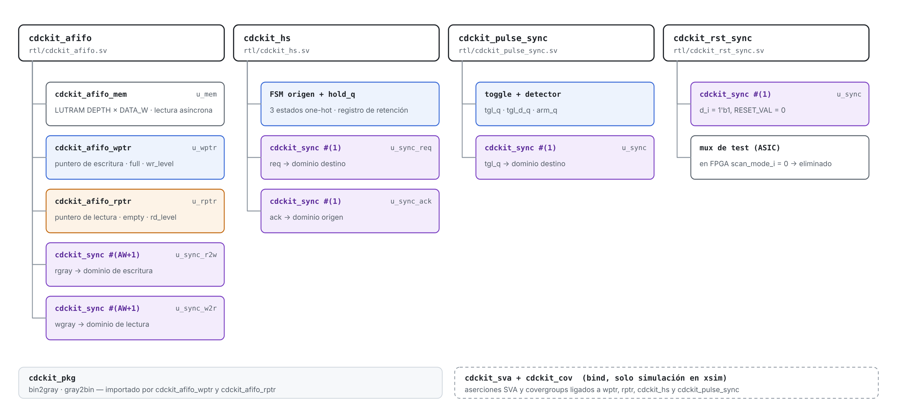
*Figura 6 — Jerarquía de módulos y archivos RTL.*

Archivos del RTL (todos `.sv`, más la lista de archivos):

| Archivo | Contenido |
|---|---|
| `rtl/cdckit_pkg.sv` | Funciones `bin2gray`, `gray2bin`, tipos. |
| `rtl/cdckit_sync.sv` | Primitiva de sincronización. |
| `rtl/cdckit_rst_sync.sv` | Sincronizador de reset. |
| `rtl/cdckit_pulse_sync.sv` | Sincronizador de pulsos. |
| `rtl/cdckit_hs.sv` | Handshake de 4 fases. |
| `rtl/cdckit_afifo_mem.sv` | Memoria de la FIFO. |
| `rtl/cdckit_afifo_wptr.sv` | Lógica de puntero de escritura. |
| `rtl/cdckit_afifo_rptr.sv` | Lógica de puntero de lectura. |
| `rtl/cdckit_afifo.sv` | Top de la FIFO. |
| `rtl/cdckit_sva.sv` | Checkers SVA conectados con `bind` (solo simulación). |
| `rtl/cdckit_rtl.f` | Lista del RTL sintetizable (`cdckit_sva.sv` se añade solo en simulación). |

Los entregables de la fase de RTL son únicamente archivos `.sv`. El arnés de implementación (`impl/cdckit_impl_top.sv`), los archivos XDC (`constraints/*.xdc`) y el script de Vivado (`scripts/vivado_impl.tcl`) se citan en la §16 como destino de fases posteriores. Los `covergroup` y el entorno de verificación pertenecen a la fase 3 y 4.

---

## 10. `cdckit_sync` — Sincronizador de nivel

### 10.1 Estructura

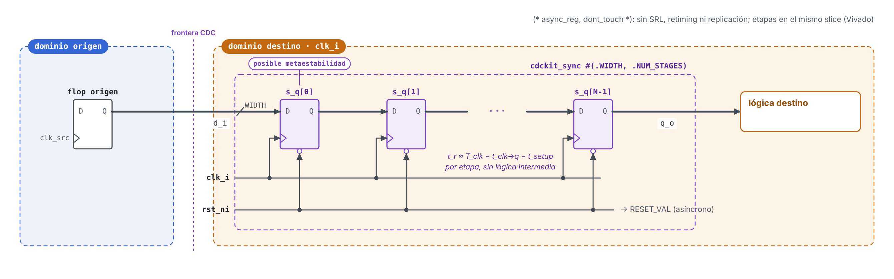
*Figura 7 — Estructura de `cdckit_sync`.*

### 10.2 Decisiones de microarquitectura

| ID | Decisión | Justificación |
|---|---|---|
| MAS-SYNC-1 | Vector de registros `logic [NUM_STAGES-1:0][WIDTH-1:0] s_q` con atributos `(* ASYNC_REG = "TRUE", DONT_TOUCH = "TRUE" *)`. | En Vivado, `ASYNC_REG` impide el empaquetado en SRL y el retiming, y coloca las etapas en el mismo slice para maximizar `t_r`; es la marca con la que `report_cdc` reconoce el sincronizador. `DONT_TOUCH` impide su replicación y fusión. |
| MAS-SYNC-2 | Ninguna compuerta entre etapas. | Maximiza el tiempo de resolución `t_r`. |
| MAS-SYNC-3 | Reset asíncrono a `RESET_VAL`. | Estado conocido desde el primer ciclo de reloj. |
| MAS-SYNC-4 | Implementación aislada en su propio módulo. | Punto único de sustitución (`xpm_cdc_array_single` o celda de librería, INTG-005) y de reconocimiento por `report_cdc`. |

### 10.3 Recursos

`NUM_STAGES × WIDTH` flip-flops (`FDCE`); 0 LUT.

---

## 11. `cdckit_rst_sync` — Sincronizador de reset

### 11.1 Estructura

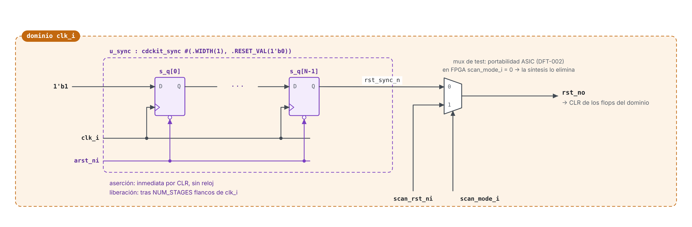
*Figura 8 — Estructura de `cdckit_rst_sync`.*

### 11.2 Decisiones de microarquitectura

| ID | Decisión | Justificación |
|---|---|---|
| MAS-RST-1 | `arst_ni` conectado directamente a la entrada CLR de todas las etapas. | Aserción inmediata, incluso sin reloj activo (FUNC-003). |
| MAS-RST-2 | Las etapas propagan una constante `1'b1`. | La liberación se alinea a `clk_i` tras `NUM_STAGES` flancos. |
| MAS-RST-3 | Mux de test a la salida, seleccionado por `scan_mode_i`. | Portabilidad ASIC: da al ATPG control directo del reset (DFT-002). En FPGA, con `scan_mode_i = 1'b0` (INTG-007), la síntesis elimina el mux y `rst_no` sale directamente de la última etapa. |
| MAS-RST-4 | En ASIC, la celda del mux DEBE ser una celda de librería designada (*don't touch*). | Evita que la síntesis la reestructure en una lógica que pueda glitchear sobre la red de reset. No aplica en FPGA. |
| MAS-RST-5 | Equivalente de referencia: `xpm_cdc_async_rst`. | Se compara su clasificación en `report_cdc` y sus recursos (PERF-007). |

---

## 12. `cdckit_pulse_sync` — Sincronizador de pulsos (toggle)

### 12.1 Estructura

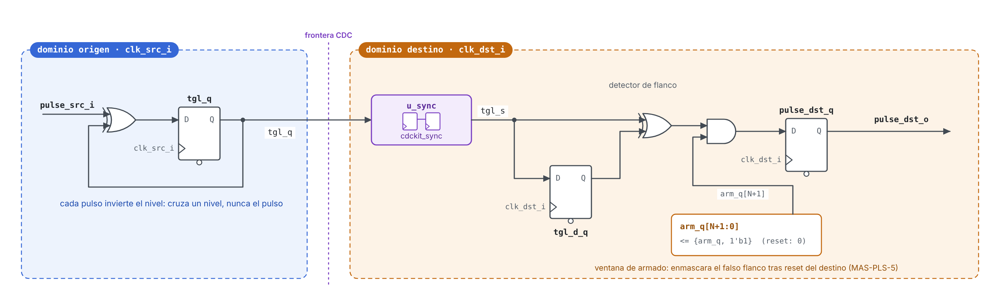
*Figura 9 — Estructura de `cdckit_pulse_sync` con ventana de armado.*

### 12.2 Lógica

| Dominio | Ecuación |
|---|---|
| Origen | `tgl_q <= tgl_q ^ pulse_src_i;` |
| Destino | `arm_q <= {arm_q[N:0], 1'b1};`  `tgl_d <= tgl_s;`  `pulse_dst_q <= arm_q[N+1] & (tgl_s ^ tgl_d);` |
| Salida | `pulse_dst_o = pulse_dst_q;` (registrada; INTF-001 aplicado por coherencia) |

### 12.3 Decisiones de microarquitectura

| ID | Decisión | Justificación |
|---|---|---|
| MAS-PLS-1 | Cruza un nivel (`tgl_q`), nunca el pulso. | Un pulso más corto que `T_dst` puede no ser muestreado. |
| MAS-PLS-2 | `tgl_q` es un flip-flop. | Ninguna lógica combinacional alimenta el sincronizador (INTG-001). |
| MAS-PLS-3 | Salida registrada. | Libre de glitches, a costa de un flanco de latencia (§7.2). |
| MAS-PLS-4 | Sin canal de confirmación. | Coste mínimo. La restricción de espaciado (PERF-003) la garantiza el integrador y la verifica una aserción `assume` en la interfaz. |
| MAS-PLS-5 | Ventana de armado de `NUM_STAGES+2` ciclos tras el reset del destino (`arm_q`). | Tras un reset solo del destino, el sincronizador arranca en 0 y converge al valor actual de `tgl_q`, que el detector vería como un flanco. La ventana cubre el peor caso de convergencia: N etapas, 1 flanco por metaestabilidad y 1 de `tgl_d` (RST-006). |

---

## 13. `cdckit_hs` — Transferencia multibit por handshake de 4 fases

### 13.1 Estructura

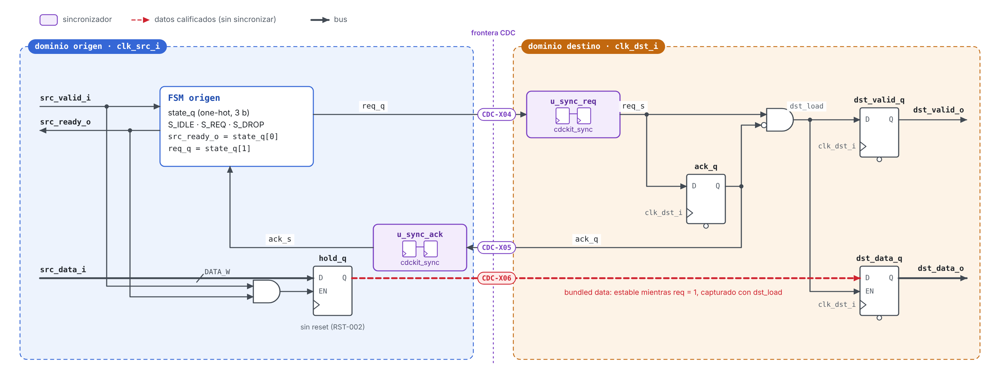
*Figura 10 — Estructura de `cdckit_hs` y cruces CDC-X04 a CDC-X06.*

### 13.2 FSM del dominio origen

| Estado | `src_ready_o` | `req_q` | Transición |
|---|---|---|---|
| `S_IDLE` | 1 | 0 | `src_valid_i` → `S_REQ`; además `hold_q <= src_data_i` |
| `S_REQ` | 0 | 1 | `ack_s == 1` → `S_DROP` |
| `S_DROP` | 0 | 0 | `ack_s == 0` → `S_IDLE` |

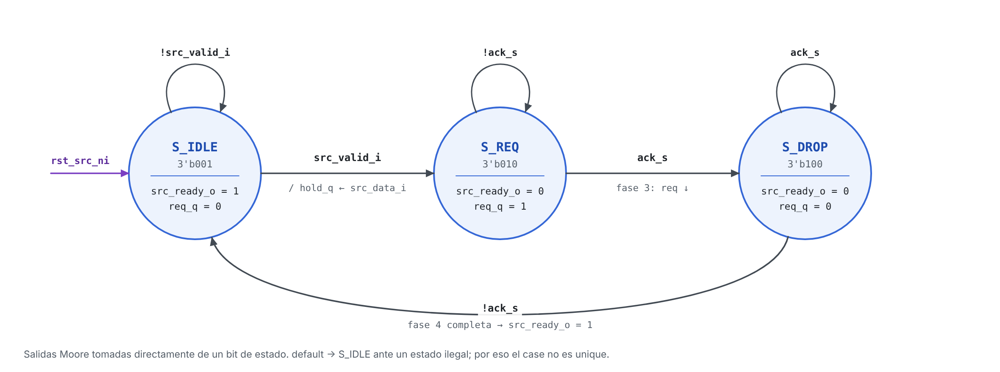
*Figura 11 — FSM del dominio origen de `cdckit_hs`.*

**Codificación:** one-hot de 3 bits. `src_ready_o` y `req_q` se toman directamente de un bit de estado (salidas Moore registradas, sin decodificación). Con `default` hacia `S_IDLE`. La sentencia es `case` y no `unique case`: con `unique` la síntesis puede asumir que los estados ilegales no ocurren y eliminar la lógica de recuperación. La codificación escrita se conserva con `FSM_ENCODING = "none"` (MAS-HS-6).

### 13.3 Lógica del dominio destino

| Señal | Ecuación |
|---|---|
| `ack_q` | `ack_q <= req_s;` |
| `dst_valid_q` | `dst_valid_q <= req_s & ~ack_q;` |
| `dst_data_q` | `if (req_s & ~ack_q) dst_data_q <= hold_q;` |

### 13.4 Decisiones de microarquitectura

| ID | Decisión | Justificación |
|---|---|---|
| MAS-HS-1 | Registro de retención en el origen. | Desacopla `src_data_i` del protocolo: el emisor puede cambiar su dato tras la aceptación sin afectar la transferencia en curso. |
| MAS-HS-2 | `hold_q` solo se carga en `S_IDLE`. | Garantiza estabilidad durante las fases 1–3, cuando el destino puede muestrear. |
| MAS-HS-3 | El destino captura en el flanco de subida de `req_s` (`req_s & ~ack_q`). | Una única captura por transferencia; `dst_valid_o` dura exactamente un ciclo destino. |
| MAS-HS-4 | `ack_q` es una copia retrasada de `req_s`. | Sin FSM en el destino; mínima lógica. |
| MAS-HS-5 | Salidas del destino registradas. | `dst_valid_o` y `dst_data_o` cambian en el mismo flanco. |
| MAS-HS-6 | `state_q` DEBE llevar `(* FSM_ENCODING = "none" *)`. | `req_q` cruza de dominio directamente desde un bit de estado. Si Vivado extrajera y recodificara la FSM, `req_q` pasaría a ser lógica combinacional delante del sincronizador, que es justo lo que prohíbe INTG-001 y lo que `report_cdc` clasifica como crítico. |

---

## 14. `cdckit_afifo` — FIFO asíncrona

### 14.1 Diagrama de bloques

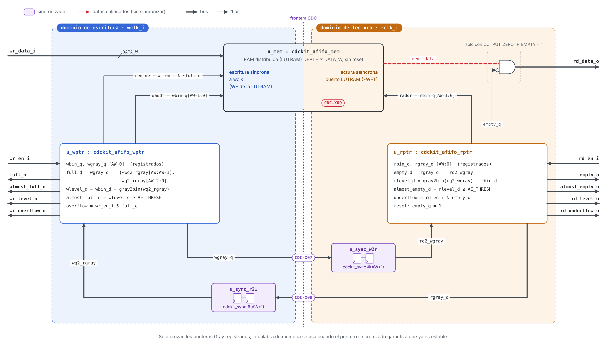
*Figura 12 — Microarquitectura de `cdckit_afifo`.*

### 14.2 Lógica de puntero de escritura (`cdckit_afifo_wptr`)

| Señal | Ecuación | Tipo |
|---|---|---|
| `w_push` | `wr_en_i & ~full_q` | comb |
| `wbin_d` | `wbin_q + w_push` | comb |
| `wgray_d` | `bin2gray(wbin_d) = (wbin_d >> 1) ^ wbin_d` | comb |
| `wq2_rbin` | `gray2bin(wq2_rgray)` | comb |
| `wlevel_d` | `wbin_d − wq2_rbin` (módulo 2^(AW+1)) | comb |
| `full_q` | `wgray_d == {~wq2_rgray[AW:AW-1], wq2_rgray[AW-2:0]}` | reg |
| `almost_full_q` | `wlevel_d >= AF_THRESH` | reg |
| `wr_level_q` | `wlevel_d` | reg |
| `wr_overflow_q` | `wr_en_i & full_q` | reg |
| `wbin_q`, `wgray_q` | `wbin_d`, `wgray_d` | reg |
| `mem_we` | `w_push` | comb → `cdckit_afifo_mem` |

### 14.3 Lógica de puntero de lectura (`cdckit_afifo_rptr`)

| Señal | Ecuación | Tipo |
|---|---|---|
| `r_pop` | `rd_en_i & ~empty_q` | comb |
| `rbin_d` | `rbin_q + r_pop` | comb |
| `rgray_d` | `bin2gray(rbin_d)` | comb |
| `rq2_wbin` | `gray2bin(rq2_wgray)` | comb |
| `rlevel_d` | `rq2_wbin − rbin_d` | comb |
| `empty_q` | `rgray_d == rq2_wgray` | reg (reset = 1) |
| `almost_empty_q` | `rlevel_d <= AE_THRESH` | reg (reset = 1) |
| `rd_level_q` | `rlevel_d` | reg |
| `rd_underflow_q` | `rd_en_i & empty_q` | reg |
| `rbin_q`, `rgray_q` | `rbin_d`, `rgray_d` | reg |

### 14.4 Memoria (`cdckit_afifo_mem`)

| Aspecto | Especificación |
|---|---|
| Implementación | RAM distribuida (LUTRAM) de doble puerto, inferida por Vivado a partir del array `mem_q` sin reset. La lectura asíncrona impide inferir Block RAM. IMPL-003 exige comprobar en `report_utilization` que se infiere LUTRAM y no registros. |
| Escritura | Síncrona a `wclk_i`, habilitada por `mem_we`, dirección `wbin_q[AW-1:0]`. |
| Lectura | Asíncrona desde el puerto de lectura de la LUTRAM, dirección `rbin_q[AW-1:0]` (FWFT). Con `DEPTH = 32`, un nivel de LUT. |
| Salida | `rd_data_o = (OUTPUT_ZERO_IF_EMPTY && empty_q) ? '0 : mem[rbin_q[AW-1:0]]`. |
| Habilitación | `mem_we` actúa como WE de la LUTRAM. En FPGA no se infieren ICG (§18.2). |

### 14.5 Decisiones de microarquitectura

| ID | Decisión | Justificación |
|---|---|---|
| MAS-AF-1 | Punteros de `AW+1` bits. | El bit adicional distingue lleno de vacío sin sacrificar una entrada. |
| MAS-AF-2 | Se sincronizan los punteros Gray **registrados** (`wgray_q`, `rgray_q`), nunca `wgray_d`. | La salida combinacional de `bin2gray` puede glitchear y cambiar más de un bit durante la evaluación. |
| MAS-AF-3 | Coexisten dos representaciones por dominio (binaria para direccionar, Gray para cruzar). | Evita convertir Gray→binario en el camino de dirección de la memoria. |
| MAS-AF-4 | `full` y `empty` se calculan con los punteros *próximos* (`*_d`) y se registran. | Las banderas reflejan la operación del ciclo actual sin un ciclo de retraso adicional, y quedan registradas (INTF-001). |
| MAS-AF-5 | `full` compara los dos MSB invertidos. | Equivalencia, en código Gray reflejado, de “MSB distinto y resto igual” en binario. |
| MAS-AF-6 | Los niveles se calculan desde el puntero remoto sincronizado. | `wr_level_o` es una cota superior y `rd_level_o` una cota inferior de la ocupación real. Ambas son seguras para control de flujo. |
| MAS-AF-7 | Memoria inferida como LUTRAM con lectura asíncrona. | FWFT sin ciclo de latencia adicional. La configuración de referencia pasa de ≈ 2370 a ≈ 66 flip-flops (§18.1). Para `DEPTH × DATA_W` grandes se planea Block RAM con prefetch (OI-01). |
| MAS-AF-8 | `gray2bin` combinacional. | Cadena XOR de profundidad AW. Si limita timing, se registra `wq2_rbin` / `rq2_wbin` a costa de un ciclo adicional de pesimismo en los niveles (OI-05). |
| MAS-AF-9 | `wgray_q` y `rgray_q` DEBEN llevar `(* DONT_TOUCH = "TRUE" *)`. | El MSB del puntero Gray es idéntico al MSB binario. Por eso Vivado fusionaría `wgray_q[AW]` con `wbin_q[AW]` (eliminación de registros equivalentes). El flop de lanzamiento del cruce cambiaría de nombre, quedaría sin cubrir por las restricciones de la §16 y alimentaría lógica de su propio dominio además del sincronizador. |

### 14.6 Caminos críticos esperados

| ID | Camino | Dominio | Profundidad lógica aproximada | Mitigación |
|---|---|---|---|---|
| CP-1 | `wbin_q` → +1 → `bin2gray` → comparador `AW+1` → `full_q` | `wclk` | sumador `AW+1` + XOR + árbol de comparación | Precalcular `wbin_q + 1` en un registro. |
| CP-2 | `wq2_rgray` → `gray2bin` → resta → comparación con `AF_THRESH` → `almost_full_q` | `wclk` | cadena XOR AW + resta `AW+1` + comparador | MAS-AF-8 (registrar `wq2_rbin`). |
| CP-3 | `rbin_q` → dirección de LUTRAM → `rd_data_o` | `rclk` | 1 LUT (`DEPTH ≤ 32`) + máscara de `OUTPUT_ZERO_IF_EMPTY` | Registro de salida en el consumidor; Block RAM con prefetch (OI-01). |
| CP-4 | Camino CDC LUTRAM → registro del consumidor | `wclk` → `rclk` | — | Camino calificado; restringido con `set_max_delay -datapath_only` (§16). |

CP-1 y CP-2 en `rclk` (4.0 ns) son los candidatos a limitar la Fmax en Artix-7 grado -1 (OI-13).

---

## 15. Intención CDC y tabla de cruces

### 15.1 Tabla de cruces

| ID | Módulo | Señal origen | Dominio origen → destino | Ancho | Esquema | Estructura de sincronización | Calificador |
|---|---|---|---|---|---|---|---|
| CDC-X01 | `cdckit_sync` | `d_i` | asíncrono → `clk_i` | `WIDTH` | Nivel, bits independientes | `NUM_STAGES` flops | — |
| CDC-X02 | `cdckit_rst_sync` | `arst_ni` (liberación) | asíncrono → `clk_i` | 1 | Reset async-assert / sync-deassert | `NUM_STAGES` flops con CLR | — |
| CDC-X03 | `cdckit_pulse_sync` | `tgl_q` | `clk_src` → `clk_dst` | 1 | Toggle | `cdckit_sync` | — |
| CDC-X04 | `cdckit_hs` | `req_q` | `clk_src` → `clk_dst` | 1 | Handshake 4 fases | `cdckit_sync` | — |
| CDC-X05 | `cdckit_hs` | `ack_q` | `clk_dst` → `clk_src` | 1 | Handshake 4 fases | `cdckit_sync` | — |
| CDC-X06 | `cdckit_hs` | `hold_q` | `clk_src` → `clk_dst` | `DATA_W` | Datos agrupados (*bundled data*) | Ninguna (dato estable) | `req_s & ~ack_q` |
| CDC-X07 | `cdckit_afifo` | `wgray_q` | `wclk` → `rclk` | `AW+1` | Gray | `cdckit_sync` (`u_sync_w2r`) | — |
| CDC-X08 | `cdckit_afifo` | `rgray_q` | `rclk` → `wclk` | `AW+1` | Gray | `cdckit_sync` (`u_sync_r2w`) | — |
| CDC-X09 | `cdckit_afifo` | `mem[*]` | `wclk` → `rclk` | `DATA_W` | FIFO (datos en memoria) | Ninguna | `empty_q == 0` |

### 15.2 Requisitos CDC

| ID | Requisito |
|---|---|
| CDC-001 | `report_cdc -details` sobre el arnés (§16.4) NO DEBE contener resultados *Critical*. Cada resultado *Warning* DEBE estar cubierto por un `create_waiver` con su justificación y referencia a la §15.3. |
| CDC-002 | Ningún cruce DEBE presentar reconvergencia de señales sincronizadas por separado. |
| CDC-003 | Los buses X07 y X08 DEBEN cambiar como máximo un bit por ciclo de su reloj de origen (SVA-01, SVA-02), y su skew DEBE quedar acotado por `set_bus_skew` (STA-004). |
| CDC-004 | No DEBE haber cruces de dominio de reset no justificados bajo la secuencia de la Figura 5. Vivado no incluye análisis RDC dedicado, así que se verifica de tres formas: simulación de la secuencia (TP-AF-05), reconocimiento de `cdckit_rst_sync` como sincronizador de reset en `report_cdc` y revisión de diseño. |

### 15.3 Clasificación esperada en `report_cdc`

| Cruce | Topología esperada | Severidad esperada | Tratamiento |
|---|---|---|---|
| X01, X03, X04, X05 | Sincronizador de 1 bit con `ASYNC_REG` | Info (seguro) | — |
| X02 | Sincronizador de reset asíncrono con `ASYNC_REG` | Info (seguro) | — |
| X07, X08 | Sincronizador multibit con `ASYNC_REG` (regla CDC-6) | Warning | Waiver: codificación Gray (SVA-01, SVA-02) y `set_bus_skew` (§16.2). Es el mismo waiver que aplica `xpm_cdc_gray`. |
| X06 | Estructura controlada por *clock enable* (`dst_load`) | Warning | Waiver: *bundled data*, estable durante `req` (SVA-09) y acotado con `set_max_delay`. |
| X09 | Camino desde LUTRAM escrita en `wclk` hacia el dominio `rclk` | Warning | Waiver: el protocolo de punteros impide leer una palabra mientras se escribe (FUNC-008, FUNC-009). |

Los identificadores exactos de regla, salvo CDC-6, se registrarán a partir del primer informe y se fijarán en la fase de implementación (OI-11).

---

## 16. Restricciones de timing (XDC)

Esta sección especifica la **intención** de las restricciones. Los archivos `.xdc`, el arnés y el script de Vivado se escriben en la fase de implementación (§9).

### 16.1 Principio

En Vivado, `set_clock_groups` y `set_false_path` tienen **prioridad** sobre `set_max_delay`, y los grupos de reloj no se pueden anular. Por tanto, si un camino entre dos relojes se restringe con `set_max_delay -datapath_only`, esos dos relojes NO DEBEN agruparse con `set_clock_groups`. `set_bus_skew`, en cambio, no es una excepción sino una aserción de timing: se evalúa siempre, solo la optimiza `route_design` y se reporta con `report_bus_skew`, no en `report_timing_summary`.

La política de la IP es acotar **todos** sus cruces internos con `set_max_delay -datapath_only`, sin `set_false_path`. Así cada cruce tiene una latencia máxima garantizada y ninguno queda sin analizar.

### 16.2 Archivos con alcance por módulo

Cada archivo se carga como restricciones **no gestionadas** con alcance al módulo (`read_xdc -unmanaged -ref <módulo>`) y con `PROCESSING_ORDER LATE`, igual que las macros XPM. El Tcl completo permite leer los períodos de los relojes que llegan a cada instancia, sin rutas jerárquicas fijas, y comprobar STA-006 dentro del propio archivo (`send_msg_id` con *critical warning* si una consulta de celdas está vacía).

```tcl
## constraints/cdckit_afifo.xdc  — SCOPED_TO_REF cdckit_afifo, PROCESSING_ORDER LATE
set t_w [get_property PERIOD [get_clocks -of_objects [get_pins {u_wptr/wgray_q_reg[0]/C}]]]
set t_r [get_property PERIOD [get_clocks -of_objects [get_pins {u_rptr/rgray_q_reg[0]/C}]]]

# CDC-X07: wgray_q -> u_sync_w2r (Gray)
set_max_delay -datapath_only -from [get_cells {u_wptr/wgray_q_reg[*]}] \
              -to [get_cells {u_sync_w2r/s_q_reg[0][*]}] $t_w
set_bus_skew  -from [get_cells {u_wptr/wgray_q_reg[*]}] \
              -to [get_cells {u_sync_w2r/s_q_reg[0][*]}] [expr {min($t_w, $t_r)}]

# CDC-X08: rgray_q -> u_sync_r2w (Gray)
set_max_delay -datapath_only -from [get_cells {u_rptr/rgray_q_reg[*]}] \
              -to [get_cells {u_sync_r2w/s_q_reg[0][*]}] $t_r
set_bus_skew  -from [get_cells {u_rptr/rgray_q_reg[*]}] \
              -to [get_cells {u_sync_r2w/s_q_reg[0][*]}] [expr {min($t_w, $t_r)}]

# CDC-X09: LUTRAM (escrita en wclk) -> dominio de lectura
set_max_delay -datapath_only -from [get_cells -hierarchical -filter {REF_NAME =~ RAM*}] \
              -to [get_clocks -of_objects [get_pins {u_rptr/rgray_q_reg[0]/C}]] $t_r
```

```tcl
## constraints/cdckit_hs.xdc  — SCOPED_TO_REF cdckit_hs, PROCESSING_ORDER LATE
set t_s [get_property PERIOD [get_clocks -of_objects [get_pins {hold_q_reg[0]/C}]]]
set t_d [get_property PERIOD [get_clocks -of_objects [get_pins {dst_data_q_reg[0]/C}]]]

# CDC-X04 / X05: req y ack (1 bit)
set_max_delay -datapath_only -from [get_cells {state_q_reg[1]}] \
              -to [get_cells {u_sync_req/s_q_reg[0][0]}] $t_d
set_max_delay -datapath_only -from [get_cells {ack_q_reg}] \
              -to [get_cells {u_sync_ack/s_q_reg[0][0]}] $t_s
# CDC-X06: bundled data
set_max_delay -datapath_only -from [get_cells {hold_q_reg[*]}] \
              -to [get_cells {dst_data_q_reg[*]}] $t_d
```

```tcl
## constraints/cdckit_pulse_sync.xdc  — SCOPED_TO_REF cdckit_pulse_sync, PROCESSING_ORDER LATE
set t_d [get_property PERIOD [get_clocks -of_objects [get_pins {tgl_d_q_reg/C}]]]
# CDC-X03: toggle (1 bit)
set_max_delay -datapath_only -from [get_cells {tgl_q_reg}] \
              -to [get_cells {u_sync/s_q_reg[0][0]}] $t_d
```

```tcl
## constraints/cdckit_impl_top.xdc  — arnés de implementación (§16.4)
create_clock -name wclk -period 6.400 [get_ports wclk_i]
create_clock -name rclk -period 4.000 [get_ports rclk_i]
# CDC-X02: solo el camino de aserción del reset asíncrono. La liberación se analiza como
# recovery/removal a la salida de cdckit_rst_sync.
set_false_path -from [get_ports arst_ni]
# Sin set_clock_groups entre wclk y rclk (STA-001).
```

Los nombres de celda (`*_reg`, `s_q_reg[0][*]`) corresponden a la nomenclatura de Vivado para registros inferidos. DEBEN comprobarse tras la primera síntesis: una restricción con `-from` o `-to` vacío no aplica nada y Vivado solo emite una advertencia.

### 16.3 Requisitos de timing

| ID | Requisito |
|---|---|
| STA-001 | NO DEBEN usarse `set_clock_groups` ni `set_false_path` entre los relojes de una instancia. Cada cruce interno DEBE acotarse con `set_max_delay -datapath_only` (§16.1). |
| STA-002 | Las etapas de `cdckit_sync` DEBEN llevar `ASYNC_REG` y `DONT_TOUCH`; NO DEBEN aparecer empaquetadas en SRL, retemporizadas ni replicadas. |
| STA-003 | Los chequeos de recovery/removal desde la salida de `cdckit_rst_sync` hacia los flops del dominio DEBEN cumplir (`report_timing_summary`). |
| STA-004 | `report_bus_skew` NO DEBE reportar violaciones en X07 y X08. |
| STA-005 | `report_timing_summary -check_timing` NO DEBE reportar caminos sin restringir ni relojes ausentes dentro de la IP. `report_methodology` NO DEBE reportar advertencias TIMING-* sin justificar. |
| STA-006 | Cada restricción de la §16.2 DEBE resolver al menos una celda en `-from` y en `-to` (comprobación tras la síntesis). |

### 16.4 Arnés de implementación

| ID | Requisito |
|---|---|
| IMPL-001 | El arnés de implementación (`impl/cdckit_impl_top.sv`, fase de implementación) DEBE instanciar al menos una vez cada primitiva (`cdckit_afifo` `wclk`→`rclk`, `cdckit_hs`, `cdckit_pulse_sync`, `cdckit_sync` y un `cdckit_rst_sync` por dominio) con la configuración de referencia. |
| IMPL-002 | Todas las entradas y salidas del arnés DEBEN registrarse en su dominio, de modo que todo camino analizado sea de registro a registro. `rd_data_o` se registra en `rclk`. La síntesis es *out-of-context*; los puertos del arnés no se restringen. |
| IMPL-003 | `report_utilization` DEBE mostrar la memoria de `cdckit_afifo` como LUTRAM. El log de síntesis NO DEBE contener latches inferidos. |

---

## 17. Aserciones de diseño

Las aserciones se entregan en `rtl/cdckit_sva.sv`, conectadas por `bind` y ejecutadas en xsim.

- Las propiedades marcadas como *assume* son suposiciones sobre el entorno. Al no haber verificación formal en la plataforma (OI-08), se ejecutan como `assert` y detectan un estímulo ilegal del testbench.
- xsim no soporta `cover property`; la cobertura funcional (`covergroup`) se define en el plan de verificación (fase 3) y no forma parte de los archivos de RTL.
- xsim no soporta propiedades multirreloj, así que cada propiedad usa un único reloj.

| ID | Módulo | Tipo | Propiedad (resumen) | Reloj |
|---|---|---|---|---|
| SVA-01 | `cdckit_afifo` | assert | `$countones(wgray_q ^ $past(wgray_q)) <= 1` | `wclk` |
| SVA-02 | `cdckit_afifo` | assert | `$countones(rgray_q ^ $past(rgray_q)) <= 1` | `rclk` |
| SVA-03 | `cdckit_afifo` | assert | `full_q` y `wr_en_i` implican que `wbin_q` no cambia (`$stable`) | `wclk` |
| SVA-04 | `cdckit_afifo` | assert | `empty_q` y `rd_en_i` implican que `rbin_q` no cambia (`$stable`) | `rclk` |
| SVA-05 | `cdckit_afifo` | assert | `wr_level_q <= DEPTH` | `wclk` |
| SVA-06 | `cdckit_afifo` | assert | `rd_level_q <= DEPTH` | `rclk` |
| SVA-07 | `cdckit_afifo` | assert | `!$isunknown(full_q)` y `!$isunknown(empty_q)` fuera de reset | `wclk` / `rclk` |
| SVA-08 | `cdckit_hs` | assert | `$onehot(state_q)` | `clk_src` |
| SVA-09 | `cdckit_hs` | assert | `hold_q` estable (`$stable`) mientras `state_q != S_IDLE` | `clk_src` |
| SVA-10 | `cdckit_hs` | assert | `dst_valid_q |=> !dst_valid_q` (pulso de un ciclo) | `clk_dst` |
| SVA-11 | `cdckit_hs` | assume | `src_valid_i && !src_ready_o |=> src_valid_i && $stable(src_data_i)` | `clk_src` |
| SVA-12 | `cdckit_pulse_sync` | assume | Tras `pulse_src_i`, no hay otro pulso durante el espaciado de PERF-003 | `clk_src` |
| SVA-13 | `cdckit_pulse_sync` | assert | `pulse_dst_q |=> !pulse_dst_q` | `clk_dst` |

Todas las aserciones concurrentes usan `disable iff (!rst_ni)` del dominio de su reloj. SVA-01 y SVA-02 se evalúan **exclusivamente** con el reloj de origen del bus.

---

## 18. Recursos, potencia y portabilidad ASIC

### 18.1 Estimación de recursos (Artix-7)

| Módulo | Flip-flops (fórmula) | FF (ref.) | LUT / LUTRAM (estimación) |
|---|---|---|---|
| `cdckit_sync` | `N·WIDTH` | `2·WIDTH` | 0 |
| `cdckit_rst_sync` | `N` | 2 | 0 (mux eliminado, INTG-007) |
| `cdckit_pulse_sync` | `1 + N + 1 + 1 + (N+2)` | 9 | ≈ 2 LUT |
| `cdckit_hs` | `3 + DATA_W + 2N + 1 + 1 + DATA_W` | 73 (`DATA_W = 32`) | ≈ 5 LUT + CE de 64 FF |
| `cdckit_afifo` | `2·[2(AW+1) + N(AW+1)] + 2(AW+1) + 6` | 66 | ≈ 48 LUT como LUTRAM (72 b ÷ 6 b por `RAM32M` → 12 × 4 LUT) + lógica de punteros |

En FPGA la memoria de la FIFO no consume flip-flops. Si Vivado infiriera registros, el total subiría a `DEPTH·DATA_W + 66` = 2370 FF; por eso IMPL-003 exige comprobar la inferencia. En 7 series, una `RAM32M` (4 LUT, solo en slices SLICEM) implementa una RAM 32×6 de doble puerto simple. Las columnas de LUT son estimaciones y se sustituirán por los valores de `report_utilization` (PERF-007).

### 18.2 Potencia

| ID | Medida |
|---|---|
| PWR-1 | En FPGA no se infieren ICG. La escritura usa el WE de la LUTRAM y los registros con habilitación usan el pin CE: ningún elemento de memoria cambia sin escritura. |
| PWR-2 | Los punteros en código Gray conmutan un bit por operación, lo que reduce la actividad de los sincronizadores. |
| PWR-3 | *(Informativo, ASIC.)* Si la IP se instancia en la frontera de un dominio con power gating, el integrador DEBE aislar las salidas del dominio apagado; los valores de clamp recomendados son `empty_o = 1`, `full_o = 1` y `*_valid_o = 0`. La FPGA de referencia no tiene power gating. |
| PWR-4 | La potencia dinámica DEBERÍA estimarse con `report_power` usando la actividad SAIF de una simulación xsim de tráfico continuo. |

### 18.3 Portabilidad ASIC: DFT (informativo)

La FPGA de referencia no admite inserción de scan. Los requisitos siguientes se conservan para una futura implementación ASIC y quedan **fuera del alcance de verificación de la v1.0**. En FPGA aplica INTG-007.

| ID | Requisito |
|---|---|
| DFT-001 | Todos los flip-flops, incluidos los de sincronización y la memoria, DEBEN ser escaneables. |
| DFT-002 | `cdckit_rst_sync` DEBE ofrecer control directo del reset en modo de test (`scan_mode_i`, `scan_rst_ni`). |
| DFT-003 | En modo de captura de scan, los relojes `wclk` y `rclk` DEBEN pertenecer a dominios de scan distintos, o capturarse con un esquema que evite cruces de captura entre ellos. |
| DFT-004 | Las ICG que se infieran en ASIC DEBEN tener su pin de test enable conectado a `scan_enable`. |

---

## 19. Matriz de trazabilidad de requisitos

Métodos de verificación:

| Método | Significado |
|---|---|
| **SIM** | Simulación en xsim con UVM 1.2 y aserciones SVA. |
| **COV** | Cobertura funcional (definida en el plan de verificación) y de código (`xcrg`). |
| **LINT** | Vivado RTL Linter. |
| **SYN** | Síntesis: log, `report_utilization` y esquemático. |
| **STA** | `report_timing_summary` y `report_bus_skew` tras `route_design`. |
| **CDC** | `report_cdc -details` con waivers justificados. |
| **METH** | `report_methodology`. |
| **MTBF** | Cálculo del Anexo A con datos de caracterización del dispositivo. |
| **REV** | Revisión de diseño. |

La columna *Plan* referencia los identificadores que se definirán en la fase 3 (plan de verificación).

| Requisito | Método | Evidencia | Plan |
|---|---|---|---|
| FUNC-001, FUNC-002 | LINT, CDC | Cada sincronizador clasificado por `report_cdc`; sin lógica combinacional antes de un sincronizador | TP-CDC-01 |
| FUNC-003 | SIM | Aserción de la liberación tras N flancos; aserción del reset sin reloj | TP-RST-01 |
| FUNC-004 | SIM | Scoreboard de conteo de eventos; SVA-13 | TP-PLS-01 |
| FUNC-005, FUNC-006 | SIM, COV | Scoreboard de palabras; SVA-08, SVA-09; cobertura de transferencias consecutivas y de estados de la FSM (plan de verificación) | TP-HS-01 |
| FUNC-007 | SIM | Scoreboard de orden con relojes aleatorios | TP-AF-01 |
| FUNC-008 | SIM, COV | SVA-03, SVA-04; cobertura de intentos con FIFO llena / vacía (plan de verificación) | TP-AF-02 |
| FUNC-009 | SIM | Checker de seguridad: modelo lleno ⇒ `full_o`, modelo vacío ⇒ `empty_o` | TP-AF-03 |
| FUNC-010, FUNC-011 | SIM | Comparación de `rd_data_o` con la cabeza del modelo, para ambos valores del parámetro | TP-AF-04 |
| FUNC-012, RST-004 | SIM | Secuencia de reset de la Figura 5 a distintos niveles de ocupación | TP-AF-05 |
| RST-005, RST-006 | SIM | Reset de un dominio con transferencia en vuelo; ausencia de pulsos espurios (salvo el caso acotado de RST-006) | TP-HS-02, TP-PLS-02 |
| CLK-002 | SIM, COV | Barrido de relaciones de reloj, incluida deriva de fase con frecuencias casi iguales | TP-CLK-01 |
| PERF-001, PERF-002 | SIM | Medición de throughput sostenido | TP-PERF-01 |
| PERF-003, PERF-004 | SIM | Medición de espaciado y de tiempo de ciclo | TP-PERF-02 |
| PERF-005, PERF-006 | STA | Informes de timing tras `route_design`; barrido de período | TP-IMPL-01 |
| PERF-007 | SYN, STA | Tabla comparativa `cdckit` frente a XPM | TP-IMPL-02 |
| STA-001…006 | STA, METH, REV | Informes de timing, de bus skew y de metodología; script de comprobación de restricciones | TP-IMPL-01 |
| IMPL-001…003 | SYN, REV | Arnés, `report_utilization`, log de síntesis | TP-IMPL-01 |
| CDC-001, CDC-002 | CDC | `report_cdc` sin Critical; waivers de la §15.3 | TP-CDC-01 |
| CDC-003 | SIM, STA | SVA-01, SVA-02; `report_bus_skew` | TP-AF-06 |
| CDC-004 | SIM, CDC, REV | Secuencia de reset (TP-AF-05); `cdckit_rst_sync` reconocido como sincronizador de reset | TP-AF-05 |
| MTBF-001, MTBF-002 | MTBF | Cálculo del Anexo A sobre los sincronizadores del arnés | TP-IMPL-03 |
| PARAM-001…003 | SIM, SYN | Prueba negativa de elaboración en `xelab` y en `synth_design` | TP-PARAM-01 |
| INTF-001, INTF-002 | SYN, REV | Esquemático post-síntesis: salidas desde registro | — |
| PWR-4 | SIM, SYN | `report_power` con SAIF | TP-IMPL-04 (opcional) |
| DFT-001…004, PWR-3 | — | Fuera del alcance de la v1.0 (ASIC) | — |

---

## 20. Temas abiertos

| ID | Tema | Impacto | Propuesta | Estado |
|---|---|---|---|---|
| OI-01 | Soporte de Block RAM (lectura síncrona) con prefetch para mantener FWFT. | Recursos para `DEPTH·DATA_W` grandes; latencia de lectura +1 sin prefetch. | Parámetro `MEM_STYLE` en la versión 1.1. | Abierto |
| OI-02 | Reset independiente por dominio en `cdckit_afifo`. | RDC; NetSwitch-4 requiere resetear el puerto ante link-down sin resetear el núcleo. | Protocolo de reset con handshake entre dominios, o reset sincronizado de ambos lados desde el dominio que inicia. | Abierto |
| OI-03 | Profundidad mínima para throughput sostenido con relojes iguales. | PERF-002. | Confirmar por simulación de rendimiento (TP-PERF-01). | Abierto |
| OI-04 | Frecuencia objetivo y dispositivo. | PERF-005. | `xc7a100tcsg324-1` a 156.25 / 250 MHz (§1.3). | Cerrado (v0.7) |
| OI-05 | Registro opcional de `gray2bin` en el cálculo de niveles. | Timing de CP-2 frente a pesimismo de `almost_*`. | Decidir tras la primera síntesis. | Abierto |
| OI-06 | Canal de confirmación en `cdckit_pulse_sync` (`busy_o`). | Evitar la fusión de eventos cuando el espaciado no está garantizado. | Variante `cdckit_pulse_sync_ack` en la versión 1.1. | Abierto |
| OI-07 | Pulso espurio en `cdckit_pulse_sync` ante reset solo del origen. | Si `tgl_q = 1` al resetear el origen, su caída a 0 se ve como un evento en el destino. | Exigir reset conjunto a nivel de sistema, o una variante con codificación de eventos por contador Gray en la v1.1. | Abierto |
| OI-08 | Verificación formal fuera de la plataforma. | SVA-11 y SVA-12 solo como `assert`; FUNC-003, FUNC-005 y FUNC-008 sin prueba exhaustiva. | Compensar con regresión aleatoria y cobertura. Formal opcional fuera de la plataforma en una versión futura. | Aceptado |
| OI-09 | UVM 1.2 en xsim en lugar de IEEE 1800.2. | Diferencias menores de API. | No usar APIs eliminadas en 1800.2, para facilitar la migración. | Aceptado |
| OI-10 | Comportamiento de `synth_design` ante los `$fatal` de elaboración. | PARAM-001…003 en síntesis. | Prueba negativa en síntesis; si no detiene el flujo, añadir la comprobación al script Tcl. | Abierto |
| OI-11 | Identificadores de regla de `report_cdc` para X06 y X09. | §15.3. | Fijarlos a partir del primer informe, en la fase de implementación. | Abierto |
| OI-12 | Cambios de RTL derivados de la v0.4. | MAS-HS-6 y MAS-AF-9 (atributos de síntesis). | Aplicados en el RTL. Arnés y XDC diferidos a la fase de implementación. | Cerrado (v0.7) |
| OI-13 | Cierre de timing de `rclk` = 250 MHz en Artix-7 grado -1. | PERF-005; CP-1 y CP-2 (§14.6). | Medir la Fmax tras `route_design`. Si no cierra, aplicar MAS-AF-8 / precálculo de CP-1 o reducir `rclk` y documentar la Fmax. | Abierto |

---

# ANEXOS

## Anexo A — Análisis de MTBF

El comando `report_synchronizer_mtbf` de Vivado calcula el MTBF con datos de caracterización del dispositivo, pero según UG835 aplica a las familias UltraScale y UltraScale+. En Artix-7, el MTBF se calcula con el modelo analítico siguiente, tomando τ y T₀ de la caracterización de metaestabilidad que AMD publica para la familia 7 series. Los sincronizadores se identifican por `ASYNC_REG`.

Modelo del sincronizador:

```
MTBF = e^(t_r / τ) / (T_0 · f_clk · f_data)
t_r ≈ T_clk − t_clk→q − t_setup        (sin lógica entre etapas; por etapa adicional)
```

Ejemplo **ilustrativo** (τ y T₀ no proceden de una librería real): bus `wgray` hacia `rclk` en la configuración de referencia, con τ = 20 ps, T₀ = 50 ps, `f_clk = 250 MHz`, `f_data ≤ 156.25 MHz` y `t_r ≈ 3.9 ns`.

```
t_r / τ = 195          e^195 ≈ 10^84.7
denominador = 50e-12 · 250e6 · 156.25e6 ≈ 1.95e6 s⁻¹
MTBF por bit ≈ 10^78 s                  →  con AW+1 = 6 bits: ≈ 10^77 s
```

| ID | Requisito |
|---|---|
| MTBF-001 | El MTBF agregado de todos los sincronizadores de una instancia DEBE superar 1000 veces la vida útil objetivo del producto, calculado con el modelo de este anexo, con `t_r` obtenido del slack de las etapas tras `route_design` y con τ y T₀ de la caracterización de AMD. |
| MTBF-002 | Si MTBF-001 no se cumple con `NUM_STAGES = 2`, DEBE incrementarse `NUM_STAGES`. |
| MTBF-003 | El cálculo DEBE documentar la tasa de conmutación supuesta para las señales de origen. Para los punteros Gray DEBERÍA usarse la tasa de escritura o lectura a ritmo completo, que es el caso más desfavorable. |

## Anexo B — Integración de referencia: snapshot de contador de 64 b

Composición informativa (no forma parte de la IP) que lee de forma coherente un contador de 64 b del dominio `clk_rx` desde el dominio `clk_cfg`.

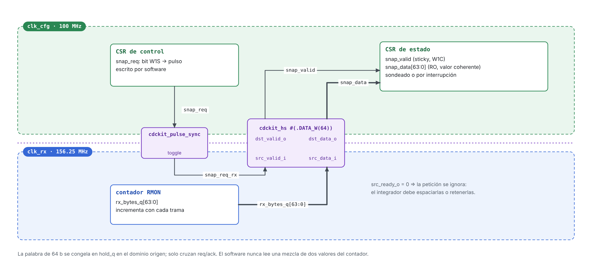
*Figura 13 — Integración de referencia: snapshot coherente de un contador de 64 b.*

El software escribe un bit de control (`snap_req`), espera `snap_valid` (o lo sondea en un registro de estado) y lee el valor coherente de 64 b. Si `snap_req_rx` llega con `src_ready_o = 0`, la petición se ignora. El integrador DEBE impedir peticiones con esa frecuencia, o retenerlas hasta `src_ready_o = 1`.

## Anexo C — Glosario

| Término | Definición |
|---|---|
| CDC | *Clock Domain Crossing*: transferencia de una señal entre flip-flops con relojes sin relación de fase garantizada. |
| RDC | *Reset Domain Crossing*: camino entre flip-flops con resets asíncronos distintos. |
| FWFT | *First-Word Fall-Through*: el dato en cabeza está disponible en la salida sin un ciclo de lectura previo. |
| Gray | Código en el que dos valores consecutivos difieren en un solo bit. |
| Metaestabilidad | Estado intermedio de un biestable cuya resolución a 0 o 1 tiene un tiempo no acotado. |
| MTBF | *Mean Time Between Failures* de un sincronizador. |
| Bundled data | Esquema en el que un bus de datos estable acompaña a una señal de control sincronizada. |
| Reconvergencia | Combinación de señales sincronizadas por separado que pueden llegar en ciclos distintos. |
| Recovery / removal | Restricciones temporales de liberación de un reset asíncrono respecto al flanco de reloj. |
| XDC | *Xilinx Design Constraints*: formato de restricciones de Vivado, basado en SDC. |
| XPM | *Xilinx Parameterized Macros*: macros de Vivado para CDC (`xpm_cdc_*`), memorias y FIFOs. |
| LUTRAM | RAM distribuida construida con LUTs del CLB; admite lectura asíncrona. |
| OOC | *Out-of-context*: síntesis de un módulo sin buffers de E/S, como bloque aislado. |
| WNS / WHS / TPWS | *Worst Negative Slack* (setup), *Worst Hold Slack* y *Total Pulse Width Slack*. |
| Waiver | Justificación registrada (`create_waiver`) que acepta un resultado de `report_cdc` o de metodología. |

## Anexo D — Referencias

1. IEEE Std 1800-2017, *SystemVerilog — Unified Hardware Design, Specification, and Verification Language*.
2. C. E. Cummings, *Simulation and Synthesis Techniques for Asynchronous FIFO Design*, SNUG San Jose, 2002.
3. C. E. Cummings, *Clock Domain Crossing (CDC) Design & Verification Techniques Using SystemVerilog*, SNUG Boston, 2008.
4. R. Ginosar, “Metastability and Synchronizers: A Tutorial”, *IEEE Design & Test of Computers*, 2011.
5. AMD, *FIFO Generator LogiCORE IP Product Guide* (PG057), y *Embedded FIFO Generator LogiCORE IP Product Guide* (PG327): estructura de puertos por dominio, flags `overflow` / `underflow`, contadores de datos.
6. lowRISC / OpenTitan, *Comportability Definition and Specification* y plantilla de especificación de IP (Overview, Features, Theory of Operation, Hardware Interfaces, Design Details); primitivas `prim_flop_2sync`, `prim_pulse_sync`, `prim_fifo_async` (parámetro `OutputZeroIfEmpty`).
7. IETF RFC 2119, *Key words for use in RFCs to Indicate Requirement Levels*.
8. AMD, *Vivado Design Suite User Guide: Logic Simulation* (UG900): soporte de SystemVerilog y SVA en xsim, UVM, cobertura de código.
9. AMD, *Vivado Design Suite User Guide: Synthesis* (UG901): RTL Linter, atributos `ASYNC_REG`, `DONT_TOUCH`, `FSM_ENCODING`.
10. AMD, *Vivado Design Suite User Guide: Using Constraints* (UG903): prioridad de excepciones, `set_bus_skew`, `ASYNC_REG`.
11. AMD, *Vivado Design Suite User Guide: Design Analysis and Closure Techniques* (UG906): `report_cdc` y sus reglas.
12. AMD, *UltraFast Design Methodology Guide* (UG949): restricciones de CDC y precedencia sobre `set_max_delay`.
13. AMD, *Vivado Design Suite Tcl Command Reference* (UG835): `report_cdc`, `create_waiver`, `report_synchronizer_mtbf`.
14. AMD, *UltraScale Architecture Libraries Guide* (UG974): macros `xpm_cdc_*` y `xpm_fifo_async`.
15. AMD, *Vivado Design Suite User Guide: Release Notes, Installation, and Licensing* (UG973): dispositivos incluidos en la edición gratuita.
16. AMD, *7 Series FPGAs Configurable Logic Block User Guide* (UG474): RAM distribuida (`RAM32M`), SLICEM.