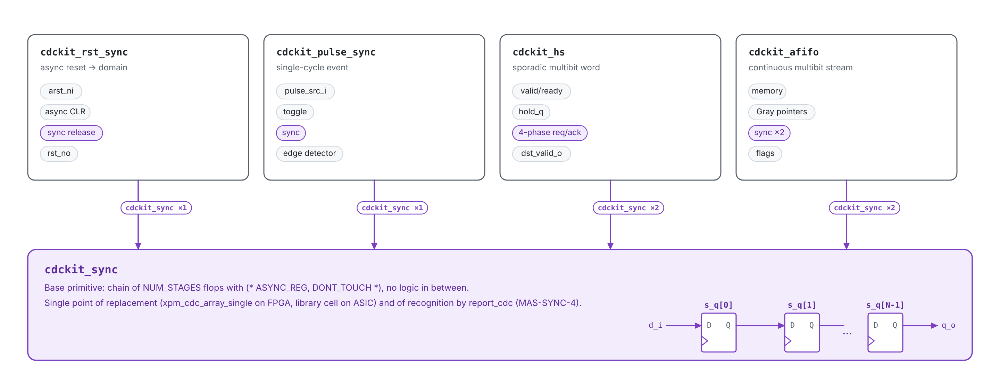
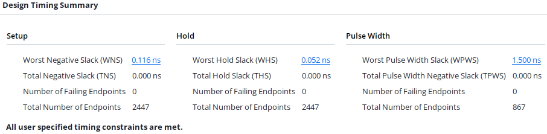
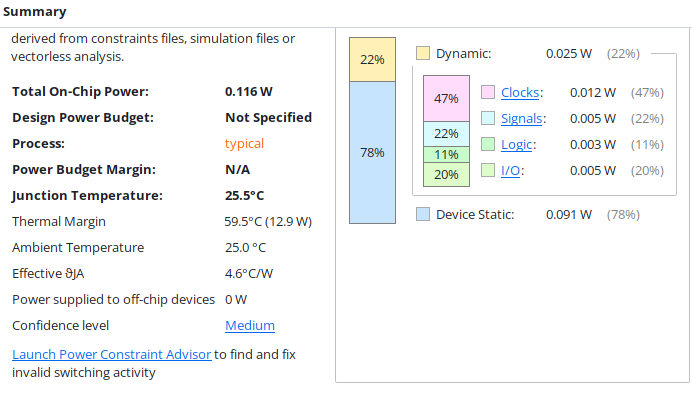

# CDC-Kit — Clock Domain Crossing Toolkit

Synthesizable SystemVerilog library for moving data safely between unrelated clock domains, targeting AMD Artix-7 (`xc7a100tcsg324-1`). It is the MAC ↔ core interface block of NetSwitch-4, a mini Ethernet switch portfolio project.

**Status:** RTL complete and smoke-tested. UVM verification is next. Results below are preliminary.



## Progress

```text
── Phase 1 · Spec & Planning ──
✅[AI] Generate the spec draft for CDC-Kit: features, interfaces, parameters, clocks, resets, performance targets
✅Review and freeze the spec, assigning requirement IDs (FUNC, PARAM, CLK, RST, PERF, INTG, MAS), i.e [FUNC-3]
✅Write the micro-architecture (MAS): block diagram, FSMs, timing diagrams, latency/throughput budget, Artix-7 resource estimate
✅[AI] Ask AI to check the spec and MAS for ambiguities, untestable or missing requirements

── Phase 2 · RTL ──
✅Writing the RTL
✅[AI] Tag each requirement in the code using the format i.e // [MAS-RST-1]
✅ [AI] Write the XDC constraints (clocks, clock groups, set_max_delay -datapath_only for CDC, I/O delays)
✅ Compile and elaborate on Vivado (xvlog/xelab) for syntax errors
✅ [AI] RTL syntax and recommendations review from AI (synthesizability, latches, CDC/RDC, resets, critical paths)
✅ Lint with Vivado and fix errors
✅ [AI] Help describe the waive for every warning with a justification and document all the Lint descitions and results
✅ [AI] Ask AI to check all requirement IDs are implemented and tagged in RTL/SVA, and flag missing ones
✅ Write the SVA (protocol, invariants, CDC)
✅[AI] Generate a directed smoke test to validate basic functionality before UVM
✅Check if the smoke test pass
✅ Document all the smoke test results at rtl README
✅ Run an out-of-context synthesis and check report_cdc, report_methodology and inference warnings ↺
✅ Document all the important reports at the repo README and the rtl README, including images of preliminary Power, Timing and Utilization

── Phase 3 · UVM Verification ──
Generate the testplan FROM THE SPEC in a xml file: scenarios, checkers, SVA list and coverpoints, each mapped to a requirement ID
[AI] Ask AI to check testplan and do upgrades and corrections (corner cases, weak checkers, coverage holes)
UVM environment generation (agents, independent reference model, scoreboard, coverage, base test)
[AI] UVM syntax and recommendations review from AI (phasing, objections, races, factory/config_db, model independence)
Write the tests, sequences and plusargs from the testplan
[AI] Ask AI to check and comment all the tests, plusargs and verification requirements on the code, and check if there's missing requirements
Simulate on Vivado (xsim) the base test for syntax errors
Run the random-seed regression and fix RTL/TB bugs found ↺
Run the bug-injection campaign (BUG parameter): every injected bug must be caught by a checker
Merge and analyze code + functional coverage (xcrg) ↺
[AI] Ask AI to review coverage holes and propose closure (new constraints, tests or justified exclusions)
(Optional) Formal proof of key properties with SymbiYosys

── Phase 4 · Implementation ──
Synthesis and implementation on Vivado for xc7a100tcsg324-1 at the target frequency
Timing closure: WNS/TNS/WHS ≥ 0, clean report_cdc, no critical methodology warnings ↺
[AI] Ask AI to review synthesis/implementation reports (critical paths, inferred BRAM/SRL/DSP, optimizations)
Generate the bitstream
(If board available) Validate on hardware with a demo wrapper + ILA

── Phase 5 · Signoff & Documentation ──
Report PPA: Fmax, LUT/FF/BRAM/DSP, report_power, latency/throughput, coverage %, bugs caught
Fill the traceability matrix (requirement → RTL → SVA → test → coverpoint → status)
[AI] Write the README, Overview and Key Contributions & Architecture
Write the interview notes: design decisions, trade-offs, bug-injection results
Tag the release in git (v1.0) and archive the reports
```

## Primitives

| Module | Carries | Technique |
|---|---|---|
| `cdckit_sync` | Level or independent bits | 2–4 stage `ASYNC_REG` synchronizer, single replacement point for all crossings |
| `cdckit_rst_sync` | Reset | Asynchronous assertion, synchronous release |
| `cdckit_pulse_sync` | Single-cycle events | Toggle crossing, with an arm window that blocks false pulses after a destination reset |
| `cdckit_hs` | Sporadic multibit words | 4-phase handshake, holding register, recovery from source-only resets |
| `cdckit_afifo` | Continuous streams | Gray pointers, first-word fall-through, conservative flags, LUTRAM storage |

## Key features

- 1 word/cycle sustained FIFO throughput per port, by design.
- Parameterized width, depth, thresholds and synchronizer stages, with elaboration-time checks.
- Requirement IDs frozen in a spec and tagged in the RTL.
- Crossing table with the expected `report_cdc` rule for each crossing.
- Self-checking LFSR implementation harness that exercises all five primitives.

## Results

| Metric | Result | Tool |
|---|---|---|
| Timing, per clock domain | Closes at 156.25 / 250 MHz: WNS +0.116 ns, WHS +0.052 ns | Vivado 2026.1 |
| CDC structure | 0 Critical in `report_cdc`; all Warnings are expected crossing types | Vivado 2026.1 |
| RTL lint | 7 findings, all justified and waived; 0 RTL changes | Vivado 2026.1 |
| Smoke test | 6 of 6 directed tests pass | xsim 2026.1 |
| Functional coverage | Pending (Phase 3) | — |
| Fmax | Pending (Phase 4) | — |

Timing does not yet bound the crossing paths; that is closed in Phase 4.



### Power (preliminary)

Vectorless estimate that includes the harness: 25 mW dynamic, 91 mW device static.



### Utilization (reference configuration)

| Module | LUT | LUTRAM | FF |
|---|---|---|---|
| `cdckit_afifo` (72 × 32) | 45 | 48 | 66 |
| `cdckit_hs` (64 b) | 4 | 0 | 137 |
| `cdckit_pulse_sync` | — | 0 | 9 |
| `cdckit_rst_sync` | — | 0 | 2 |

LUT counts of the two smallest primitives are pending; their FF counts are from synthesis.

## Project status

| Phase | Status |
|---|---|
| 1. Spec and micro-architecture | Done |
| 2. RTL | Done |
| 3. UVM verification | Not started |
| 4. Implementation | Preliminary run done |
| 5. Sign-off | Not started |

## Repository

| Path | Contents |
|---|---|
| [`rtl/`](rtl/) | RTL, SVA checkers and the [full specification, detailed results](rtl/README.md) |
| [`constraints/`](constraints/) | XDC constraints |
| [`impl/`](impl/) | Implementation harness |
| [`tb/`](tb/) | Directed smoke test |

**Disclaimer: The **design specifications and functional requirements** in this documentation were generated, structured, and refined using AI-assisted tools to emulate client-side specifications and streamline the microarchitecture planning stage.
