# CDCKIT — Clock Domain Crossing Toolkit
## Hardware Architecture Specification (HAS) & Micro-Architecture Specification (MAS)

| Field | Value |
|---|---|
| Document | CDCKIT-SPEC-001 |
| Revision | 1.0 — requirements baseline **frozen** 2026-11-05 |
| IP | `cdckit` — Library of CDC primitives + parameterizable asynchronous FIFO |
| IP version | 1.0 (target) |
| Parent project | NetSwitch-4 — MAC ↔ core interface block |
| Reference platform | AMD Vivado ML Standard Edition (free) · Artix-7 `xc7a100tcsg324-1` |

---

## Implementation results

**Preliminary.** Measured on `impl/cdckit_impl_top.sv` (§16.4) with Vivado 2026.1, Artix-7 `xc7a100tcsg324-1`, reference configuration (§1.3), before functional verification. Final figures are reported in Phase 5.

### Timing

Post-route, `wclk` = 156.25 MHz (6.4 ns), `rclk` = 250 MHz (4.0 ns).

| Metric | Worst slack | Total negative | Failing endpoints | Endpoints |
|---|---|---|---|---|
| Setup (WNS / TNS) | +0.116 ns | 0.000 ns | 0 | 2447 |
| Hold (WHS / THS) | +0.052 ns | 0.000 ns | 0 | 2447 |
| Pulse width (WPWS / TPWS) | +1.500 ns | 0.000 ns | 0 | 867 |

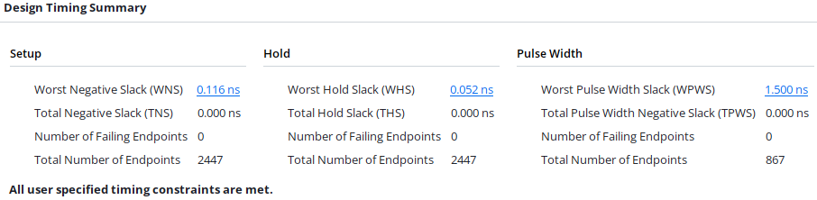

These figures cover paths inside each clock domain. `wclk` and `rclk` are asynchronous clock groups, which override the `set_max_delay -datapath_only` exceptions (TIMING-24), so crossing routes are not bounded by them. Bus skew has not been confirmed post-route. Fmax has not been measured ([PERF-6]).

### CDC and methodology

Out-of-context synthesis of the harness with Vivado 2026.1: `report_cdc` shows 0 Critical findings (CDC-3 ×3, CDC-9 ×2, CDC-6 ×2, CDC-15 ×64, CDC-26 ×72), matching §15.2. The only methodology finding is TIMING-24 ×7, caused by the clock groups. Synthesis infers no latches, 0 SRLs and 0 Block RAMs. Waivers are pending until the RTL is stable.

### Power

Vectorless estimate that includes the harness: 25 mW dynamic and 91 mW device static, confidence Medium. It is not a measurement of the IP.

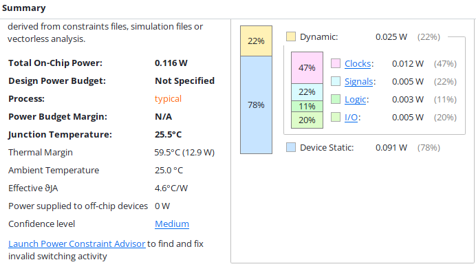

### Utilization

| Module | Slice LUTs | LUT as logic | LUT as memory | Slice registers | Slices |
|---|---|---|---|---|---|
| `u_afifo` (72 × 32) | 93 | 45 | 48 | 66 | 36 |
| `u_hs` (64 b) | 4 | 4 | 0 | 137 | 42 |
| **`cdckit_impl_top`** (includes harness) | 172 (0.27 %) | 124 | 48 | 769 (0.61 %) | 219 (1.38 %) |

`u_pulse`, `u_rst_r` and `u_rst_w` fall below the display threshold of this report. Together they use 13 FF in synthesis: 9 in `u_pulse` and 2 in each reset synchronizer.

The `cdckit_afifo` flip-flop and LUTRAM counts match the estimate of Table 18-1 exactly (66 FF, 12 × `RAM32M`). The harness accounts for most of the total, so only the per-module rows describe the IP.

### Lint waivers

Vivado RTL Linter reports 7 findings, all waived. No RTL change was required.

| Rule | Location | Class | Justification |
|---|---|---|---|
| ASSIGN-1 | `cdckit_afifo_rptr.sv:47` | Intentional | `rlevel_d` is a subtraction modulo 2^(AW+1) (§14.3); dropping the carry is what handles pointer wrap-around. |
| ASSIGN-1 | `cdckit_afifo_wptr.sv:52` | Intentional | `wlevel_d`, same as above (§14.2). |
| ASSIGN-5 | `cdckit_impl_top.sv:25` | False positive | `next_data` returns a concatenation that drives every bit. |
| ASSIGN-5 | `cdckit_impl_top.sv:30` | False positive | `next_gate` returns a concatenation that drives every bit. |
| ASSIGN-5 | `cdckit_impl_top.sv:130` | False positive | `next_hs` returns a concatenation that drives every bit. |
| ASSIGN-5 | `cdckit_pkg.sv:11` | False positive | `bin2gray` returns a full-width expression. |
| ASSIGN-5 | `cdckit_pkg.sv:16` | False positive | `gray2bin` assigns the MSB directly and every other bit in its loop. |

### Smoke test

`tb/cdckit_smoke_tb.sv`: directed test run in xsim (Vivado 2026.1) with `wclk` = 156.25 MHz and `rclk` = 250 MHz. **Result: `SMOKE TEST PASSED`**, 0 errors, 25.1 µs of simulated time.

| Test | Scope | Result |
|---|---|---|
| `test_reset` | `cdckit_rst_sync` assertion and release; FIFO state after reset | Pass |
| `test_fifo_fill_drain` | Fill to `DEPTH`, `full_o`, overflow, ordered drain, `empty_o`, underflow | Pass |
| `test_fifo_stream` | 300 words, concurrent read and write with random gaps | Pass |
| `test_hs` | 16 words through `cdckit_hs` | Pass |
| `test_pulse` | 16 events through `cdckit_pulse_sync` | Pass |
| `test_harness` | `cdckit_impl_top` traffic for 20 µs, `err_o` = 0 | Pass |

Scope limits: one clock ratio, no metastability injection, no single-domain resets, and SVA checkers not attached. These are covered in Phase 3.

---

## Table of contents

- [Implementation results](#implementation-results)
- [Progress](#progress)

**Part I — Hardware Architecture Specification (HAS)**

1. [Introduction](#1-introduction)
2. [Feature summary](#2-feature-summary)
3. [Functional description](#3-functional-description)
4. [Hardware interfaces](#4-hardware-interfaces)
5. [Configuration parameters](#5-configuration-parameters)
6. [Clocks and resets](#6-clocks-and-resets)
7. [Performance and latency](#7-performance-and-latency)
8. [Integration requirements](#8-integration-requirements)

**Part II — Micro-Architecture Specification (MAS)**

9. [Module hierarchy](#9-module-hierarchy)
10. [`cdckit_sync`](#10-cdckit_sync--level-synchronizer)
11. [`cdckit_rst_sync`](#11-cdckit_rst_sync--reset-synchronizer)
12. [`cdckit_pulse_sync`](#12-cdckit_pulse_sync--pulse-synchronizer-toggle)
13. [`cdckit_hs`](#13-cdckit_hs--multibit-transfer-via-4-phase-handshake)
14. [`cdckit_afifo`](#14-cdckit_afifo--asynchronous-fifo)
15. [CDC intent and crossing table](#15-cdc-intent-and-crossing-table)
16. [Timing constraints (XDC)](#16-timing-constraints-xdc)
17. [Design assertions](#17-design-assertions)
18. [Resources, power and ASIC portability](#18-resources-power-and-asic-portability)
19. [Requirements traceability matrix](#19-requirements-traceability-matrix)
20. [Open issues](#20-open-issues)

**Annexes**

- [A. MTBF analysis](#annex-a--mtbf-analysis)
- [B. Reference integration: 64-bit counter snapshot](#annex-b--reference-integration-64-bit-counter-snapshot)
- [C. Glossary](#annex-c--glossary)
- [D. References](#annex-d--references)

---

## Document conventions

**Signal naming.**

| Suffix / prefix | Meaning |
|---|---|
| `_i` / `_o` | Module input / output. |
| `_ni` / `_no` | Active-low input / output. |
| `_q` | Register (flip-flop) output. |
| `_d` | Register D input (next value). |
| `_s` | Output of a `cdckit_sync` instance (synchronized copy). |
| `current_state` / `nxt_state` | FSM state register / next-state value (used instead of `_q` / `_d` for FSMs). |
| `w*` / `r*` | FIFO write / read domain. |
| `src_*` / `dst_*` | Source / destination domain. |

**Units.** `T_x` denotes the period of clock `x`; `N` denotes `NUM_STAGES`. Latencies are expressed in active (rising) edges of the indicated clock, counted from the reference event: "edge 1" is the first edge strictly after the event, so the *k*-th edge occurs no later than `k·T` after it.

**Requirement keywords.** MUST, MUST NOT, SHOULD and MAY are used as defined in RFC 2119. Only MUST / MUST NOT statements are pass/fail criteria for sign-off; SHOULD statements are measured and reported.

**Requirement identifiers.** Normative requirements carry a bracketed identifier `[CAT-n]`, with `CAT` ∈ {`FUNC`, `PARAM`, `CLK`, `RST`, `PERF`, `INTG`} for the HAS and `MAS-<block>-n` for micro-architecture decisions (`<block>` ∈ {`SYNC`, `RST`, `PLS`, `HS`, `AF`, `XDC`}). Since baseline 1.0 the identifiers are frozen: an identifier is never renumbered or reused; a withdrawn requirement is kept in place and marked *Retired*. Other identifiers are not requirements: `CDC-Xnn` (crossings, §15), `SVA-nn` (assertions, §17), `OI-nn` (open issues, §20), `R-nn` (review findings, §20.2).

---

# PART I — HARDWARE ARCHITECTURE SPECIFICATION

## 1. Introduction

### 1.1 Scope

`cdckit` is a library of five synthesizable primitives for safely transferring information between clock domains with no frequency or phase relationship:

| Module | Signal class it carries |
|---|---|
| `cdckit_sync` | 1-bit level, or mutually independent bits. |
| `cdckit_rst_sync` | Asynchronous reset into a clock domain. |
| `cdckit_pulse_sync` | Single-cycle events (pulses). |
| `cdckit_hs` | Sporadic multibit word (configuration, snapshots). |
| `cdckit_afifo` | Continuous stream of multibit words. |

**Out of scope for version 1.0:**

- Asynchronous FIFO on Block RAM (v1.0 uses distributed RAM, LUTRAM, only; see OI-01).
- Non-power-of-2 depths.
- Data-width conversion between ports.
- ECC or parity protection of the memory.
- Independent single-domain reset of the FIFO (see §6.3 and OI-02).
- Rate compensation between domains of equal nominal frequency (idle insertion or removal).
- ASIC implementation. The RTL is kept portable (DFT and isolation requirements as informative, §18.3), but v1.0 is only verified and implemented on FPGA.
- Formal verification (the reference platform does not include a formal engine; see OI-08).

### 1.2 System context

In NetSwitch-4, `cdckit_afifo` decouples each MAC RX (recovered clock at 156.25 MHz, ±100 ppm) from the core (250 MHz). The remaining primitives carry link status, flow-control events and counter snapshots to the configuration domain (100 MHz).

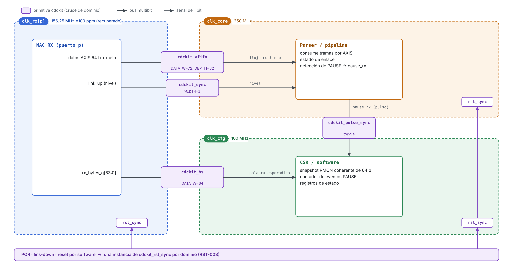
*Figure 1 — Use of `cdckit` in NetSwitch-4.*

### 1.3 Reference configuration

Unless stated otherwise, the figures and numerical examples in this document use the NetSwitch-4 reference configuration:

| Parameter | Value |
|---|---|
| `DATA_W` (FIFO) | 72 (64 b of data + 8 b of `tkeep` / `tlast` / `tuser`) |
| `DEPTH` | 32 |
| `NUM_STAGES` | 2 |
| `wclk` (FIFO) | 156.25 MHz (T = 6.4 ns), MAC RX |
| `rclk` (FIFO) | 250 MHz (T = 4.0 ns), core |
| `cdckit_hs` | `DATA_W = 64`, `clk_src` = 156.25 MHz (MAC RX) → `clk_dst` = 100 MHz (configuration) |
| `cdckit_pulse_sync` | `clk_src` = 100 MHz (configuration) → `clk_dst` = 156.25 MHz (MAC RX) |
| Device | Artix-7 `xc7a100tcsg324-1` (speed grade -1) |
| Tools | Vivado ML Standard Edition 2026.1 |

---

## 2. Feature summary

- Five CDC primitives with a structure recognizable by Vivado `report_cdc` (synchronizers marked with `ASYNC_REG`) and by commercial CDC tools.
- All synchronizers are implemented through **a single primitive** (`cdckit_sync`). This allows replacing it with Vivado's `xpm_cdc_array_single` macro, or with a library synchronizer cell in ASIC, without modifying the rest of the RTL.
- Configurable number of synchronization stages (2 to 4).
- Reset synchronizer with asynchronous assertion and synchronous deassertion.
- Toggle-based pulse synchronizer, with no combinational path between domains and an arm window that suppresses false events after a destination reset.
- Multibit transfer through a 4-phase handshake with a valid/ready interface on the source side, a holding register, and safe recovery from single-domain resets.
- Asynchronous FIFO:
  - **registered** Gray pointers synchronized to the opposite domain;
  - *first-word fall-through* (FWFT) semantics;
  - conservative `full` / `empty` flags, guaranteed free of overflow and underflow;
  - `almost_full` / `almost_empty` thresholds programmable by parameter;
  - per-domain occupancy counters;
  - `overflow` / `underflow` indicators (write attempt with the FIFO full, or read attempt with the FIFO empty);
  - option to force `rd_data_o` to zero when the FIFO is empty.
- Sustained throughput of 1 word per cycle on both ports.
- Embedded SVA assertions (disabled in synthesis) for the critical invariants.
- CDC crossing table, expected `report_cdc` classification and module-scoped XDC constraints (§15, §16).
- Documented equivalence with Vivado XPM macros, which serve as the resource and Fmax reference (Table 8-1).

---

## 3. Functional description

### 3.1 IP block diagram

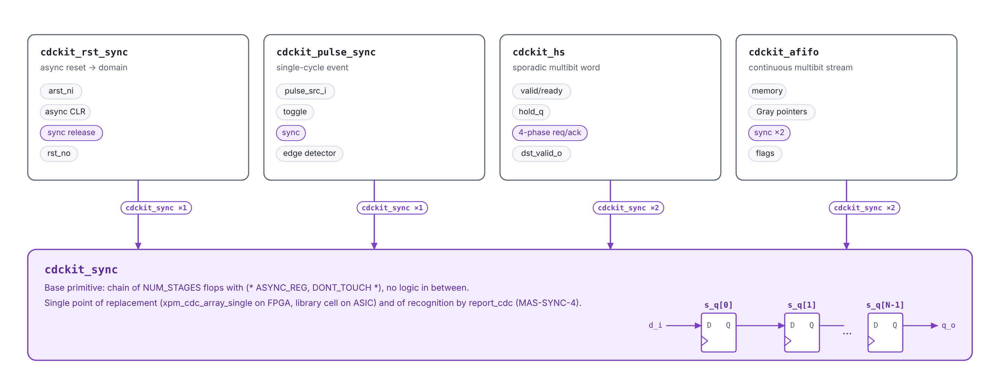
*Figure 2 — IP composition. All synchronization goes through `cdckit_sync`.*

### 3.2 Primitive selection

The IP does not decide which primitive to use; that decision belongs to the integrator. Table 3-1 is the normative selection guide.

| Signal characteristic | Primitive | Usage restriction |
|---|---|---|
| 1-bit level, slowly changing relative to `clk_dst` | `cdckit_sync` (`WIDTH=1`) | The signal MUST come from a flip-flop in the source domain ([INTG-1]). |
| Several mutually **independent** bits | `cdckit_sync` (`WIDTH=N`) | MUST NOT be used if the bits are interpreted together ([INTG-2]). |
| Single-cycle event | `cdckit_pulse_sync` | Minimum spacing between events ([PERF-3]). |
| Sporadic multibit word | `cdckit_hs` | Rate ≤ 1 / T_hs ([PERF-4]). |
| Continuous multibit stream | `cdckit_afifo` | — |
| Asynchronous reset | `cdckit_rst_sync` | One instance per clock domain ([RST-3]). |

*Table 3-1 — Primitive selection by signal class.*

### 3.3 Functional requirements

| ID | Requirement |
|---|---|
| [FUNC-1] | Every **control** signal that crosses between domains inside `cdckit` (pointers, `req`, `ack`, toggle levels) MUST pass through an instance of `cdckit_sync`. Multibit **data** MAY cross without a synchronizer only through the qualified paths listed in §15 (CDC-X06, CDC-X09), whose stability at the sampling instant is guaranteed by a synchronized control signal. |
| [FUNC-2] | `cdckit_sync` MUST NOT contain combinational logic between its stages. |
| [FUNC-3] | `cdckit_rst_sync` MUST assert `rst_no` without depending on `clk_i`, and MUST release it synchronously to `clk_i` between the `N`-th and the `(N+1)`-th `clk_i` edge after the rising edge of `arst_ni`. |
| [FUNC-4] | `cdckit_pulse_sync` MUST generate exactly one `pulse_dst_o` pulse, one `clk_dst_i` cycle wide, for each `clk_src_i` cycle in which `pulse_src_i = 1`, provided [PERF-3] is met and the event does not fall inside the arm window ([MAS-PLS-5]). |
| [FUNC-5] | `cdckit_hs` MUST deliver at the destination the exact word accepted at the source, with no intermediate values or mixed bits. |
| [FUNC-6] | `cdckit_hs` MUST NOT accept a new word (`src_ready_o = 0`) until all four phases of the previous transfer have completed, as observed in the source domain (`ack_s` = 0). |
| [FUNC-7] | `cdckit_afifo` MUST deliver words in the same order in which they were written, with no loss or duplication. |
| [FUNC-8] | `cdckit_afifo` MUST NOT write to memory when `full_o = 1`, nor advance the read pointer when `empty_o = 1`. Each `wclk_i` cycle with `wr_en_i = 1` and `full_o = 1` MUST assert `wr_overflow_o` for exactly one cycle on the next `wclk_i` edge; likewise `rd_underflow_o` for `rd_en_i = 1` and `empty_o = 1`. A request held for *k* cycles produces *k* consecutive cycles of the indicator. |
| [FUNC-9] | Flags and levels MUST be conservative: at every `wclk_i` edge, `wr_level_o` ≥ real occupancy; at every `rclk_i` edge, `rd_level_o` ≤ real occupancy. Consequently `full_o = 1` whenever the FIFO is really full and `empty_o = 1` whenever it is really empty; the flags may assert earlier and deassert later than the real state, within the bounds of [PERF-8]. |
| [FUNC-10] | `rd_data_o` MUST present the word at the head of the FIFO in every cycle with `empty_o = 0` (FWFT). |
| [FUNC-11] | With `OUTPUT_ZERO_IF_EMPTY = 1`, `rd_data_o` MUST be zero while `empty_o = 1`. |
| [FUNC-12] | After reset, the FIFO MUST present `empty_o = 1`, `almost_empty_o = 1`, `full_o = 0`, `almost_full_o = 0`, `wr_level_o = 0`, `rd_level_o = 0`, `wr_overflow_o = 0` and `rd_underflow_o = 0`. |
| [FUNC-13] | All flag and status outputs of `cdckit_afifo` (`full_o`, `almost_full_o`, `wr_level_o`, `wr_overflow_o`, `empty_o`, `almost_empty_o`, `rd_level_o`, `rd_underflow_o`) MUST be driven directly by flip-flops. `rd_data_o` is exempt: it is the asynchronous LUTRAM read of the registered address `rbin_q` (plus one masking gate with `OUTPUT_ZERO_IF_EMPTY = 1`). |
| [FUNC-14] | `src_ready_o` of `cdckit_hs` MUST be driven directly by a state flip-flop and MUST NOT depend combinationally on any input. |
| [FUNC-15] | The flags of `cdckit_afifo` MUST be consistent with the levels of the same domain in every cycle: `full_o = (wr_level_o == DEPTH)`, `almost_full_o = (wr_level_o ≥ AF_THRESH)`, `empty_o = (rd_level_o == 0)`, `almost_empty_o = (rd_level_o ≤ AE_THRESH)`. |
| [FUNC-16] | `dst_valid_o` of `cdckit_hs` MUST be one `clk_dst_i` cycle wide per delivered word; `dst_data_o` MUST change only on the edge that asserts `dst_valid_o` and hold its value until the next delivery. |

### 3.4 Theory of operation

**Level synchronization.** A signal sampled asynchronously can drive the first flip-flop into a metastable state. The following stages provide resolution time before the value reaches functional logic. The failure probability decreases exponentially with that time (Annex A).

**Pulses.** A source pulse may be shorter than the destination period. It is therefore converted into a level transition (toggle), the level is synchronized, and the pulse is rebuilt at the destination by edge detection.

**Sporadic words.** The word is frozen in a holding register in the source domain. Only the `req` / `ack` control signals are synchronized. The protocol guarantees that the data is stable whenever the destination samples it.

**Continuous streams.** Data is written into a memory with the write clock and read with the read clock. Only the pointers cross, Gray-encoded: a single bit changes between consecutive values, so a capture during the transition returns either the old or the new value, never an invalid one. The synchronization delay makes each domain see the remote pointer late, so the flags are conservative.

---

## 4. Hardware interfaces

Table columns: **Dir** = direction, **Dom.** = clock domain, **Reset** = value during reset.

### 4.1 `cdckit_sync`

| Signal | Dir | Width | Dom. | Reset | Description |
|---|---|---|---|---|---|
| `clk_i` | in | 1 | — | — | Destination clock. |
| `rst_ni` | in | 1 | `clk_i` | — | Active-low asynchronous reset, already synchronized to the destination domain. |
| `d_i` | in | `WIDTH` | async | — | Input to synchronize. MUST come directly from a flip-flop ([INTG-1]). |
| `q_o` | out | `WIDTH` | `clk_i` | `RESET_VAL` | Synchronized output. |

### 4.2 `cdckit_rst_sync`

| Signal | Dir | Width | Dom. | Reset | Description |
|---|---|---|---|---|---|
| `clk_i` | in | 1 | — | — | Clock of the domain receiving the reset. |
| `arst_ni` | in | 1 | async | — | Asynchronous reset source (POR, link-down, software). MUST be glitch-free ([INTG-9]). |
| `rst_no` | out | 1 | `clk_i` | 0 | Domain reset: asynchronous assertion, synchronous deassertion. |

### 4.3 `cdckit_pulse_sync`

| Signal | Dir | Width | Dom. | Reset | Description |
|---|---|---|---|---|---|
| `clk_src_i` | in | 1 | — | — | Source clock. |
| `rst_src_ni` | in | 1 | `clk_src_i` | — | Source domain reset. |
| `pulse_src_i` | in | 1 | `clk_src_i` | — | Event: each cycle at 1 is one event. Consecutive events MUST respect [PERF-3]. |
| `clk_dst_i` | in | 1 | — | — | Destination clock. |
| `rst_dst_ni` | in | 1 | `clk_dst_i` | — | Destination domain reset. |
| `pulse_dst_o` | out | 1 | `clk_dst_i` | 0 | Single-cycle pulse for each source event. Registered. |

### 4.4 `cdckit_hs`

| Signal | Dir | Width | Dom. | Reset | Description |
|---|---|---|---|---|---|
| `clk_src_i` | in | 1 | — | — | Source clock. |
| `rst_src_ni` | in | 1 | `clk_src_i` | — | Source domain reset. |
| `src_valid_i` | in | 1 | `clk_src_i` | — | Word available. |
| `src_ready_o` | out | 1 | `clk_src_i` | **0** | The IP can accept a word. State flip-flop. Rises `N+1` to `N+2` `clk_src_i` edges after reset release ([MAS-HS-7]). |
| `src_data_i` | in | `DATA_W` | `clk_src_i` | — | Word to transfer. Captured in the `src_valid_i && src_ready_o` cycle. |
| `clk_dst_i` | in | 1 | — | — | Destination clock. |
| `rst_dst_ni` | in | 1 | `clk_dst_i` | — | Destination domain reset. |
| `dst_valid_o` | out | 1 | `clk_dst_i` | 0 | Single-cycle pulse: `dst_data_o` holds a new word. |
| `dst_data_o` | out | `DATA_W` | `clk_dst_i` | 0 | Last word received. Stable until the next transfer. |

Source-side protocol: AMBA **valid/ready**. `src_valid_i` MUST NOT depend on `src_ready_o`; once asserted, `src_valid_i` and `src_data_i` MUST remain stable until the transfer occurs (SVA-11). The transfer occurs on the edge where both are 1. The destination side has no backpressure ([INTG-11]).

### 4.5 `cdckit_afifo`

**Write port (`wclk_i` domain)**

| Signal | Dir | Width | Reset | Description |
|---|---|---|---|---|
| `wclk_i` | in | 1 | — | Write clock. |
| `wrst_ni` | in | 1 | — | Write domain reset (see [RST-4]). |
| `wr_en_i` | in | 1 | — | Write request. Ignored if `full_o = 1`. |
| `wr_data_i` | in | `DATA_W` | — | Data to write. Sampled in the cycle with `wr_en_i = 1` and `full_o = 0`. |
| `full_o` | out | 1 | 0 | FIFO full (conservative). Registered. |
| `almost_full_o` | out | 1 | 0 | `wr_level_o ≥ AF_THRESH`. Registered. |
| `wr_level_o` | out | `AW+1` | 0 | Occupancy seen from the write domain (≥ real occupancy). |
| `wr_overflow_o` | out | 1 | 0 | One cycle per rejected write, one cycle after it ([FUNC-8]). Registered. |

**Read port (`rclk_i` domain)**

| Signal | Dir | Width | Reset | Description |
|---|---|---|---|---|
| `rclk_i` | in | 1 | — | Read clock. |
| `rrst_ni` | in | 1 | — | Read domain reset (see [RST-4]). |
| `rd_en_i` | in | 1 | — | Consumes the head word. Ignored if `empty_o = 1`. |
| `rd_data_o` | out | `DATA_W` | — / 0 | Head word (FWFT). Zero if `OUTPUT_ZERO_IF_EMPTY = 1` and `empty_o = 1`; otherwise undefined while `empty_o = 1` (X in simulation before the first write). Not registered ([FUNC-13]). |
| `empty_o` | out | 1 | 1 | FIFO empty (conservative). Registered. |
| `almost_empty_o` | out | 1 | 1 | `rd_level_o ≤ AE_THRESH`. Registered. |
| `rd_level_o` | out | `AW+1` | 0 | Occupancy seen from the read domain (≤ real occupancy). |
| `rd_underflow_o` | out | 1 | 0 | One cycle per rejected read, one cycle after it ([FUNC-8]). Registered. |

`AW = $clog2(DEPTH)`.

### 4.6 Interface requirements

The interface requirements of the draft (INTF-*) are folded into the frozen categories: design-side obligations are [FUNC-13] and [FUNC-14]; integrator-side obligations are [INTG-1] and [INTG-7]. Timing of the request inputs (`wr_en_i`, `rd_en_i`) is budgeted in [INTG-12].

### 4.7 Timing diagrams

**Write into an empty FIFO and first read** (`NUM_STAGES = 2`, `rclk` faster than `wclk`)

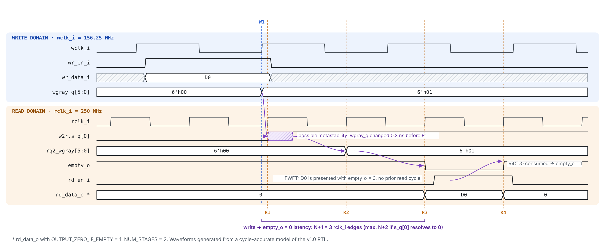
*Figure 3 — Write→read latency: `N+1` to `N+2` `rclk` edges after the `wclk` edge that accepts the write.*

**Transfer through `cdckit_hs`**

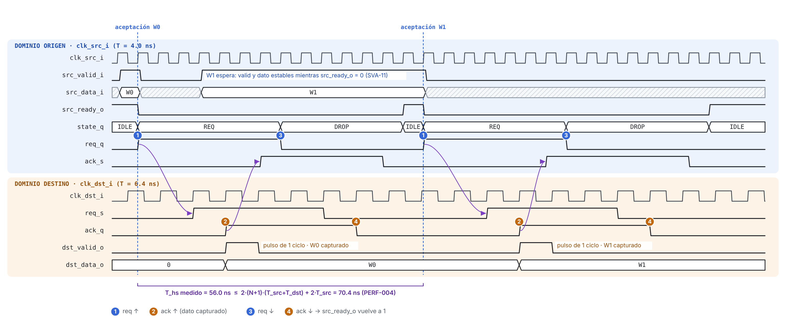
*Figure 4 — 4-phase handshake. Note: the bound annotated in the figure uses the draft formula; the frozen bound is [PERF-4] (83.2 ns for the clocks shown). Figure update tracked in OI-14.*

Additional cycle-level diagrams: pulse event and arm window in §12.2; round-trip budget in §7.2.

---

## 5. Configuration parameters

| Module | Parameter | Type | Range | Default | Description |
|---|---|---|---|---|---|
| all | `NUM_STAGES` | int | 2–4 | 2 | Synchronization stages. Chosen with the MTBF analysis (Annex A). |
| `cdckit_sync` | `WIDTH` | int | ≥ 1 | 1 | Number of independent bits. |
| `cdckit_sync` | `RESET_VAL` | logic [WIDTH-1:0] | — | `'0` | Output value during reset. |
| `cdckit_hs` | `DATA_W` | int | ≥ 1 | 32 | Word width. |
| `cdckit_afifo` | `DATA_W` | int | ≥ 1 | 72 | Word width. |
| `cdckit_afifo` | `DEPTH` | int | power of 2, 4 … 64 | 32 | Number of entries (see [PARAM-5]). |
| `cdckit_afifo` | `AF_THRESH` | int | 1 … `DEPTH` | `DEPTH-4` (`DEPTH-1` if `DEPTH = 4`) | `almost_full_o` threshold (≥). |
| `cdckit_afifo` | `AE_THRESH` | int | 0 … `DEPTH-1` | 2 | `almost_empty_o` threshold (≤). |
| `cdckit_afifo` | `OUTPUT_ZERO_IF_EMPTY` | bit | 0 / 1 | 0 | Forces `rd_data_o = 0` while the FIFO is empty. |

| ID | Requirement |
|---|---|
| [PARAM-1] | The IP MUST stop elaboration (elaboration-time `$fatal` inside a `generate` block) if `DEPTH` is not a power of 2 or is less than 4, both in `xelab` and in `synth_design` (OI-10). |
| [PARAM-2] | The IP MUST stop elaboration if `NUM_STAGES` is outside 2–4. |
| [PARAM-3] | The IP MUST stop elaboration if `AF_THRESH` or `AE_THRESH` are out of range. |
| [PARAM-4] | The IP MUST stop elaboration if `WIDTH` or `DATA_W` is 0. |
| [PARAM-5] | v1.0 verifies and characterizes `DEPTH` ∈ {4, 8, 16, 32, 64}. Larger depths elaborate but are outside the LUTRAM-cost envelope of §18.1 and are not signed off (OI-01). |

**Rationale.**

- `DEPTH ≥ 4`: the `full` comparison inverts the two most significant bits of the Gray pointer and requires `AW ≥ 2`.
- `DEPTH` power of 2: the Gray sequence MUST close the cycle with a single-bit change.
- `DEPTH ≤ 64` signed off: up to 64 entries one LUTRAM column (`RAM64M`) serves 3 bits; beyond that, Vivado cascades LUTRAMs with muxes and Block RAM becomes the better choice.
- `OUTPUT_ZERO_IF_EMPTY = 0` by default: the masking adds `DATA_W` AND gates (≈ `DATA_W/2` LUTs) and one logic level to the read path. Enabling it is recommended when `rd_data_o` drives logic not qualified by `empty_o` (a functional and X-propagation protection; it does **not** change the `report_cdc` classification of CDC-X09, see §15.2).

---

## 6. Clocks and resets

### 6.1 Clocks

| ID | Requirement |
|---|---|
| [CLK-1] | The clocks of each primitive MAY have no frequency or phase relationship at all. |
| [CLK-2] | The IP MUST operate correctly with any `f_src / f_dst` ratio within [1/16, 16]. Ratios outside this range are not verified in v1.0 and no claim is made for them. |
| [CLK-3] | The IP MUST NOT generate, divide or gate clocks. |
| [CLK-4] | With two domains of equal nominal frequency and different sources (e.g. ±100 ppm), whose relative phase drifts slowly through the capture window of the synchronizers, the IP MUST NOT lose, duplicate or corrupt data. Long-term rate mismatch is absorbed only within the FIFO depth; rate compensation is the responsibility of the system (§1.1). |
| [CLK-5] | Each clock MUST be running during the reset overlap and release of its domain ([RST-4]). Outside reset, a clock MAY stop while its domain is idle; on restart the IP resumes without loss. |

### 6.2 Resets

| ID | Requirement |
|---|---|
| [RST-1] | All control flip-flops MUST use an active-low asynchronous reset, released synchronously in their domain through `cdckit_rst_sync`. Exception: the stages of `cdckit_rst_sync` itself, which receive `arst_ni` directly. On Artix-7 they map to `FDCE`/`FDPE`; the asynchronous reset is kept because [FUNC-3] requires assertion without a clock, and for ASIC portability. |
| [RST-2] | Data flip-flops whose content is only observed when qualified by a reset control flag (FIFO memory, `cdckit_hs` `hold_q`) MAY have no reset. |
| [RST-3] | Each clock domain MUST receive its own `cdckit_rst_sync` instance. |
| [RST-4] | For `cdckit_afifo`, `wrst_ni` and `rrst_ni` MUST be simultaneously low for at least `N+1` cycles of the slower clock, and the FIFO MUST be considered empty after release. Each domain MAY be released at any time after the overlap. |
| [RST-5] | For `cdckit_hs`: (a) a source-only reset that meets [RST-7] MAY lose the word in progress, but every word accepted after the source reset is released MUST be delivered exactly once; (b) a destination-only reset MAY lose the word in progress or deliver it once more, but MUST NOT assert `dst_valid_o` with a word never accepted at the source. |
| [RST-6] | For `cdckit_pulse_sync`, a destination-only reset MAY lose in-flight events and events within the arm window, but MUST NOT generate a spurious `pulse_dst_o`. A source-only reset MAY generate at most one spurious `pulse_dst_o` (see OI-07). |
| [RST-7] | For `cdckit_hs`, `rst_src_ni` MUST stay low for at least `T_hs` ([PERF-4]) in a source-only reset. With a shorter reset, a stale `ack` from the aborted transfer can reach the next one, and [RST-5] (a) is not guaranteed. |

### 6.3 FIFO reset sequence

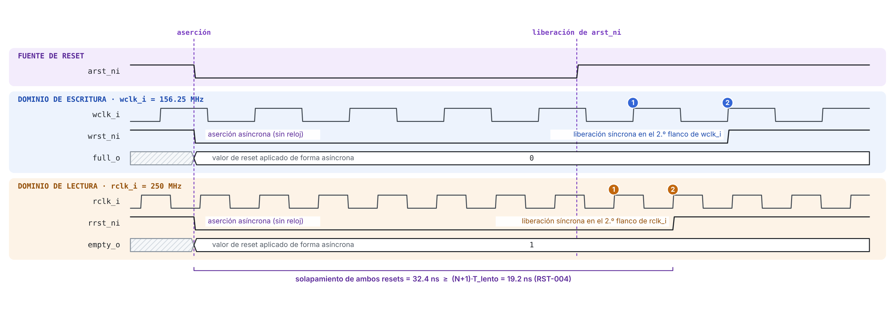
*Figure 5 — Supported reset sequence.*

**Limitation.** Resetting a single FIFO domain while the other is active leaves the pointers inconsistent between domains: this is a Reset Domain Crossing not supported in version 1.0 (§15.3). The integrator MUST apply the sequence in Figure 5. See OI-02.

---

## 7. Performance and latency

### 7.1 Performance requirements

| ID | Requirement |
|---|---|
| [PERF-1] | `cdckit_afifo` MUST accept one write per `wclk_i` cycle while `full_o = 0` and deliver one read per `rclk_i` cycle while `empty_o = 0`. |
| [PERF-2] | With equal nominal clock frequencies, continuous writes and continuous reads, `cdckit_afifo` MUST sustain 1 word/cycle without asserting `full_o` when `DEPTH ≥ 16` (any `N` in 2–4). Derivation in Table 7-3; confirmation in simulation (OI-03). |
| [PERF-3] | `cdckit_pulse_sync` MUST deliver every event when two consecutive source events are separated by at least `MIN_GAP = ⌈3·T_dst / T_src⌉ + 2` `clk_src_i` cycles (i.e. ≥ `3·T_dst + 2·T_src`). With smaller spacing, consecutive events MAY merge into one. |
| [PERF-4] | `cdckit_hs` MUST complete a transfer, from the acceptance edge (`src_valid_i && src_ready_o`) to the edge on which `src_ready_o` returns to 1, in at most `T_hs = 2·(N+2)·(T_src + T_dst)`. A new word MAY be accepted on the next edge. |
| [PERF-5] | On the reference platform (§1.3), the implementation harness (§16.4) SHOULD close timing after `route_design` with `wclk` = 156.25 MHz and `rclk` = 250 MHz: WNS ≥ 0, WHS ≥ 0, TPWS ≥ 0 and `report_bus_skew` without violations. If `rclk` = 250 MHz does not close in speed grade -1, the requirement is evaluated at the Fmax obtained per [PERF-6] (OI-13). |
| [PERF-6] | The Fmax of each domain SHOULD be documented, obtained by reducing its clock period in 0.1 ns steps until WNS < 0. |
| [PERF-7] | The resources and Fmax of each primitive versus its equivalent XPM macro (Table 8-1), implemented in the same harness, SHOULD be documented. |
| [PERF-8] | The latencies of Table 7-2 are normative: every event MUST become visible at the destination no later than the maximum, and no earlier than the minimum, given there. |
| [PERF-9] | The FIFO memory MUST be implemented as LUTRAM (0 Block RAM, 0 flip-flops in the storage array), and the utilization of each primitive SHOULD stay within +25 % of the estimate in Table 18-1. |

### 7.2 Latency table (`NUM_STAGES = N`)

| Path | Minimum | Maximum | Reference event | Max, reference config |
|---|---|---|---|---|
| `cdckit_sync`: `d_i` → `q_o` | edge N | edge N+1 | Change of `d_i` | (N+1)·T_dst |
| `cdckit_rst_sync`: assertion | 0 (asynchronous) | t_CLR→Q | Falling edge of `arst_ni` | < 1 ns |
| `cdckit_rst_sync`: release | edge N | edge N+1 | Rising edge of `arst_ni` | 3·T_clk |
| `cdckit_pulse_sync`: event → `pulse_dst_o` | edge N+1 | edge N+2 | `clk_src` edge that samples the event | 25.6 ns (100 → 156.25 MHz) |
| `cdckit_hs`: acceptance → `dst_valid_o` | edge N+1 | edge N+2 | `clk_src` acceptance edge | 40.0 ns (156.25 → 100 MHz) |
| `cdckit_hs`: acceptance → next `src_ready_o = 1` | — | `T_hs` ([PERF-4]) | `clk_src` acceptance edge | 131.2 ns |
| `cdckit_afifo`: write → `empty_o = 0`, `rd_level_o` updated | edge N+1 | edge N+2 | `wclk` edge that accepts the write | 16.0 ns |
| `cdckit_afifo`: read → `full_o = 0`, `wr_level_o` updated | edge N+1 | edge N+2 | `rclk` edge that accepts the read | 25.6 ns |
| `cdckit_afifo`: `rd_en_i` → next `rd_data_o` | edge 1 | edge 1 | Read cycle | 4.0 ns + read path |

*Table 7-2 — Normative latencies. "edge k" = k-th destination edge after the reference event.*

The extra edge in the maximum covers two effects: sampling uncertainty (arbitrary phase between clocks) and the possibility that the first stage resolves metastability toward the previous value. The one-edge uncertainty is also the root of the margins in [PERF-2], [PERF-3] and [PERF-4].

**Round-trip budget** (basis of [PERF-2]; equal frequencies, cycles of either clock):

| Step | Cycles |
|---|---|
| Write accepted → visible to the reader (`empty_o = 0`) | N+1 … N+2 |
| Reader pops the word (`rbin_q`, `rgray_q` update) | 1 |
| Read visible to the writer (`wr_level_o`, `full_o` update) | N+1 … N+2 |
| **Round trip** = words counted by `wr_level_o` in steady state | **2N+3 … 2N+5** |

*Table 7-3 — With 1 word/cycle, `wr_level_o` peaks at `2N+5` (9 for N = 2, 13 for N = 4). `full_o` never asserts if `DEPTH ≥ 2N+6`, i.e. `DEPTH = 16` for every legal N. `DEPTH = 8` with N = 2 can assert `full_o` when both crossings resolve late.*

### 7.3 Depth sizing

For a burst of `B` words written at `f_w` while reading continuously at `f_r < f_w`, with no backpressure on the writer (`full_o` must never assert), and `r = f_r / f_w`:

```
DEPTH ≥ B·(1 − r) + (N + 2)·(1 + r)          ; rounded up to the next power of 2
```

The first term is the backlog accumulated during the burst. The second is the latency term in words: `N+2` write cycles before the reader starts (first word visible), plus `N+2` cycles in which reads are not yet visible to the writer, during which the reader consumes `(N+2)·r` words that `wr_level_o` still counts.

NetSwitch-4 example, TX side (the core writes at 250 MHz and the MAC reads at 156.25 MHz), 1518 B frame in 190 beats of 8 B, N = 2:

```
r = 156.25 / 250 = 0.625
DEPTH ≥ 190 · 0.375 + 4 · 1.625 = 71.25 + 6.5 = 77.75   →   DEPTH = 128
```

`DEPTH = 128` is outside the v1.0 signed-off range ([PARAM-5]); the TX FIFO is the motivating case of OI-01. The RX side (write at 156.25 MHz, read at 250 MHz) only absorbs core stalls. Its depth is set by the maximum stall duration `S` (core cycles) specified by the core: `DEPTH ≥ ⌈S · f_w / f_r⌉ + 2N + 6`. Reference configuration `DEPTH = 32` covers `S ≤ 35` core cycles with N = 2.

---

## 8. Integration requirements

| ID | Requirement |
|---|---|
| [INTG-1] | The `d_i` port of `cdckit_sync` (and every crossing source listed in §15) MUST be driven directly by a flip-flop of the source domain, with no combinational logic in between and no fan-out of that flip-flop to other destination-domain logic. |
| [INTG-2] | The integrator MUST NOT separately synchronize bits that are later recombined or interpreted together (reconvergence). Such information MUST cross through `cdckit_hs` or `cdckit_afifo`. |
| [INTG-3] | The integrator MUST load the module-scoped XDC files of §16 (`read_xdc -unmanaged -ref <module>`, `PROCESSING_ORDER LATE`), so that they apply to every instance. |
| [INTG-4] | The integrator MUST run `report_cdc -details` on the integrated design and justify every remaining Warning or Critical with `create_waiver`, referencing the crossing ID of §15. |
| [INTG-5] | The `cdckit_sync` primitive MAY be replaced by `xpm_cdc_array_single` (FPGA) or by a library synchronizer cell (ASIC). The replacement MUST preserve the number of stages. `xpm_cdc_array_single` has no reset: the loss of `RESET_VAL` MUST be evaluated for each use (in particular `u_sync_ack` of `cdckit_hs`, which requires `RESET_VAL = 1`, [MAS-HS-7]). |
| [INTG-6] | The consumer of `rd_data_o` MUST qualify its use with `empty_o = 0`, or the instance MUST be configured with `OUTPUT_ZERO_IF_EMPTY = 1`. |
| [INTG-7] | Each signal MUST be used only in the domain indicated in its interface table. Using `wr_level_o` in the `rclk_i` domain, for example, is an unsynchronized crossing. |
| [INTG-8] | Global `set_clock_groups` or `set_false_path` MUST NOT be used between the clocks of an instance, because they override the `set_max_delay -datapath_only` exceptions of §16 ([MAS-XDC-1]). |
| [INTG-9] | `arst_ni` of `cdckit_rst_sync` MUST be glitch-free: driven by a flip-flop, a POR circuit or a debounced pin, never by combinational logic. |
| [INTG-10] | Each crossing implemented by the integrator with a standalone `cdckit_sync` MUST be constrained with the template of §16.3, because `cdckit_sync` carries no XDC of its own ([MAS-XDC-2]). |
| [INTG-11] | The consumer of `cdckit_hs` MUST accept `dst_valid_o` in the cycle in which it asserts. The producer of `cdckit_pulse_sync` events MUST respect [PERF-3]. |
| [INTG-12] | For operation at 250 MHz, `wr_en_i`, `rd_en_i` and `src_valid_i` SHOULD be driven by a flip-flop or at most one LUT level: inside the IP they feed the pointer increment and the flag/level logic in the same cycle (path budget in §16.4). |

| `cdckit` primitive | Equivalent XPM macro | Relevant differences |
|---|---|---|
| `cdckit_sync` | `xpm_cdc_single` / `xpm_cdc_array_single` | XPM has no reset and ships its own XDC; same configurable number of stages. |
| `cdckit_rst_sync` | `xpm_cdc_async_rst` | Functionally equivalent (active-low polarity, `DEST_SYNC_FF` = N). Used as the resource and `report_cdc` reference. |
| `cdckit_pulse_sync` | `xpm_cdc_pulse` | XPM uses a source/destination reset pair with a different recovery behaviour; `cdckit` adds the arm window ([MAS-PLS-5]). |
| `cdckit_hs` | `xpm_cdc_handshake` | `cdckit` exposes valid/ready on the source side and recovers from single-domain resets ([RST-5]). |
| `cdckit_afifo` | `xpm_fifo_async` | `cdckit` adds per-cycle `overflow`/`underflow` indicators, per-domain levels and `OUTPUT_ZERO_IF_EMPTY`; XPM supports Block RAM and non-FWFT modes. |

*Table 8-1 — Equivalences with Vivado XPM macros (reference for [PERF-7]).*

---

# PART II — MICRO-ARCHITECTURE SPECIFICATION

## 9. Module hierarchy

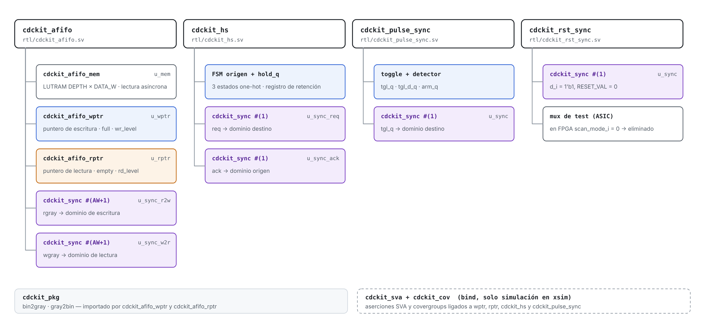
*Figure 6 — Module hierarchy and RTL files.*

RTL files (all `.sv`, plus the file list):

| File | Contents |
|---|---|
| `rtl/cdckit_pkg.sv` | `bin2gray`, `gray2bin` functions, types. |
| `rtl/cdckit_sync.sv` | Synchronization primitive. |
| `rtl/cdckit_rst_sync.sv` | Reset synchronizer. |
| `rtl/cdckit_pulse_sync.sv` | Pulse synchronizer. |
| `rtl/cdckit_hs.sv` | 4-phase handshake. |
| `rtl/cdckit_afifo_mem.sv` | FIFO memory. |
| `rtl/cdckit_afifo_wptr.sv` | Write pointer logic. |
| `rtl/cdckit_afifo_rptr.sv` | Read pointer logic. |
| `rtl/cdckit_afifo.sv` | FIFO top. |
| `rtl/cdckit_sva.sv` | SVA checker modules (simulation only), attached in the verification phase. |
| `rtl/cdckit_rtl.f` | Synthesizable RTL file list, package first. `cdckit_sva.sv` is added in simulation only. |

The deliverables of the RTL phase are `.sv` files only. The implementation harness (`impl/cdckit_impl_top.sv`), the XDC files (`constraints/*.xdc`) and the Vivado script (`scripts/vivado_impl.tcl`) are specified in §16 as targets of later phases. The `covergroup`s and the verification environment belong to phases 3 and 4.

---

## 10. `cdckit_sync` — Level synchronizer

### 10.1 Structure

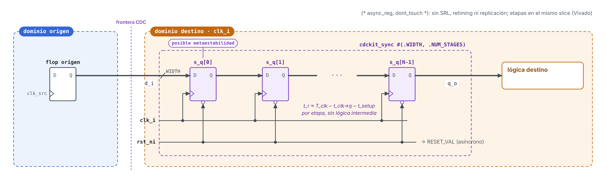
*Figure 7 — Structure of `cdckit_sync`.*

### 10.2 Micro-architecture decisions

| ID | Decision | Rationale |
|---|---|---|
| [MAS-SYNC-1] | Register vector `logic [NUM_STAGES-1:0][WIDTH-1:0] s_q` with attributes `(* ASYNC_REG = "TRUE", DONT_TOUCH = "TRUE" *)`. | In Vivado, `ASYNC_REG` prevents SRL packing and retiming, and places the stages in the same slice to maximize `t_r`; it is the mark by which `report_cdc` recognizes the synchronizer. `DONT_TOUCH` prevents replication and merging. |
| [MAS-SYNC-2] | No gates between stages. | Maximizes the resolution time `t_r` ([FUNC-2]). |
| [MAS-SYNC-3] | Asynchronous reset to `RESET_VAL`. | Known state from the first clock cycle; `RESET_VAL` lets a parent choose the pessimistic value of the crossing ([MAS-HS-7]). |
| [MAS-SYNC-4] | Implementation isolated in its own module, with no XDC of its own. | Single point of replacement ([INTG-5]) and of recognition by `report_cdc`. Constraints are owned by the parent ([MAS-XDC-2]). |
| [MAS-SYNC-5] | Register names are fixed: stage *k* bit *b* is `s_q_reg[k][b]`. | The scoped XDC of the parents address the first stage as `<inst>/s_q_reg[0][*]` (§16.2). |

### 10.3 Resources

`NUM_STAGES × WIDTH` flip-flops (`FDCE` for bits with `RESET_VAL = 0`, `FDPE` for bits with `RESET_VAL = 1`); 0 LUT.

---

## 11. `cdckit_rst_sync` — Reset synchronizer

### 11.1 Structure

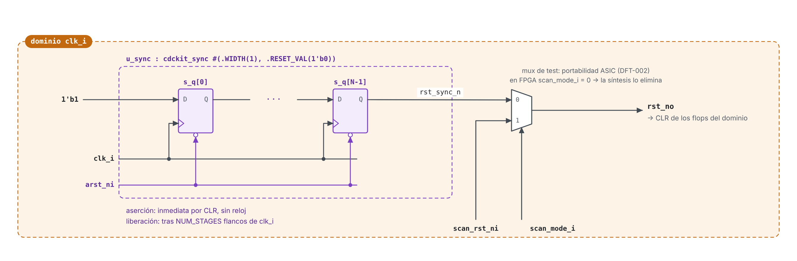
*Figure 8 — Structure of `cdckit_rst_sync`.*

### 11.2 Micro-architecture decisions

| ID | Decision | Rationale |
|---|---|---|
| [MAS-RST-1] | `arst_ni` connected directly to the CLR input of every stage (a `cdckit_sync` instance with `RESET_VAL = 0`). | Immediate assertion, even with no active clock ([FUNC-3]). |
| [MAS-RST-2] | The stages propagate a constant `1'b1`. | The release is aligned to `clk_i` after N to N+1 edges. |
| [MAS-RST-3] | Reference equivalent: `xpm_cdc_async_rst`. | Its `report_cdc` classification and its resources are compared ([PERF-7]). |
| [MAS-RST-4] | The path from `arst_ni` to the CLR pins of the stages is a false path; `rst_no` is a normal synchronous net whose recovery/removal checks remain timed. | Assertion is asynchronous by design; only the release must meet recovery/removal, and it is launched by the last stage in `clk_i` ([MAS-XDC-4]). |

---

## 12. `cdckit_pulse_sync` — Pulse synchronizer (toggle)

### 12.1 Structure

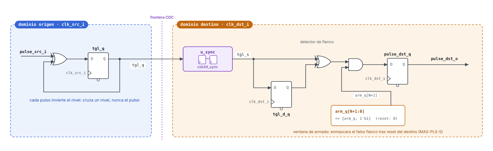
*Figure 9 — Structure of `cdckit_pulse_sync` with arm window.*

### 12.2 Logic

| Domain | Equation |
|---|---|
| Source | `tgl_q <= tgl_q ^ pulse_src_i;` |
| Destination | `arm_q <= {arm_q[N:0], 1'b1};`  `tgl_d_q <= tgl_s;`  `pulse_dst_q <= arm_q[N+1] & (tgl_s ^ tgl_d_q);` |
| Output | `pulse_dst_o = pulse_dst_q;` (registered) |

**Event timing** (N = 2; `clk_dst` edges after the `clk_src` edge that toggles `tgl_q`; values after each edge):

| Edge | `s_q[0]` | `tgl_s` | `tgl_d_q` | `pulse_dst_q` |
|---|---|---|---|---|
| 1 | 1 (or metastable → 0) | 0 | 0 | 0 |
| 2 | 1 | **1** (or 0) | 0 | 0 |
| 3 | 1 | 1 | 1 (or 0) | **1** (or 0) |
| 4 | 1 | 1 | 1 | 0 (or **1**) |
| 5 | 1 | 1 | 1 | 0 |

The pulse appears at edge N+1 or N+2 ([PERF-8]). Two events must keep `tgl_s` stable for ≥ 2 destination cycles so that `tgl_s ^ tgl_d_q` returns to 0 between them; a level held 3·T_dst at the source survives the one-edge capture uncertainty with ≥ 2 cycles at `tgl_s`. This is the origin of [PERF-3].

**Arm window** (N = 2, `ARM_W = 4`; destination-only reset released while `tgl_q = 1`; values after each edge):

| Edge | `arm_q` | `tgl_s` | `tgl_d_q` | `tgl_s ^ tgl_d_q` | `pulse_dst_q` |
|---|---|---|---|---|---|
| 1 | 0001 | 0 | 0 | 0 | 0 |
| 2 | 0011 | 1 (or 0) | 0 | 1 (or 0) | 0 (`arm_q[3]` = 0) |
| 3 | 0111 | 1 | 1 (or 0) | 0 (or 1) | 0 (masked) |
| 4 | 1111 | 1 | 1 | 0 | 0 (masked) |
| 5 | 1111 | 1 | 1 | 0 | 0 |

The false edge exists only before edge N+2 and `arm_q[N+1]` becomes 1 on edge N+2, so the mask covers the worst case exactly ([RST-6]).

### 12.3 Micro-architecture decisions

| ID | Decision | Rationale |
|---|---|---|
| [MAS-PLS-1] | A level (`tgl_q`) crosses, never the pulse. | A pulse shorter than `T_dst` might not be sampled. |
| [MAS-PLS-2] | `tgl_q` is a flip-flop. | No combinational logic drives the synchronizer ([INTG-1]). |
| [MAS-PLS-3] | Registered output. | Glitch-free, at the cost of one edge of latency (§7.2). |
| [MAS-PLS-4] | No acknowledge channel. | Minimum cost. The spacing constraint ([PERF-3]) is guaranteed by the integrator and checked by an *assume* assertion at the interface (SVA-12). |
| [MAS-PLS-5] | Arm window of `NUM_STAGES+2` cycles after destination reset (`arm_q`, with `(* SHREG_EXTRACT = "no" *)` so it keeps its reset). | After a destination-only reset, the synchronizer starts at 0 and converges to the current value of `tgl_q`, which the detector would see as an edge. The window covers the worst-case convergence: N stages, 1 edge for metastability and 1 for `tgl_d_q` ([RST-6]). Real events inside the window are lost (accepted trade-off). |

---

## 13. `cdckit_hs` — Multibit transfer via 4-phase handshake

### 13.1 Structure

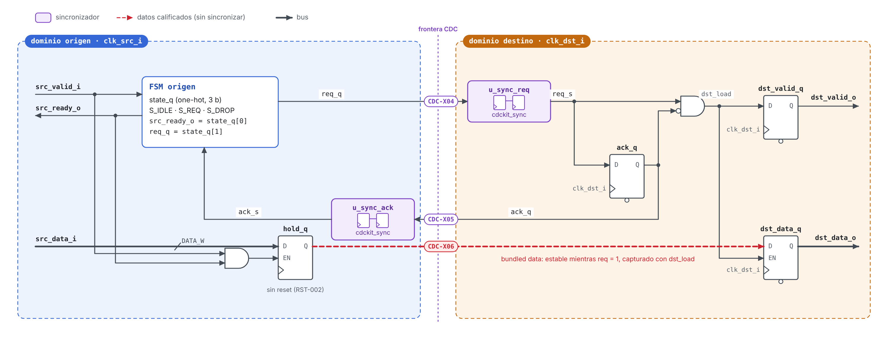
*Figure 10 — Structure of `cdckit_hs` and crossings CDC-X04 to CDC-X06.*

### 13.2 Source-domain FSM

| State | Encoding | `src_ready_o` | `req_q` | Transition |
|---|---|---|---|---|
| `S_IDLE` | `3'b001` | 1 | 0 | `src_valid_i` → `S_REQ`; also `hold_q <= src_data_i` |
| `S_REQ` | `3'b010` | 0 | 1 | `ack_s == 1` → `S_DROP` |
| `S_DROP` | `3'b100` | 0 | 0 | `ack_s == 0` → `S_IDLE`. **Reset state.** |

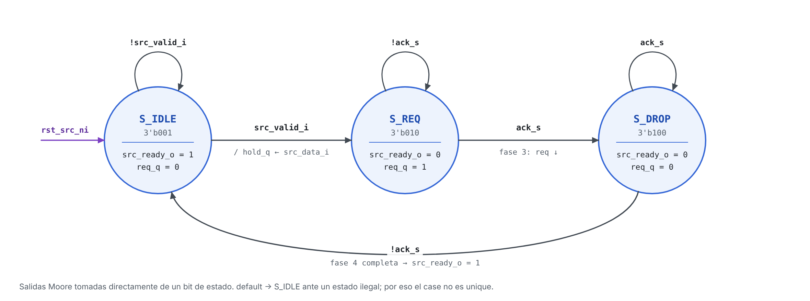
*Figure 11 — Source-domain FSM of `cdckit_hs` (reset arrow to be moved to `S_DROP`, OI-14).*

**Encoding:** 3-bit one-hot, held in `current_state` (next value `nxt_state`). `src_ready_o` and `req_q` are taken directly from a state bit (registered Moore outputs, no decoding). `default` returns to `S_DROP`, the safe state. The statement is `case`, not `unique case`: with `unique`, synthesis may assume illegal states never occur and remove the recovery logic. The written encoding is preserved with `FSM_ENCODING = "none"` ([MAS-HS-6]).

**Reset recovery** ([MAS-HS-7]). The FSM resets into `S_DROP` and `u_sync_ack` resets to `RESET_VAL = 1`. After reset, `ack_s` is pessimistically 1 and can only become 0 by propagating the real `ack_q = 0` of the destination. The FSM therefore reaches `S_IDLE` only when the destination has observed `req = 0`, which guarantees that the next `req` rising edge is seen as a new transfer:

| Scenario | Without [MAS-HS-7] (draft RTL) | With [MAS-HS-7] |
|---|---|---|
| Power-up, both domains reset | `src_ready_o = 1` immediately | `src_ready_o = 1` after N+1 … N+2 `clk_src` edges |
| Source-only reset while the destination still has `ack_q = 1` | Source returns to `S_IDLE` with `ack_s = 0` (reset value), accepts word B and raises `req` while `req_s` never fell at the destination: no rising edge, word B is never delivered, yet the source sees `ack` and completes. **Silent loss of a word accepted after reset.** | Source waits in `S_DROP` until the real `ack` falls, then accepts B, which is delivered ([RST-5a]). |

### 13.3 Destination-domain logic

| Signal | Equation |
|---|---|
| `ack_q` | `ack_q <= req_s;` |
| `dst_load` | `req_s & ~ack_q` (comb) |
| `dst_valid_q` | `dst_valid_q <= dst_load;` |
| `dst_data_q` | `if (dst_load) dst_data_q <= hold_q;` |

**Destination-only reset** ([RST-5b]): `ack_q` and `u_sync_req` reset to 0. If the source is in `S_REQ`, `req_s` re-converges to 1 and produces a new rising edge: the word in progress (still frozen in `hold_q`) is delivered once more. If the source is in `S_DROP` or `S_IDLE`, nothing is delivered. In no case is a word delivered that the source did not accept.

### 13.4 Micro-architecture decisions

| ID | Decision | Rationale |
|---|---|---|
| [MAS-HS-1] | Holding register at the source. | Decouples `src_data_i` from the protocol: the sender may change its data after acceptance without affecting the transfer in progress. |
| [MAS-HS-2] | `hold_q` is loaded only in `S_IDLE`. | Guarantees stability during phases 1–3, when the destination may sample. |
| [MAS-HS-3] | The destination captures on the rising edge of `req_s` (`req_s & ~ack_q`). | A single capture per transfer; `dst_valid_o` lasts exactly one destination cycle ([FUNC-16]). |
| [MAS-HS-4] | `ack_q` is a delayed copy of `req_s`. | No FSM at the destination; minimal logic. |
| [MAS-HS-5] | Registered destination outputs. | `dst_valid_o` and `dst_data_o` change on the same edge. |
| [MAS-HS-6] | `current_state` MUST carry `(* FSM_ENCODING = "none", DONT_TOUCH = "TRUE" *)`. | `req_q` crosses domains directly from a state bit. If Vivado extracted and re-encoded the FSM, `req_q` would become combinational logic in front of the synchronizer, which is exactly what [INTG-1] forbids and what `report_cdc` classifies as critical (CDC-10). |
| [MAS-HS-7] | Reset state `S_DROP`; `u_sync_ack` with `RESET_VAL = 1'b1`; `default` → `S_DROP`. | Makes `ack_s` pessimistic after a source reset so that the FSM cannot start a transfer the destination will not recognize ([RST-5a]). Costs N+1 … N+2 cycles of `src_ready_o = 0` after reset. |

---

## 14. `cdckit_afifo` — Asynchronous FIFO

### 14.1 Block diagram

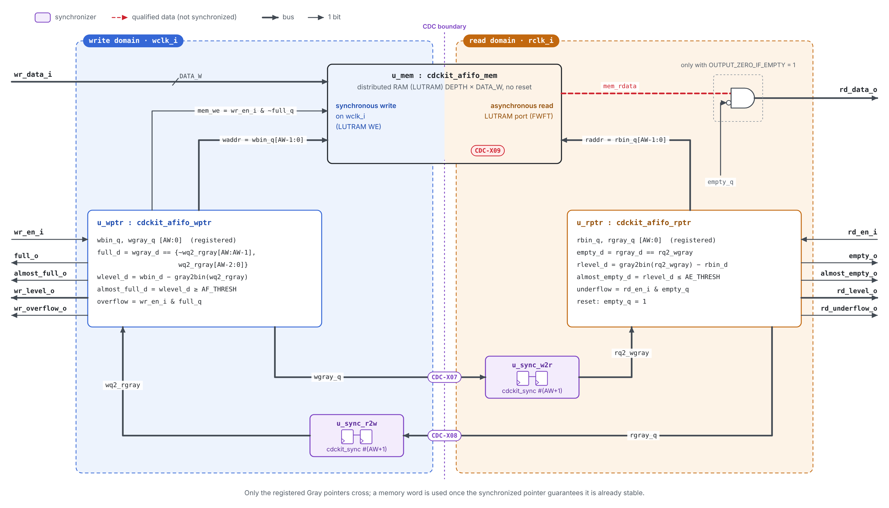
*Figure 12 — Micro-architecture of `cdckit_afifo`.*

### 14.2 Write pointer logic (`cdckit_afifo_wptr`)

| Signal | Equation | Type |
|---|---|---|
| `w_push` | `wr_en_i & ~full_q` | comb |
| `wbin_d` | `wbin_q + w_push` | comb |
| `wgray_d` | `bin2gray(wbin_d) = (wbin_d >> 1) ^ wbin_d` | comb |
| `wq2_rbin` | `gray2bin(wq2_rgray)` | comb |
| `wlevel_d` | `wbin_d − wq2_rbin` (modulo 2^(AW+1)) | comb |
| `full_q` | `wgray_d == {~wq2_rgray[AW:AW-1], wq2_rgray[AW-2:0]}` (≡ `wlevel_d == DEPTH`) | reg |
| `almost_full_q` | `wlevel_d >= AF_THRESH` | reg |
| `wr_level_q` | `wlevel_d` | reg |
| `wr_overflow_q` | `wr_en_i & full_q` | reg |
| `wbin_q`, `wgray_q` | `wbin_d`, `wgray_d` | reg |
| `mem_we` | `w_push` | comb → `cdckit_afifo_mem` |

### 14.3 Read pointer logic (`cdckit_afifo_rptr`)

| Signal | Equation | Type |
|---|---|---|
| `r_pop` | `rd_en_i & ~empty_q` | comb |
| `rbin_d` | `rbin_q + r_pop` | comb |
| `rgray_d` | `bin2gray(rbin_d)` | comb |
| `rq2_wbin` | `gray2bin(rq2_wgray)` | comb |
| `rlevel_d` | `rq2_wbin − rbin_d` | comb |
| `empty_q` | `rgray_d == rq2_wgray` (≡ `rlevel_d == 0`) | reg (reset = 1) |
| `almost_empty_q` | `rlevel_d <= AE_THRESH` | reg (reset = 1) |
| `rd_level_q` | `rlevel_d` | reg |
| `rd_underflow_q` | `rd_en_i & empty_q` | reg |
| `rbin_q`, `rgray_q` | `rbin_d`, `rgray_d` | reg |

The equivalences in parentheses follow from the reflected Gray code: inverting the two MSBs of a Gray value is the same as adding `2^AW = DEPTH` to its binary value. They are the basis of [FUNC-15] and SVA-14 to SVA-17.

### 14.4 Memory (`cdckit_afifo_mem`)

| Aspect | Specification |
|---|---|
| Ports | `wclk_i`, `we_i`, `waddr_i[AW-1:0]`, `wdata_i[DATA_W-1:0]`, `raddr_i[AW-1:0]`, `rdata_o[DATA_W-1:0]` (as instantiated in `cdckit_afifo.sv`). |
| Implementation | Simple dual-port distributed RAM (LUTRAM), inferred by Vivado from a `mem_q` array without reset. The asynchronous read prevents Block RAM inference. [PERF-9] requires checking in `report_utilization` that LUTRAM, not registers, is inferred. Expected primitive for `DEPTH ≤ 32`: `RAM32M` (32 × 6 bits per primitive). |
| Write | Synchronous to `wclk_i`, enabled by `we_i`, address `waddr_i = wbin_q[AW-1:0]`. |
| Read | Asynchronous from the LUTRAM read port, address `raddr_i = rbin_q[AW-1:0]` (FWFT). With `DEPTH ≤ 64`, one LUT level. |
| Output | `rd_data_o = (OUTPUT_ZERO_IF_EMPTY && empty_q) ? '0 : mem_q[rbin_q[AW-1:0]]` (mask in `cdckit_afifo`). |
| Enable | `we_i` acts as the LUTRAM WE. No ICGs are inferred on FPGA (§18.2). |
| Collisions | A read and a write to the same address only happen while the FIFO is really empty (read data unused, [INTG-6]) or really full (write blocked by `full_q`). The data read with `empty_o = 0` is therefore never being written (§15.2). |

### 14.5 Micro-architecture decisions

| ID | Decision | Rationale |
|---|---|---|
| [MAS-AF-1] | `AW+1`-bit pointers. | The extra bit distinguishes full from empty without sacrificing an entry. |
| [MAS-AF-2] | The **registered** Gray pointers (`wgray_q`, `rgray_q`) are synchronized, never `wgray_d`. | The combinational output of `bin2gray` can glitch and change more than one bit during evaluation. |
| [MAS-AF-3] | Two representations coexist per domain (binary for addressing, Gray for crossing). | Avoids a Gray→binary conversion in the memory address path. |
| [MAS-AF-4] | `full` and `empty` are computed from the *next* pointers (`*_d`) and registered. | The flags reflect the current cycle's operation without an extra cycle of delay, and remain registered ([FUNC-13]). |
| [MAS-AF-5] | `full` compares the two MSBs inverted. | In reflected Gray code, the equivalent of "MSB different and the rest equal" in binary. |
| [MAS-AF-6] | Levels are computed from the synchronized remote pointer. | `wr_level_o` is an upper bound and `rd_level_o` a lower bound of the real occupancy ([FUNC-9]). Both are safe for flow control. |
| [MAS-AF-7] | Memory inferred as LUTRAM with asynchronous read. | FWFT with no extra latency cycle. The reference configuration goes from ≈ 2370 to ≈ 66 flip-flops (§18.1). For large `DEPTH × DATA_W`, Block RAM with prefetch is planned (OI-01). |
| [MAS-AF-8] | Combinational `gray2bin`. | XOR tree of depth ⌈log6(AW+1)⌉ LUTs (one LUT for AW+1 ≤ 6). If the level/flag path limits timing at 250 MHz, the mitigations of OI-05 apply. |
| [MAS-AF-9] | `wgray_q` and `rgray_q` MUST carry `(* DONT_TOUCH = "TRUE" *)`. | The MSB of the Gray pointer is identical to the binary MSB. Vivado would therefore merge `wgray_q[AW]` with `wbin_q[AW]` (equivalent register removal). The crossing's launch flop would be renamed, would no longer be covered by the constraints of §16, and would drive logic in its own domain in addition to the synchronizer ([INTG-1]). |
| [MAS-AF-10] | Each synchronizer is reset by the reset of its **destination** domain (`u_sync_w2r` by `rrst_ni`, `u_sync_r2w` by `wrst_ni`). | Every flip-flop belongs to exactly one reset domain; the remaining reset crossing is covered by [RST-4] (§15.3). |

---

## 15. CDC intent and crossing table

### 15.1 Crossing table

| ID | Module | Source (launch) | Destination (capture) | Width | Mechanism | Constraint |
|---|---|---|---|---|---|---|
| CDC-X01 | `cdckit_sync` (standalone use) | Integrator flip-flop | `s_q_reg[0][*]` | `WIDTH` | N-FF synchronizer, independent bits | Template §16.3 ([INTG-10]) |
| CDC-X02 | `cdckit_rst_sync` | `arst_ni` (async) | CLR of `u_sync/s_q_reg[*][0]` | 1 | Async assert / sync release | False path to CLR ([MAS-XDC-4]) |
| CDC-X03 | `cdckit_pulse_sync` | `tgl_q` (`clk_src`) | `u_sync/s_q_reg[0][0]` (`clk_dst`) | 1 | Toggle + N-FF synchronizer | max delay T_dst |
| CDC-X04 | `cdckit_hs` | `req_q` = `current_state[1]` (`clk_src`) | `u_sync_req/s_q_reg[0][0]` (`clk_dst`) | 1 | N-FF synchronizer | max delay T_dst |
| CDC-X05 | `cdckit_hs` | `ack_q` (`clk_dst`) | `u_sync_ack/s_q_reg[0][0]` (`clk_src`) | 1 | N-FF synchronizer | max delay T_src |
| CDC-X06 | `cdckit_hs` | `hold_q[*]` (`clk_src`) | `dst_data_q[*]` (`clk_dst`, CE = `dst_load`) | `DATA_W` | Qualified data: stable from N·T_dst before capture | max delay T_dst |
| CDC-X07 | `cdckit_afifo` | `u_wptr/wgray_q[*]` (`wclk`) | `u_sync_w2r/s_q_reg[0][*]` (`rclk`) | AW+1 | Gray bus + N-FF synchronizer | max delay T_wclk + bus skew |
| CDC-X08 | `cdckit_afifo` | `u_rptr/rgray_q[*]` (`rclk`) | `u_sync_r2w/s_q_reg[0][*]` (`wclk`) | AW+1 | Gray bus + N-FF synchronizer | max delay T_rclk + bus skew |
| CDC-X09 | `cdckit_afifo` | LUTRAM `u_mem` (written on `wclk`) | `rd_data_o` → consumer flops (`rclk`) | `DATA_W` | Qualified data: written ≥ N·T_rclk before `empty_o` deasserts | max delay T_rclk |

### 15.2 Expected `report_cdc` classification and waiver rationale

| Crossing | Expected rule (severity) | Disposition |
|---|---|---|
| CDC-X03, X04, X05 | CDC-3 — 1-bit synchronized with `ASYNC_REG` (Info) | No action. |
| CDC-X02 | CDC-9 — asynchronous reset synchronized with `ASYNC_REG` (Info), when `arst_ni` is launched by a clocked flip-flop; not reported when it comes from an unclocked port. | No action. |
| CDC-X07, X08 | CDC-6 — multi-bit synchronized with `ASYNC_REG` (Warning) | Waiver: Gray-coded bus (SVA-01/02 prove ≤ 1 bit change per source cycle); coherence guaranteed by `set_bus_skew` ≤ min(T_src, T_dst), checked by `report_bus_skew`. |
| CDC-X06 | CDC-15 — clock-enable-controlled CDC structure (Warning) | Waiver: `dst_data_q` CE = `dst_load` is derived from synchronized `req_s`; `hold_q` is frozen from N·T_dst before the CE edge ([MAS-HS-2]). |
| CDC-X09 | CDC-26 — LUTRAM read/write potential collision (Warning) | Waiver: read data is used only with `empty_o = 0`, which is asserted ≥ N+1 `rclk` edges after the write; collisions limited to unused data (§14.4). |
| Any CDC-1, CDC-4, CDC-7, CDC-10, CDC-11, CDC-12, CDC-13, CDC-14 | Critical | **Not waivable.** Indicates a violation of [FUNC-1], [INTG-1] or [MAS-AF-9] and MUST be fixed. |

### 15.3 Reset domain crossings

| ID | Source reset → destination | Risk | Mitigation |
|---|---|---|---|
| RDC-1 | `wrst_ni` asserted: `wgray_q` clears asynchronously while `u_sync_w2r` samples it on `rclk` | All bits may change at once (non-Gray transition) → false pointer at the reader | [RST-4]: `rrst_ni` is also low, so `u_sync_w2r` is held in reset during the transition. |
| RDC-2 | `rrst_ni` asserted: `rgray_q` clears while `u_sync_r2w` samples it | Same as RDC-1 at the writer | [RST-4]. |
| RDC-3 | `rst_src_ni` of `cdckit_hs` asserted while `req_q = 1` | `req` drops early; transfer abandoned | Handled by protocol: [MAS-HS-7], [RST-5a]. |
| RDC-4 | `rst_src_ni` of `cdckit_pulse_sync` asserted while `tgl_q = 1` | Level drop seen as one event | Accepted: at most one spurious pulse ([RST-6], OI-07). |

---

## 16. Timing constraints (XDC)

### 16.1 Constraint strategy

| ID | Decision | Rationale |
|---|---|---|
| [MAS-XDC-1] | Every crossing is constrained with `set_max_delay -datapath_only` (plus `set_bus_skew` for Gray buses). No `set_clock_groups` and no `set_false_path` between the data clocks ([INTG-8]). | Bounds the routing delay of each crossing, which the latency bounds ([PERF-8], [PERF-4]) and the Gray coherence rely on. A clock-group or false-path exception would override `-datapath_only` and leave the routes unbounded. |
| [MAS-XDC-2] | One module-scoped Tcl XDC per parent primitive (`cdckit_rst_sync`, `cdckit_pulse_sync`, `cdckit_hs`, `cdckit_afifo`); **none** for `cdckit_sync`. | A generic constraint inside `cdckit_sync` (e.g. a false path to stage 0) would conflict with the stricter constraints its parents need for the same cells. |
| [MAS-XDC-3] | Periods are read from the clocks propagated to the instance ports (`get_clocks -of_objects [get_ports …]`), so files are loaded `-unmanaged` with `PROCESSING_ORDER LATE` ([INTG-3]). | One file serves every instance and every frequency; no hard-coded numbers. If both ports carry the same clock, no exception is applied (synchronous instance). |
| [MAS-XDC-4] | `cdckit_rst_sync`: `set_false_path` to the CLR pins of its stages only. | Assertion is asynchronous; the release path (`rst_no` → CLR of the domain) stays timed for recovery/removal. |

### 16.2 Per-module constraints

| Module | Crossing | Constraint | Value |
|---|---|---|---|
| `cdckit_pulse_sync` | CDC-X03 | `set_max_delay -datapath_only` `tgl_q_reg` → `u_sync/s_q_reg[0][0]` | T_dst |
| `cdckit_hs` | CDC-X04 | `set_max_delay -datapath_only` `current_state_reg[1]` → `u_sync_req/s_q_reg[0][0]` | T_dst |
| `cdckit_hs` | CDC-X05 | `set_max_delay -datapath_only` `ack_q_reg` → `u_sync_ack/s_q_reg[0][0]` | T_src |
| `cdckit_hs` | CDC-X06 | `set_max_delay -datapath_only` `hold_q_reg[*]` → `dst_data_q_reg[*]` | T_dst (available: N·T_dst) |
| `cdckit_afifo` | CDC-X07 | `set_max_delay -datapath_only` + `set_bus_skew` `u_wptr/wgray_q_reg[*]` → `u_sync_w2r/s_q_reg[0][*]` | T_wclk; skew min(T_wclk, T_rclk) |
| `cdckit_afifo` | CDC-X08 | idem `u_rptr/rgray_q_reg[*]` → `u_sync_r2w/s_q_reg[0][*]` | T_rclk; skew min(T_wclk, T_rclk) |
| `cdckit_afifo` | CDC-X09 | `set_max_delay -datapath_only` from the LUTRAM cells of `u_mem` to clock `rclk` | T_rclk (available: N·T_rclk) |
| `cdckit_rst_sync` | CDC-X02 | `set_false_path -to` CLR pins of `u_sync/s_q_reg*` | — |

Reference implementation of `constraints/cdckit_afifo.xdc` (Tcl, unmanaged, scoped to `cdckit_afifo`):

```tcl
set wclk [get_clocks -quiet -of_objects [get_ports wclk_i]]
set rclk [get_clocks -quiet -of_objects [get_ports rclk_i]]

if {[llength $wclk] == 1 && [llength $rclk] == 1 &&
    [get_property NAME $wclk] ne [get_property NAME $rclk]} {
  set tw   [get_property -min PERIOD $wclk]
  set tr   [get_property -min PERIOD $rclk]
  set tmin [expr {min($tw, $tr)}]

  # CDC-X07: write Gray pointer -> read domain
  set src [get_cells {u_wptr/wgray_q_reg[*]}]
  set dst [get_cells {u_sync_w2r/s_q_reg[0][*]}]
  set_max_delay -datapath_only -from $src -to $dst $tw
  set_bus_skew                 -from $src -to $dst $tmin

  # CDC-X08: read Gray pointer -> write domain
  set src [get_cells {u_rptr/rgray_q_reg[*]}]
  set dst [get_cells {u_sync_r2w/s_q_reg[0][*]}]
  set_max_delay -datapath_only -from $src -to $dst $tr
  set_bus_skew                 -from $src -to $dst $tmin

  # CDC-X09: LUTRAM (written on wclk) -> consumers on rclk
  set mem [get_cells -quiet -hierarchical -filter {REF_NAME =~ RAMD*}]
  if {[llength $mem] > 0} {
    set_max_delay -datapath_only -from $mem -to $rclk $tr
  }
}
```

Loading (in `scripts/vivado_impl.tcl`):

```tcl
read_xdc -unmanaged -ref cdckit_afifo constraints/cdckit_afifo.xdc
set_property PROCESSING_ORDER LATE [get_files constraints/cdckit_afifo.xdc]
```

The `-to $rclk` form of CDC-X09 reaches consumer flops outside the scoped module; its coverage MUST be confirmed with `report_exceptions` (OI-15).

### 16.3 Template for standalone `cdckit_sync`

```tcl
# CDC-X01 — to be written by the integrator, once per instance (top-level XDC)
set inst  <path_to_cdckit_sync_instance>
set src   <launch_flop_cells>
set tdst  [get_property PERIOD [get_clocks -of_objects [get_pins $inst/clk_i]]]
set_max_delay -datapath_only -from $src -to [get_cells "$inst/s_q_reg[0][*]"] $tdst
# WIDTH > 1 only if the bits are truly independent ([INTG-2]); no bus skew is implied.
```

### 16.4 Implementation harness and timing budget

| ID | Decision | Rationale |
|---|---|---|
| [MAS-XDC-5] | `impl/cdckit_impl_top.sv` has **two independent primary clock inputs** (`create_clock` 6.4 ns on `wclk`, 4.0 ns on `rclk`), not two MMCM outputs of the board oscillator. | Clocks derived from the same primary are *related* for Vivado (6.4 / 4.0 ns share a 32 ns period): they would be timed as synchronous and `report_cdc`, which only analyses asynchronous clock pairs, would not report the crossings. A board bitstream variant (MMCMs from the 100 MHz oscillator) is a separate run for hardware demonstration, not for CDC sign-off (OI-16). |
| [MAS-XDC-6] | Self-checking traffic: LFSR data generator with LFSR-gated `wr_en` (`wclk`), identical reference LFSR and checker with LFSR-gated `rd_en` (`rclk`), sticky error flag; all IP inputs and outputs registered in the harness; outputs XOR-reduced to a few pins. | Exercises the real paths, prevents Vivado from trimming the IP, keeps the IO count low, and turns the bitstream into an on-board functional test. |
| [MAS-XDC-7] | Build parameter `USE_XPM` swaps each primitive for its XPM equivalent. | Same harness for [PERF-7]. |

**Critical-path budget** (planning estimate for Artix-7 -1, before implementation; replaced by [PERF-6] measurements):

| Path (domain) | Logic | Estimated delay | Budget |
|---|---|---|---|
| `rd_en_i` (harness FF) → `r_pop` → `rbin_d` increment → `rlevel_d` subtract → `≤ AE_THRESH` → `almost_empty_q` (`rclk`) | 1 LUT + 2 carry chains + 1–2 LUT | 3.4 – 4.0 ns | 4.0 ns — **critical** |
| `rq2_wgray` → `gray2bin` → subtract → compare → `almost_empty_q` (`rclk`) | 1 LUT + carry + 1–2 LUT | 3.0 – 3.5 ns | 4.0 ns |
| `rbin_q` → increment → `bin2gray` → equality → `empty_q` (`rclk`) | carry + 2 LUT | 2.6 – 3.0 ns | 4.0 ns |
| `rbin_q` → LUTRAM read → mask (opt.) → harness FF (`rclk`) | 1–2 LUT-equivalent | 1.8 – 2.4 ns | 4.0 ns |
| Same write-side paths (`wclk`) | — | ≤ 4.0 ns | 6.4 ns |

Expected `rclk` Fmax ≈ 250 – 290 MHz. The `rd_en_i → almost_empty_q` path enters the incrementer as a late-arriving signal; the planned fix if WNS < 0 is to compute both candidates (`rq2_wbin − rbin_q` and `rq2_wbin − rbin_q − 1`) in parallel and select with `r_pop` (OI-05).

---

## 17. Design assertions

The assertions are delivered as checker modules in `rtl/cdckit_sva.sv`. They are attached in the verification phase and run in xsim.

- Properties marked as *assume* are assumptions about the environment. Since the platform has no formal verification (OI-08), they run as `assert` and detect illegal testbench stimulus.
- xsim does not support `cover property`; functional coverage (`covergroup`) is defined in the verification plan (phase 3) and is not part of the RTL files.
- xsim does not support multiclock properties, so each property uses a single clock.

| ID | Module | Type | Property (summary) | Clock | Covers |
|---|---|---|---|---|---|
| SVA-01 | `cdckit_afifo_wptr` | assert | `$countones(wgray_q ^ $past(wgray_q)) <= 1` | `wclk` | [MAS-AF-2] |
| SVA-02 | `cdckit_afifo_rptr` | assert | `$countones(rgray_q ^ $past(rgray_q)) <= 1` | `rclk` | [MAS-AF-2] |
| SVA-03 | `cdckit_afifo_wptr` | assert | `wr_en_i && full_q |=> $stable(wbin_q)` | `wclk` | [FUNC-8] |
| SVA-04 | `cdckit_afifo_rptr` | assert | `rd_en_i && empty_q |=> $stable(rbin_q)` | `rclk` | [FUNC-8] |
| SVA-05 | `cdckit_afifo_wptr` | assert | `wr_level_q <= DEPTH` | `wclk` | [FUNC-9] |
| SVA-06 | `cdckit_afifo_rptr` | assert | `rd_level_q <= DEPTH` | `rclk` | [FUNC-9] |
| SVA-07 | `cdckit_afifo_wptr` / `_rptr` | assert | `!$isunknown(full_q)` / `!$isunknown(empty_q)` outside reset | `wclk` / `rclk` | [FUNC-12] |
| SVA-08 | `cdckit_hs` | assert | `$onehot(current_state)` | `clk_src` | [MAS-HS-6] |
| SVA-09 | `cdckit_hs` | assert | `!src_ready_o |=> $stable(hold_q)` | `clk_src` | [MAS-HS-2] |
| SVA-10 | `cdckit_hs` | assert | `dst_valid_q |=> !dst_valid_q` | `clk_dst` | [FUNC-16] |
| SVA-11 | `cdckit_hs` | assume | `src_valid_i && !src_ready_o |=> src_valid_i && $stable(src_data_i)` | `clk_src` | §4.4 |
| SVA-12 | `cdckit_pulse_sync` | assume | `pulse_src_i |=> !pulse_src_i [*MIN_GAP-1]`, `MIN_GAP` per [PERF-3] | `clk_src` | [PERF-3] |
| SVA-13 | `cdckit_pulse_sync` | assert | `pulse_dst_q |=> !pulse_dst_q` | `clk_dst` | [FUNC-4] |
| SVA-14 | `cdckit_afifo_wptr` | assert | `full_q == (wr_level_q == DEPTH)` | `wclk` | [FUNC-15] |
| SVA-15 | `cdckit_afifo_wptr` | assert | `almost_full_q == (wr_level_q >= AF_THRESH)` | `wclk` | [FUNC-15] |
| SVA-16 | `cdckit_afifo_rptr` | assert | `empty_q == (rd_level_q == 0)` | `rclk` | [FUNC-15] |
| SVA-17 | `cdckit_afifo_rptr` | assert | `almost_empty_q == (rd_level_q <= AE_THRESH)` | `rclk` | [FUNC-15] |
| SVA-18 | `cdckit_hs` | assert | `src_ready_o |-> !ack_s` | `clk_src` | [FUNC-6], [MAS-HS-7] |

All concurrent assertions use `disable iff (!rst_ni)` of their clock's domain. SVA-01 and SVA-02 are evaluated **exclusively** with the source clock of the bus. SVA-12 requires `MIN_GAP` to be overridden by the environment for each clock ratio (the checker default is 8). SVA-18 fails on the draft RTL after a source-only reset, which makes it the regression check for OI-04.

---

## 18. Resources, power and ASIC portability

### 18.1 Resource estimate (Artix-7)

Planning estimates for the reference configuration (§1.3), before synthesis. [PERF-9] compares them with `report_utilization`.

| Primitive (configuration) | FF | LUT (logic) | LUTRAM | CARRY4 | BRAM / DSP |
|---|---|---|---|---|---|
| `cdckit_sync` (`WIDTH`, N) | N·WIDTH | 0 | 0 | 0 | 0 |
| `cdckit_rst_sync` (N = 2) | 2 | 0 | 0 | 0 | 0 |
| `cdckit_pulse_sync` (N = 2) | 2N+5 = 9 | 1 – 2 | 0 | 0 | 0 |
| `cdckit_hs` (`DATA_W` = 64, N = 2) | 2·DATA_W + 2N + 5 = 137 | 3 – 6 | 0 | 0 | 0 |
| `cdckit_afifo` (72 × 32, N = 2, `OUTPUT_ZERO_IF_EMPTY` = 0) | 66 | 40 – 60 | 48 (12 × `RAM32M`) | 4 – 8 | 0 |
| `cdckit_afifo`, `OUTPUT_ZERO_IF_EMPTY` = 1 | 66 | +36 – 72 | 48 | 4 – 8 | 0 |

FIFO flip-flop breakdown: per domain 6 (binary pointer) + 6 (Gray pointer) + 6 (level) + 3 (flag, almost flag, over/underflow) = 21, ×2 = 42; synchronizers 2 × N × (AW+1) = 24; total 66. A register-based memory would add `DEPTH × DATA_W` = 2304 FF (≈ 2370 total), which is what [PERF-9] guards against. If Vivado infers `RAM32X1D` instead of `RAM32M`, the LUTRAM count rises to 144 (2 per bit).

### 18.2 Power

- No clock gating on FPGA ([CLK-3]); activity is controlled with clock enables: LUTRAM WE (`mem_we`), `hold_q` and `dst_data_q` CE. Vivado `power_opt_design` MAY derive additional enables; this is acceptable as long as the synchronizer cells (protected by `DONT_TOUCH`) are untouched.
- Gray pointers toggle one bit per transfer across the boundary, minimizing switching on the long inter-domain routes.
- Dynamic power of the reference configuration is expected to be in the low mW range; `report_power` after `route_design` with default activity is reported in phase 5.

### 18.3 ASIC portability (informative)

- `cdckit_sync` maps to a library synchronizer cell (characterized τ, built-in `dont_touch`), [INTG-5].
- LUTRAM maps to a register file or a two-port SRAM macro; an SRAM with synchronous read requires the prefetch stage of OI-01 to keep FWFT.
- DFT: asynchronous resets MUST be controllable in scan mode (scan-mode mux on `rst_no`); synchronizer stages are excluded from scan compression or scanned with a dedicated clock.
- Power intent: if a domain is power-gated, outputs crossing to the other domain are clamped to their safe value (`full_o` = 1, `empty_o` = 1, `src_ready_o` = 0, `dst_valid_o` = 0) and the FIFO follows [RST-4] on power-up.

---

## 19. Requirements traceability matrix

Verification methods:

| Method | Meaning |
|---|---|
| **SIM** | Simulation in xsim with UVM 1.2 and SVA assertions. |
| **COV** | Functional coverage (defined in the verification plan) and code coverage (`xcrg`). |
| **LINT** | Vivado RTL Linter. |
| **SYN** | Synthesis: log, `report_utilization` and schematic. |
| **STA** | `report_timing_summary` and `report_bus_skew` after `route_design`. |
| **CDC** | `report_cdc -details` with justified waivers. |
| **METH** | `report_methodology`. |
| **MTBF** | Annex A calculation with device characterization data. |
| **REV** | Design review. |

| ID | Methods | Evidence |
|---|---|---|
| [FUNC-1] | CDC, REV | No Critical rule in `report_cdc`; §15.1 complete. |
| [FUNC-2] | SYN, CDC | Schematic of `s_q`; absence of CDC-10. |
| [FUNC-3] | SIM | Reset test with clock stopped during assertion; release edge count N … N+1. |
| [FUNC-4] | SIM, COV | Event scoreboard (count in = count out); SVA-13; coverage of gap = `MIN_GAP`. |
| [FUNC-5] | SIM | Word scoreboard with randomized clock ratios. |
| [FUNC-6] | SIM | SVA-18; protocol check of `src_ready_o`. |
| [FUNC-7] | SIM, COV | FIFO scoreboard (order, no loss, no duplication). |
| [FUNC-8] | SIM | SVA-03, SVA-04; overflow/underflow count = rejected requests. |
| [FUNC-9] | SIM | Reference model compares levels with real occupancy at each edge; SVA-05/06. |
| [FUNC-10] | SIM | Scoreboard samples `rd_data_o` in every cycle with `empty_o = 0`. |
| [FUNC-11] | SIM | Check with `OUTPUT_ZERO_IF_EMPTY = 1`. |
| [FUNC-12] | SIM | Post-reset check of all outputs; SVA-07. |
| [FUNC-13] | SYN, LINT, REV | Schematic: outputs driven by FD cells. |
| [FUNC-14] | SYN, REV | Schematic: `src_ready_o` = state flip-flop. |
| [FUNC-15] | SIM | SVA-14 … SVA-17. |
| [FUNC-16] | SIM | SVA-10; `dst_data_o` stability check. |
| [PARAM-1] … [PARAM-4] | SIM, SYN | Negative elaboration tests in `xelab` and `synth_design`. |
| [PARAM-5] | SIM, SYN | Regression over `DEPTH` ∈ {4 … 64}. |
| [CLK-1], [CLK-2] | SIM, COV | Clock ratio sweep 1/16 … 16 with random phase; coverage bins per ratio. |
| [CLK-3] | REV, METH | No clock-modifying cells; no `TIMING-*` clock warnings. |
| [CLK-4] | SIM | Equal-frequency test with ±100 ppm drift and metastability injection. |
| [CLK-5] | SIM, REV | Clock-stop test in idle. |
| [RST-1], [RST-2], [RST-3] | LINT, SYN, REV | Cell types `FDCE`/`FDPE`; reset tree review. |
| [RST-4] | SIM | Reset-overlap test at minimum overlap. |
| [RST-5] | SIM | Single-domain reset tests (source and destination) mid-transfer; SVA-18. |
| [RST-6] | SIM | Destination reset with `tgl_q` = 1; source reset during traffic. |
| [RST-7] | SIM | Source-only reset of exactly `T_hs` during a transfer, slowest destination clock ratio. |
| [PERF-1] | SIM | Throughput measurement under continuous traffic. |
| [PERF-2] | SIM | Equal-frequency streaming test, `DEPTH` = 16, `full_o` never asserted (OI-03). |
| [PERF-3] | SIM | SVA-12 with environment `MIN_GAP`; events at exactly `MIN_GAP`. |
| [PERF-4] | SIM | Measured transfer time ≤ T_hs over clock-ratio sweep. |
| [PERF-5], [PERF-6] | STA | Timing summary and Fmax sweep. |
| [PERF-7] | SYN, STA | `USE_XPM` comparison table. |
| [PERF-8] | SIM | Latency monitors per path of Table 7-2. |
| [PERF-9] | SYN | `report_utilization`: LUTRAM count, 0 BRAM, FF = 66. |
| [INTG-1] … [INTG-12] | REV, CDC, STA | Integration checklist; `report_cdc` and `report_exceptions` on the harness. |
| [MAS-SYNC-*], [MAS-RST-*], [MAS-PLS-*], [MAS-HS-*], [MAS-AF-*] | REV, SYN | RTL review against §10 – §14; SVA-01/02/08/09. |
| [MAS-XDC-*] | STA, CDC | `report_exceptions`, `report_bus_skew`, `report_cdc`. |
| NUM_STAGES choice | MTBF | Annex A. |

---

## 20. Open issues

### 20.1 Open issues

| ID | Type | Description | Owner / phase | Status |
|---|---|---|---|---|
| OI-01 | Scope | Block RAM FIFO with prefetch for `DEPTH > 64` (motivated by the TX FIFO, `DEPTH = 128`, §7.3). | v1.1 | Open |
| OI-02 | Scope | Independent single-domain FIFO reset (RDC-1/2). | v1.1 | Open |
| OI-03 | Verification | Confirm [PERF-2] (`DEPTH = 16` never full; `DEPTH = 8` can assert `full_o`) in simulation with metastability injection. | Phase 4 | Open |
| OI-04 | **RTL defect** | `cdckit_hs` loses a word accepted after a source-only reset ([RST-5a], §13.2). Fix: reset state `S_DROP`, `default` → `S_DROP`, `u_sync_ack` `RESET_VAL = 1'b1` ([MAS-HS-7]). | Phase 2 | Closed |
| OI-05 | Timing | `rd_en_i → almost_empty_q` path at 250 MHz (§16.4). Mitigation 1: parallel candidates selected by `r_pop`. Mitigation 2: register `gray2bin` output (+1 cycle pessimism in levels). | Phase 5 | Open |
| OI-06 | Deliverable | `rtl/cdckit_afifo_mem.sv` and `rtl/cdckit_rtl.f` are not in the repository yet. | Phase 2 | Closed |
| OI-07 | Limitation | Source-only reset of `cdckit_pulse_sync` may produce one spurious pulse ([RST-6]). Accepted for v1.0. | — | Accepted |
| OI-08 | Scope | No formal verification on the reference platform; assumes run as asserts. | — | Accepted |
| OI-09 | Analysis | No public metastability parameters (τ, T0) for 7-series; Annex A uses assumed values. `report_synchronizer_mtbf` is documented for UltraScale/UltraScale+; confirm whether it runs on 7-series. | Phase 5 | Open |
| OI-10 | Tools | Confirm that elaboration-time `$fatal` inside `generate` stops `synth_design` (not only `xelab`). | Phase 5 | Open |
| OI-11 | Tools | Confirm the `report_cdc` rule IDs for CDC-X06 (expected CDC-15) and CDC-X09 (LUTRAM path) on the first run; update §15.2. | Phase 5 | Closed |
| OI-12 | RTL (SVA) | `cdckit_sva.sv`: the `cdckit_hs` bind connects `.state_q(3'(state_q))`, but the RTL signal is `current_state` (elaboration error). The `cdckit_pulse_sync` bind does not override `MIN_GAP`. Add SVA-14 … SVA-18. Binds removed; the checkers are attached in the verification phase with `MIN_GAP` set by the environment. | Phase 2 | Closed |
| OI-13 | Timing | `rclk` = 250 MHz may not close in speed grade -1; then [PERF-5] is evaluated at measured Fmax. | Phase 5 | Open |
| OI-14 | Documentation | Update Figure 4 (bound annotation per [PERF-4]) and Figure 11 (reset to `S_DROP`). | Phase 6 | Open |
| OI-15 | Constraints | Verify with `report_exceptions` that the scoped `-to $rclk` exception of CDC-X09 covers consumer flops outside `cdckit_afifo`. | Phase 5 | Open |
| OI-16 | Platform | Select the board (Arty A7-100T or Nexys A7-100T) for the bitstream variant and its pin XDC. | Phase 5 | Open |
| OI-17 | Verification | With `OUTPUT_ZERO_IF_EMPTY = 0`, `rd_data_o` is X in simulation until the first write; the scoreboard and X-checks must sample it only when `empty_o = 0`. | Phase 3 | Open |

### 20.2 Review findings resolved in baseline 1.0

| ID | Class | Finding | Resolution |
|---|---|---|---|
| R-01 | Ambiguity | FUNC-001 required every crossing through `cdckit_sync`, contradicted by the qualified data paths of `cdckit_hs` and the FIFO memory. | [FUNC-1] separates control (synchronized) and data (qualified, §15). |
| R-02 | Ambiguity | FUNC-003 said release "after N edges", while Table 7-2 gives N … N+1. | [FUNC-3] states the range. |
| R-03 | Untestable | FUNC-009 ("may assert earlier or deassert later") had no measurable bound and no liveness: a FIFO stuck at `full_o = 1` passed. | [FUNC-9] in terms of levels vs real occupancy, [FUNC-15] consistency, [PERF-8] normative latency bounds. |
| R-04 | Ambiguity | Overflow/underflow "pulse" undefined for a request held several cycles; latency unspecified. | [FUNC-8]: one cycle per rejected request, one edge later. |
| R-05 | Defect | PERF-002 claimed no `full_o` with `DEPTH ≥ 8`; the round trip is up to 2N+5 = 9 words for N = 2. | [PERF-2] `DEPTH ≥ 16` with derivation (Table 7-3). |
| R-06 | Untestable | PERF-003 spacing had no reference point or unit, and was not linked to the SVA parameter (default `MIN_GAP = 8`). | [PERF-3] in source cycles, `MIN_GAP = ⌈3·T_dst/T_src⌉ + 2`, derivation in §12.2. |
| R-07 | Defect | PERF-004 bound `2·(N+1)·(T_src+T_dst) + 2·T_src` omitted the destination-side capture edge (+2·T_dst). | [PERF-4] `T_hs = 2·(N+2)·(T_src+T_dst)`. |
| R-08 | Defect | Latency of `cdckit_sync` given as N·T_dst minimum; the first edge can occur immediately after the change. | Table 7-2 expressed in edges with explicit edge counting rule. |
| R-09 | Defect | Depth formula added `(N+2)` cycles to a word count and ignored reads not yet seen by the writer. | §7.3 corrected: `B·(1−r) + (N+2)·(1+r)`. |
| R-10 | Untestable | CLK-002 claimed functionality "preserved" outside the verified ratio. | [CLK-2]: no claim outside the range. |
| R-11 | Ambiguity | CLK-004 "without loss" with ±100 ppm contradicts any finite FIFO under sustained rate mismatch. | [CLK-4]: correctness under phase drift; rate compensation out of scope. |
| R-12 | Defect | RST-001 required every control flop to be released through `cdckit_rst_sync`, including the flops of `cdckit_rst_sync` itself. | Exception added. |
| R-13 | Defect / Ambiguity | RST-005 "spurious" undefined; the draft RTL loses words after a source-only reset. | [RST-5] (a)/(b), [MAS-HS-7], OI-04. |
| R-14 | Ambiguity | `rd_data_o` was implicitly covered by INTF-001 ("registered") but is the asynchronous LUTRAM output. | [FUNC-13] explicit exemption; §4.5. |
| R-15 | Defect | §5 claimed `OUTPUT_ZERO_IF_EMPTY` prevents `report_cdc` findings; `report_cdc` is structural and does not evaluate qualification. | Rationale corrected. |
| R-16 | Consistency | INTF-004 duplicated INTG-001; INTF category outside the frozen set; dangling STA-001, IMPL-003; gap at INTG-007; Table 8-1 `rst_sync` row incomplete; SVA table named `cdckit_afifo` instead of the pointer modules. | Merged into [FUNC]/[INTG], references replaced by [MAS-XDC-1] and [PERF-9], table completed. |
| R-17 | Missing | Glitch-free `arst_ni`; per-domain signal usage; enable-input timing; width parameter checks; clocks running during reset; flag/level consistency; signed-off depth range. | [INTG-9], [INTG-7], [INTG-12], [PARAM-4], [CLK-5], [FUNC-15], [PARAM-5]. |
| R-18 | Defect | A false path inside `cdckit_sync` would override the max-delay/bus-skew constraints required by its parents on the same cells. | [MAS-XDC-2]: no XDC in `cdckit_sync`; template §16.3. |
| R-19 | Defect | A harness clocked by MMCMs from one oscillator makes the clocks related, so `report_cdc` would not analyse the crossings. | [MAS-XDC-5]: two primary clock inputs for sign-off. |

---

## Annex A — MTBF analysis

For one synchronizer:

```
MTBF = e^(t_r / τ) / (T0 · f_clk · f_data)
t_r  = (N − 1) · (T_clk − t_ovh),   t_ovh = t_CKO + t_net + t_SU ≈ 1.0 ns (ASYNC_REG, same slice)
```

`τ` and `T0` are not published for 7-series devices (OI-09). The table uses `T0 = 1 ns` and two values of `τ` (20 ps, typical of 28 nm; 50 ps, deliberately pessimistic). `f_data` is the total toggle rate of the crossing (for a Gray bus, one bit per transfer).

| Crossing (reference config) | f_clk | f_data | N | t_r | log₁₀ MTBF [years], τ = 20 ps | τ = 50 ps |
|---|---|---|---|---|---|---|
| CDC-X07 `wgray` → `rclk` | 250 MHz | 156.25 MHz | 2 | 3.0 ns | 50 | 11 |
| CDC-X07 | 250 MHz | 156.25 MHz | 3 | 6.0 ns | 115 | 37 |
| CDC-X08 `rgray` → `wclk` | 156.25 MHz | 250 MHz | 2 | 5.4 ns | 102 | 32 |
| CDC-X04 `req` → 100 MHz | 100 MHz | 9.8 MHz | 2 | 9.0 ns | 182 | 65 |

**Conclusion.** With `N = 2`, even the pessimistic assumption gives an MTBF above 10¹¹ years for the fastest crossing; the system MTBF (sum of failure rates of all synchronizers in NetSwitch-4, < 100 instances) stays above 10⁹ years. `NUM_STAGES = 2` is the default; `N = 3` is recommended only above ≈ 400 MHz destination clocks or if device data (OI-09) gives τ well above 50 ps.

---

## Annex B — Reference integration: 64-bit counter snapshot

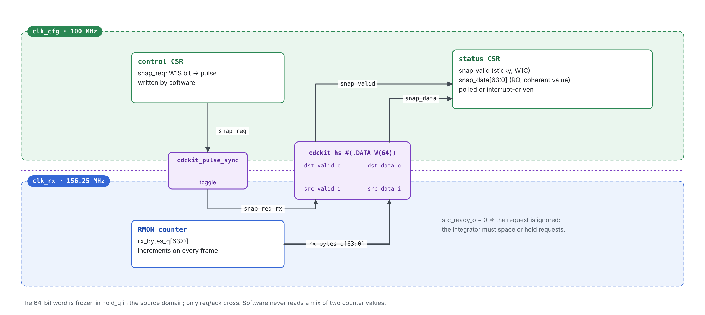
*Figure 13 — Coherent read of a 64-bit RMON counter from the configuration domain.*

| Step | Domain | Action |
|---|---|---|
| 1 | `clk_cfg` (100 MHz) | Software writes `snap_req` (W1S); the CSR produces a one-cycle pulse. |
| 2 | cfg → rx | `cdckit_pulse_sync` delivers `snap_req_rx` after N+1 … N+2 `clk_rx` edges. Spacing: `MIN_GAP = ⌈3·6.4/10⌉ + 2 = 4` `clk_cfg` cycles, met by any software access rate. |
| 3 | `clk_rx` (156.25 MHz) | `snap_req_rx` drives `src_valid_i` of `cdckit_hs #(.DATA_W(64))` with `src_data_i = rx_bytes_q`. If `src_ready_o = 0`, the request is ignored (it is a pulse, so SVA-11 does not apply). |
| 4 | rx → cfg | `hold_q` freezes the counter; `dst_valid_o` arrives ≤ 40 ns later with the coherent 64-bit value. |
| 5 | `clk_cfg` | `dst_valid_o` sets sticky `snap_valid` (W1C) and loads `snap_data`. Software polls or takes an interrupt. |

Integration rules applied: [INTG-2] (64 bits never synchronized bit by bit), [INTG-11] (CSR accepts `dst_valid_o` unconditionally). A software request issued while a transfer is in flight (`T_hs` ≤ 131.2 ns) is dropped; software MUST wait for `snap_valid` before issuing a new request.

---

## Annex C — Glossary

| Term | Definition |
|---|---|
| CDC | Clock Domain Crossing: a signal launched by one clock and captured by another, asynchronous clock. |
| RDC | Reset Domain Crossing: a path whose launch flop is reset by a different reset than the capture flop. |
| Metastability | State of a flip-flop whose input changed within its setup/hold window; the output settles to 0 or 1 after an unbounded time. |
| `t_r`, τ, T0 | Resolution time available to a synchronizer stage; metastability time constant; device capture-window parameter. |
| MTBF | Mean Time Between Failures of a synchronizer due to unresolved metastability. |
| Gray code | Encoding in which consecutive values differ in one bit (reflected binary code). |
| FWFT | First-Word Fall-Through: the head word is presented on the read port without a read request. |
| Conservative flag | A flag that may be pessimistic (full too early, empty too late) but never optimistic. |
| Qualified data path | Multibit path not synchronized but sampled only when a synchronized control signal guarantees it is stable. |
| Reconvergence | Separately synchronized signals recombined at the destination; may produce states that never existed at the source. |
| LUTRAM | Distributed RAM built from SLICEM LUTs. |
| XPM | Xilinx Parameterized Macros (Vivado library of CDC, FIFO and memory macros). |
| WNS / WHS / TPWS | Worst negative setup slack / worst hold slack / total pulse width slack. |

---

## Annex D — References

1. C. E. Cummings, "Simulation and Synthesis Techniques for Asynchronous FIFO Design", SNUG San Jose, 2002.
2. C. E. Cummings, P. Alfke, "Simulation and Synthesis Techniques for Asynchronous FIFO Design with Asynchronous Pointer Comparisons", SNUG San Jose, 2002.
3. C. E. Cummings, "Clock Domain Crossing (CDC) Design & Verification Techniques Using SystemVerilog", SNUG Boston, 2008.
4. R. Ginosar, "Metastability and Synchronizers: A Tutorial", IEEE Design & Test of Computers, 2011.
5. AMD, UG903 — Vivado Design Suite User Guide: Using Constraints.
6. AMD, UG906 — Vivado Design Suite User Guide: Design Analysis and Closure Techniques (`report_cdc`).
7. AMD, UG949 — UltraFast Design Methodology Guide.
8. AMD, UG953 / UG974 — Vivado Design Suite 7 Series / UltraScale Libraries Guide (XPM macros).
9. AMD, UG474 — 7 Series FPGAs Configurable Logic Block User Guide (LUTRAM primitives).
10. AMD, DS181 — Artix-7 FPGAs Data Sheet: DC and AC Switching Characteristics.
11. IEEE Std 1800-2017 — SystemVerilog; IEEE Std 1800.2-2020 — UVM.
12. IETF RFC 2119 — Key words for use in RFCs to Indicate Requirement Levels.

**Disclaimer: The **design specifications and functional requirements** in this documentation were generated, structured, and refined using AI-assisted tools to emulate client-side specifications and streamline the microarchitecture planning stage.
